<p align="center">
  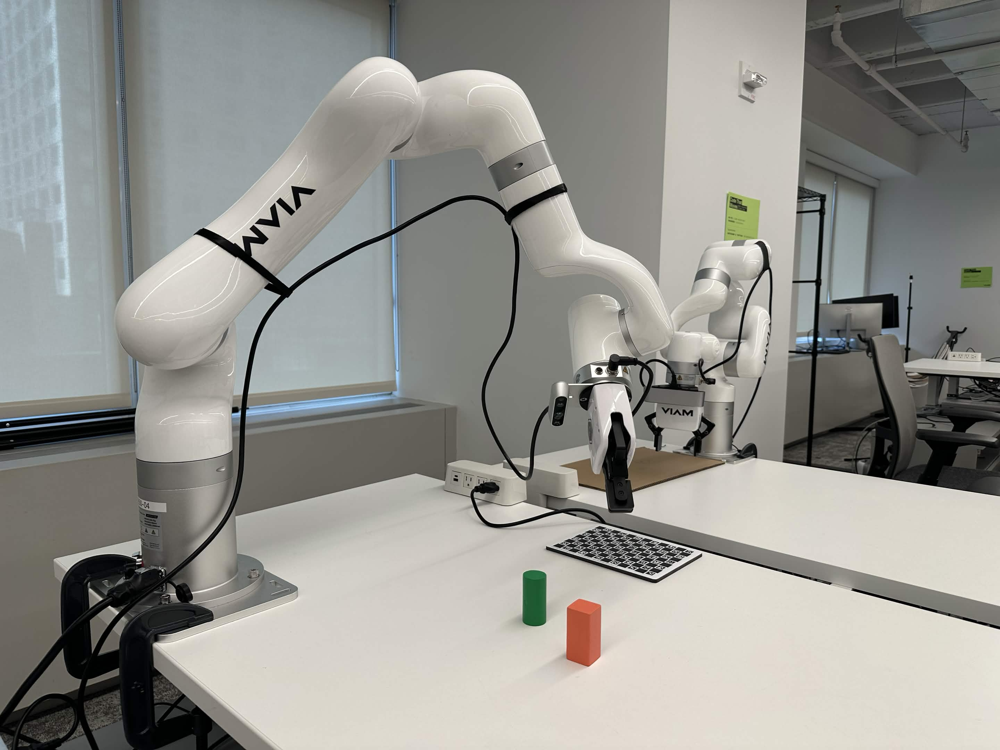
  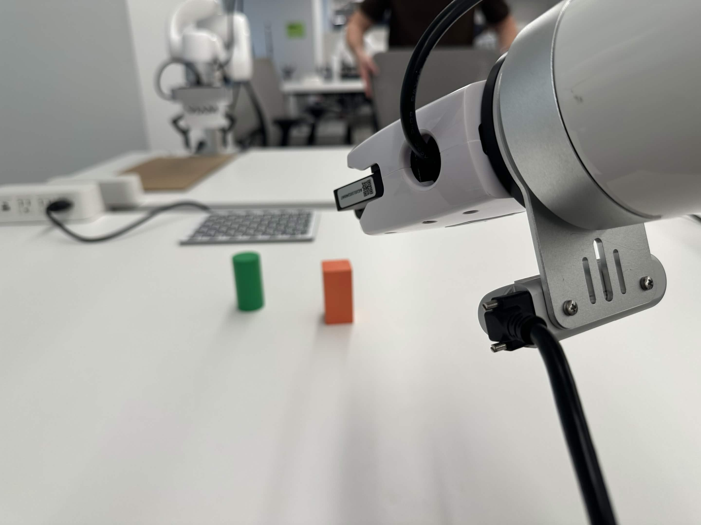
  <br>
</p>

<h1 align="center">ViamObjectReconstruction by Cameron Lerch</h1>

ViamObjectReconstruction finds the objects sitting on a table, drives a [Viam](https://www.viam.com/)-controlled robotic arm with a wrist-mounted Intel RealSense depth camera around each one, and stitches the views into a separate 3D mesh per object. A RealSense view produces noisy depth data and only sees the surfaces of an object that face the camera. By fusing many views taken from known arm poses all around an object, I can average out the noise in the depth data, capture every side the camera can reach, and generate a smooth, watertight 3D mesh of the object.

It also includes a synthetic color-and-depth ([RGB-D](https://en.wikipedia.org/wiki/Depth_map)) camera simulator, so the whole reconstruction pipeline can be developed and scored against known shapes without a robot.

---

## Quick Start

> [!NOTE]
> You need a Viam machine with an arm, a depth camera mounted on the arm, and the builtin motion service ([Machine Configuration](#92-machine-configuration)). Options, settings, tests, and how to run without a robot are outlined in [Setup and Usage](#9-setup-and-usage).

**1. Install**

```bash
git clone git@github.com:cameron-lerch/ViamObjectReconstruction.git
cd ViamObjectReconstruction
python3 -m venv .venv && source .venv/bin/activate
pip install -r requirements.txt
```

Copy the machine's API key into `apikey.json` as `{"key": "...", "key_id": "..."}` and its address into `config.toml`.

**2. Calibrate** (once per setup)

With a [ChArUco mat](#method-2-the-charuco-board) on the table:

```bash
python calibration.py
```

After asking once before the arm moves, the arm finds the mat and looks at it from 12 directions to work out exactly where the camera sits on the wrist. It then surveys the table with the calibrated camera. If a gripper is mounted, it also offers to run the touch-off, which measures how far the fingertips reach (you'll need to be at the arm with a sheet of paper).

No mat? Scan any object that holds still (step 3), then calibrate the camera from that scan:

```bash
python scan.py calibrate --objects 0 --save-mount
```

This finds the camera mount that makes all of the scan's views agree with each other ([§5.5](#55-camera-calibration)). It can't see an error that changes every view's scale equally, which is what the mat adds.

**3. Scan**

```bash
python scan.py
```

The arm starts by surveying the table from above to find the objects on it, then lists each one with its center, size and color, and asks which ones you'd like to scan. For each object, it plans a set of camera viewpoints all around it that it can reach without collisions, then visits them one at a time, stopping at each to capture a view. Before the lowest viewpoints, which bring the camera close to the table, it waits for you to confirm that you're watching. Once every object is scanned, the arm parks and the final meshes and figures are built.

> [!NOTE]
> Running the scanner (or the calibration) hosts a viewer in your browser at http://localhost:8765, where you can watch each view being captured and fused into the mesh, and pause or stop the arm. After a scan, `python data_viewer.py` replays it in the same viewer. See [§9.5](#95-watching-a-scan-live) for details.

**4. Results** are stored in `data/<session>/object_<object number>/` (`object_00`, `object_01`, ...):
- `recon/mesh.obj` is the final mesh: closed (watertight), with a flat bottom filled in where the object rests on the table
- `recon/observed.obj` is only the surface the camera measured; it's open wherever nothing was seen (always the bottom), so it isn't watertight
- `progression.png` shows the mesh rebuilt from 1, 2, 4, 8, 16 and all of the views, to show how each added view improves it
- To play back a scan, use the data viewer (`python data_viewer.py`). To look at the meshes, use the data viewer, a program like Blender, or an online tool like [3DViewer.net](https://3dviewer.net/#) (units are millimeters)

---

## Table of Contents

1. [Problem Statement and Goals](#1-problem-statement-and-goals) (including [Breaking Down the Problem](#11-breaking-down-the-problem))
2. [Approach](#2-approach)
3. [Results](#3-results)
4. [System Architecture](#4-system-architecture)
5. [Methodology](#5-methodology)
6. [Evaluating and Tuning](#6-evaluating-and-tuning)
7. [Critical Design Decisions](#7-critical-design-decisions)
8. [What I Tried That Didn't Work](#8-what-i-tried-that-didnt-work)
9. [Setup and Usage](#9-setup-and-usage)
10. [Working Safely on a Shared Real Arm](#10-working-safely-on-a-shared-real-arm)
11. [Shortcomings and Proposed Solutions](#11-shortcomings-and-proposed-solutions)
12. [Lessons for Other Developers](#12-lessons-for-other-developers)
13. [Future Work](#13-future-work)
14. [Feedback on Viam](#14-feedback-on-viam)

---

## 1. Problem Statement and Goals

The goal of this project was to use a robotic arm with a wrist-mounted RealSense camera to:

|  | Requirement |
|---|---|
| 1. | Automatically find the objects sitting on the table |
| 2. | Plan a path of camera viewpoints around each object that the arm can actually reach |
| 3. | Stitch the point clouds from many views of the same object into a mesh that is much more accurate than any single view |
| 4. | Produce an individual 3D model of each object, separated from the table and the other objects |

Beyond those requirements, I set a few goals of my own: treat each object's bottom as flat (the objects rest on the table), measure how much each additional view improves the result, and never surprise anyone working near a shared lab arm.

One lesson I carried over from an earlier attempt shaped the capture design from the start: the point clouds were noticeably better when the arm **moved to a pose, stopped, and then captured** than when it captured on the fly while moving.

### 1.1 Breaking Down the Problem

When I started, I assumed the main job was to stitch the views together and average their point clouds. It turned out to be one part of three, and the other two (knowing exactly where each view was taken, and how the averaged measurements become a mesh) were at least as important.

**1. Where to look: choosing the viewpoints**

- **Coverage:** every part of the surface has to be seen by some view, or it can only be guessed.
- **Repetition:** the same surface seen from several views is what averages the sensor noise away. Views that don't overlap add coverage but no noise reduction.
- **Overlap for alignment:** views are lined up with each other through the surface they share, so neighboring views must overlap.
- **Reachability and cost:** every view has to be reachable without collisions, and each one takes about 20s on this setup.

**2. Knowing exactly where each view was taken**

- **The camera's mount on the wrist** has to be calibrated. Measured by hand, it was 21mm and 2.2° off ([§5.5](#55-camera-calibration)).
- **Each view's pose** is refined by aligning the views to each other ([§5.6](#56-stitching-aligning-the-views)).
- **The depth readings themselves** must be accurate. The real cylinder came out 2.5-4.6mm too wide while every view agreed with every other ([§3.5](#35-the-real-cylinder-against-calipers)).

No amount of smoothing can fix a view that is in the wrong place, and this part caused the largest errors in the project.

**3. Turning the measurements into a surface**

- **Averaging:** a [truncated signed distance function](https://en.wikipedia.org/wiki/Signed_distance_function) (TSDF) averages every view's depth in 1.5mm voxels ([§5.7](#57-fusing-the-views-tsdf)); its zero crossing is the surface. Most of the "smoothing" happens here, as averaging, rather than as smoothing a rough mesh afterward.
- **Resolution:** the voxel size sets the mesh's resolution. Smaller voxels keep more detail but average fewer readings each.
- **What to keep:** surface seen by fewer than 2 views is dropped as untrustworthy.
- **Light smoothing** (5 steps of HC Laplacian) on every mesh, both the measured surface (`observed.obj`) and the final, closed mesh (`mesh.obj`), removes the ripple the averaging leaves behind ([§5.9](#59-smoothing-the-mesh)).
- **Sharp edges** get rounded by about one voxel: the synthetic box's error is 0.25mm against the cylinder's 0.07mm.
- **Filling what was never seen** needs a best guess. Here that is a flat bottom and straight walls, joined to the measured surface by Poisson reconstruction, which continues it smoothly across gaps ([§5.8](#58-closing-the-mesh-with-a-flat-bottom)).

**Assumption: objects have flat bottoms.** The objects rest flat on the table, and the camera can never see underneath them, so the bottom is always filled in: the object's outline seen from above, laid flat on the table plane. This assumption is only true for objects like these. The [measured share](#62-measured-vs-filled-in-observedobj-and-meshobj) says how much of each final mesh comes from measurement and how much from this and the straight-wall guess.

**What "watertight" means.** A watertight (closed) mesh has no holes: every edge of every triangle is shared by exactly two triangles, so the surface completely encloses a volume, with a well-defined inside and outside. That is what makes a volume measurable and the mesh 3D-printable or usable in a physics simulator. The observed surface alone is never watertight: its underside is open and it has gaps wherever no view reached. Adding the flat bottom (and filling unseen walls) is what makes the final `mesh.obj` watertight. Strictly, a mesh with tiny self-intersections, which fusion always leaves, is still closed in this sense; [§8.4](#84-closing-the-mesh) explains why that distinction mattered.

**4. Measuring the result.** Views that agree with each other show precision, not accuracy: every view can agree on the wrong size. To know whether a change actually helped, I needed an independent truth: the synthetic objects have a known true shape, and the real test objects have caliper measurements.

---

## 2. Approach

My approach was to break the project into stages and test each one before moving on to the next:

1. **Find and verify the hardware model.** I started by probing the machine read-only: the arm's kinematics, the frame system, the camera's intrinsics and depth format, and whether the motion planner could check a pose without moving the arm.
2. **Build the reconstruction offline first.** I wrote a synthetic RGB-D renderer ([`recon/synthetic.py`](recon/synthetic.py)) that produces views of known shapes with RealSense-like flaws (depth noise that grows with distance², flying pixels at edges, dropouts) and a deliberate camera-mount error. Every reconstruction idea was scored against the true shapes before it touched real data.
3. **Plan and capture on the real arm, carefully.** On the real arm I started with plan-only checks, then moved one step at a time with previews, then ran small scans (3 views), and only then larger ones (25 views).
4. **Let the real data drive the fixes.** Each real run exposed something the simulator hadn't: a 21mm camera-mount error, a table 7mm higher than measured, walls the RealSense can't see from steep angles, and slow cloud downloads. Each one is documented in [§8](#8-what-i-tried-that-didnt-work).

---

## 3. Results

Every figure in this README is labeled under its caption so it's clear where it came from:

- **REAL DATA** was captured on the real arm.
- **SYNTHETIC DATA** comes from simulated RealSense views of shapes whose exact geometry is known. I use it where I need an exact answer to score against.
- **DIAGRAM** shows no data.

### 3.1 Scanned Objects

These are all of the objects I've scanned so far, each from its most recent scan. For each one, the left panel is the final mesh, colored from the camera's images, and the right panel is the cumulative point cloud: every view's points on the object, placed by the aligned camera poses, without the ring of table around its base.

Every mesh below was rebuilt with the current pipeline, so they compare directly: a TSDF with 1.5mm voxels, surface seen by at least 2 views, a flat-bottom Poisson closing, and 5 steps of HC Laplacian smoothing on every mesh ([§5.7](#57-fusing-the-views-tsdf), [§5.8](#58-closing-the-mesh-with-a-flat-bottom), [§5.9](#59-smoothing-the-mesh)). Full scans capture 50 frames per view; the others capture 5. In each table:

- **Roughness** is how bumpy the surface is at a small scale: the typical distance of the surface from a flat plane fit over each 3mm patch. It's given for the observed surface (observed.obj) and for the measured parts of the final mesh (mesh.obj) ([§6.2](#62-measured-vs-filled-in-observedobj-and-meshobj)). Lower is smoother. It also counts real curvature and fine detail, so it's only meaningful between objects of a similar shape.
- **Measured** is how much of the final, closed mesh's surface was actually measured by the camera (seen by at least 2 views), rather than filled in by the closing. The rest is the bottom, which no view can see, and any walls the camera couldn't reach ([§6.2](#62-measured-vs-filled-in-observedobj-and-meshobj)).
- **Accuracy** compares the mesh with the average of many caliper measurements or, for the 3D-printed objects, with their CAD models. The CAD error is each measured point's distance from the true surface after the best rigid fit, and the bias is its signed average (positive means too big).

<p align="center">
  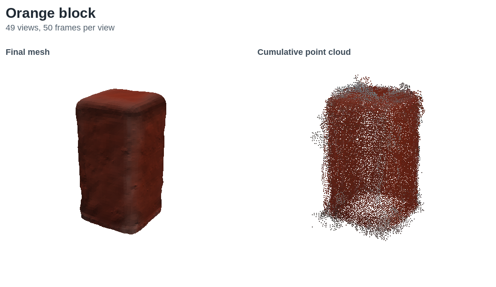
</p>

| Views × Frames Captured per View | Roughness (Observed / Final) | Measured | Volume | Accuracy | Notes |
|---|---|---|---|---|---|
| 49 × 50 | 0.077 / 0.062mm | 87% | 62.8cm³ | Calipers: +4.2, +4.6mm wide, +0.9mm tall | Full scan. Too wide on every side ([§3.5](#35-the-real-cylinder-against-calipers)) |

<p align="center">
  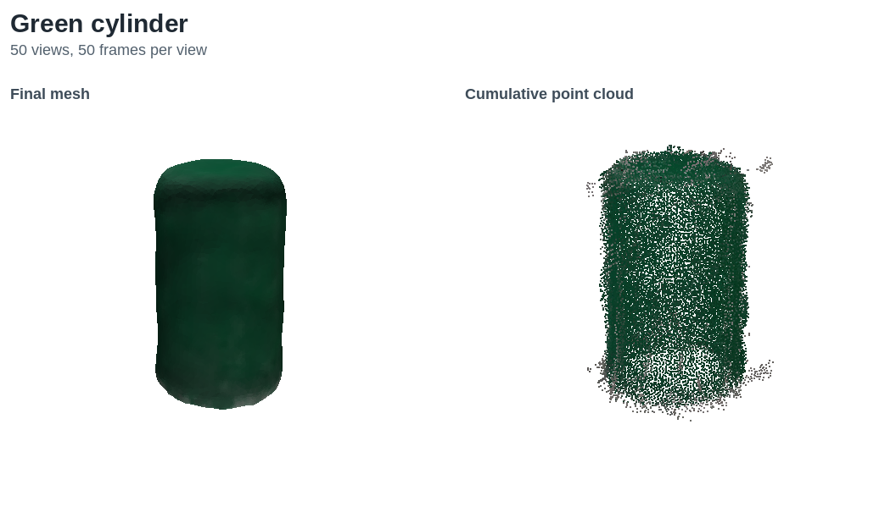
</p>

| Views × Frames Captured per View | Roughness (Observed / Final) | Measured | Volume | Accuracy | Notes |
|---|---|---|---|---|---|
| 50 × 50 | 0.074 / 0.076mm | 87% | 53.6cm³ | Calipers: +4.2mm diameter, +1.1mm tall | Full scan |

<p align="center">
  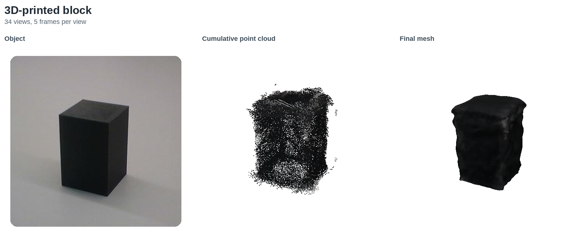
</p>

| Views × Frames Captured per View | Roughness (Observed / Final) | Measured | Volume | Accuracy | Notes |
|---|---|---|---|---|---|
| 34 × 5 | 0.131 / 0.146mm | 83% | 88.2cm³ | CAD: 0.79mm median error, −0.51mm bias; +0.6, +1.2mm wide | Rougher, but much closer to its true size than the orange block |

<p align="center">
  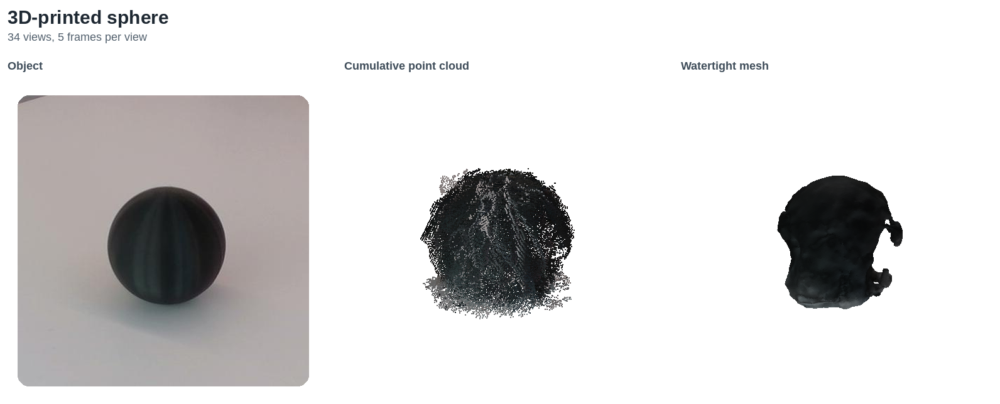
</p>

| Views × Frames Captured per View | Roughness (Observed / Final) | Measured | Volume | Accuracy | Notes |
|---|---|---|---|---|---|
| 34 × 5 | 0.179 / 0.242mm | 73% | 81.1cm³ | CAD: 2.69mm median error, −1.10mm bias | Little of its lower half was measured, so the closing had to guess much of it |

<p align="center">
  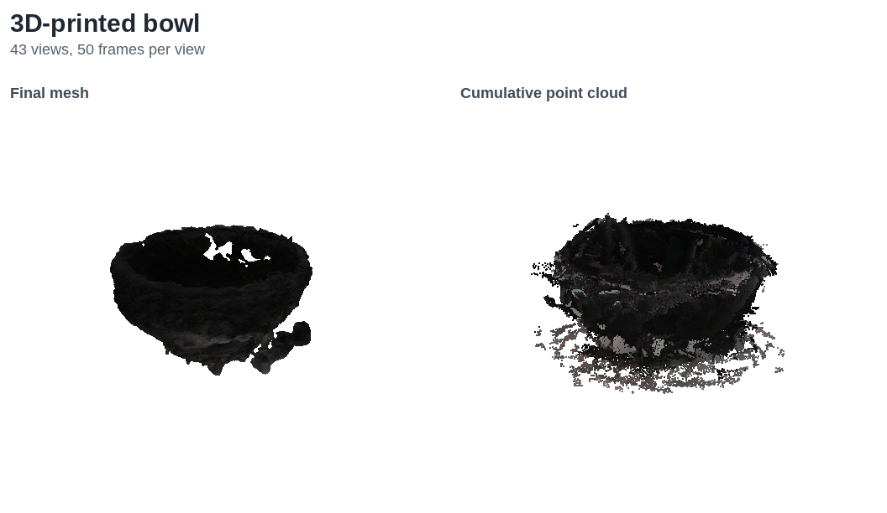
</p>

| Views × Frames Captured per View | Roughness (Observed / Final) | Measured | Volume | Accuracy | Notes |
|---|---|---|---|---|---|
| 43 × 50 | 0.135 / 0.134mm | 88% | 155.8cm³ | CAD: 1.03mm median error, +0.31mm bias; +2.5mm across the rim, +0.8mm tall | Full scan, upright |

<p align="center">
  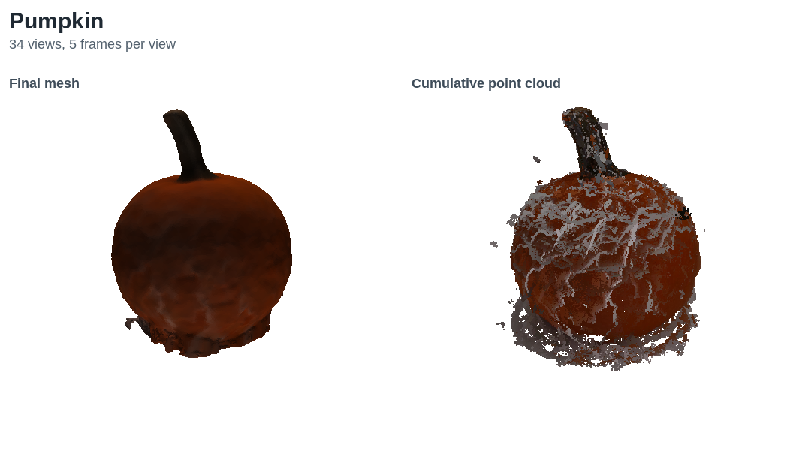
</p>

| Views × Frames Captured per View | Roughness (Observed / Final) | Measured | Volume | Accuracy | Notes |
|---|---|---|---|---|---|
| 34 × 5 | 0.036 / 0.034mm | 70% | 2,633cm³ | No ground truth | The largest object; the side away from the arm is hard to reach ([§5.8](#58-closing-the-mesh-with-a-flat-bottom)) |

<p align="center">
  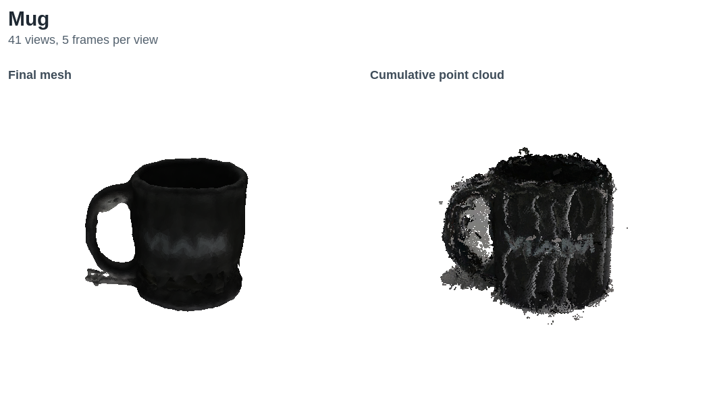
</p>

| Views × Frames Captured per View | Roughness (Observed / Final) | Measured | Volume | Accuracy | Notes |
|---|---|---|---|---|---|
| 41 × 5 | 0.089 / 0.084mm | 88% | 174.9cm³ | No ground truth | Glossy, so reflections read some surfaces too far away |

<p align="center">
  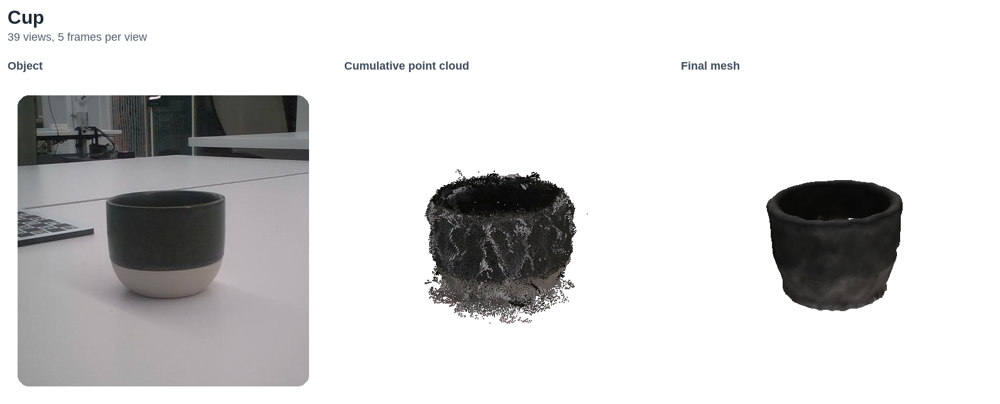
</p>

| Views × Frames Captured per View | Roughness (Observed / Final) | Measured | Volume | Accuracy | Notes |
|---|---|---|---|---|---|
| 39 × 5 | 0.070 / 0.075mm | 88% | 72.5cm³ | No ground truth | Open top; its walls are tucked in below the rim ([§5.8](#58-closing-the-mesh-with-a-flat-bottom)) |

`python tools/make_object_gallery.py` rebuilds these images and numbers.

### 3.2 Scanning an Object with Multiple Views

To show why a single view isn't enough, the figures below come from my full scans of the orange block (49 views) and the green cylinder (50 views), with 50 frames per view, and from a 34-view scan of the pumpkin.

Each column is one view: the color image on top, and under it that view's depth as points, with nothing removed (no edge filter and no outlier removal), all drawn from the same side-on direction. Each color image is turned in 90° steps so the table is at the bottom, and the small arrows in each panel's corner show the world x, y and z axes (a circled dot is an axis pointing straight at the viewer, as z does in the views from directly above).

A single view only sees the faces turned toward it. Its walls are wavy and ribbed where they should be flat, the table shows depth "stair steps", and the edges smear into the table. When all of the views are placed using the arm's poses, they overlap into a fuzzy shell several millimeters thick, and fusion turns that shell into the mesh at the bottom right.

<p align="center">
  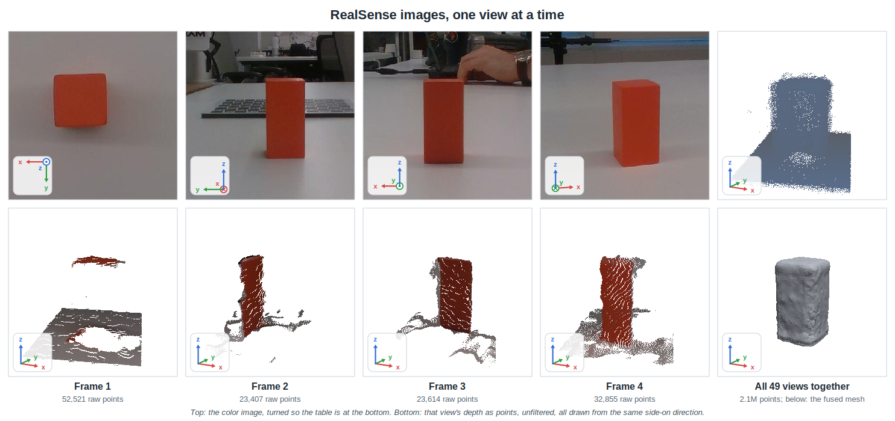
  <br><sub> RealSense images collected during the scan of the orange prism.</sub>
</p>

<p align="center">
  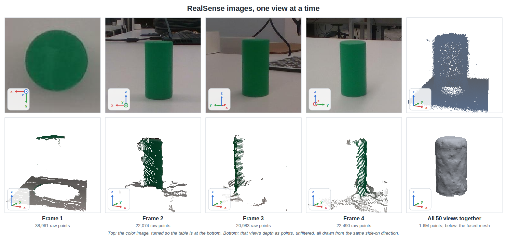
  <br><sub>RealSense images collected during the scan of the green cylinder.</sub>
</p>

<p align="center">
  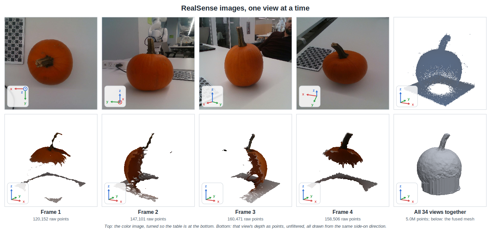
  <br><sub> RealSense images collected during the scan of the pumpkin.</sub>
</p>

Every scan also saves a figure of its showing the progression of the mesh from 1, 2, 4, 8, 16, 32 and all of its views as `progression.png` in the object's folder.

<p align="center">
  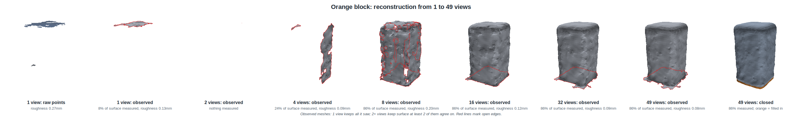
</p>

<p align="center">
  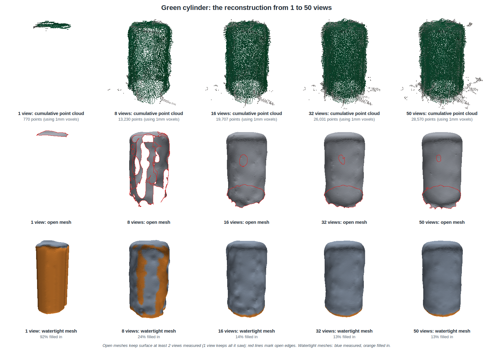
</p>

| Views | Block: measured | Block: roughness | Block: closed volume | Cylinder: measured | Cylinder: roughness | Cylinder: closed volume |
|---|---|---|---|---|---|---|
| 1 | 8% | 0.13mm | 27.4cm³ | 8% | 0.12mm | 25.6cm³ |
| 2 | nothing measured | | | nothing measured | | |
| 4 | 24% | 0.09mm | 26.3cm³ | not closed | 0.08mm | |
| 8 | 86% | 0.20mm | 62.4cm³ | 80% | 0.15mm | 55.5cm³ |
| 16 | 86% | 0.12mm | 63.9cm³ | 87% | 0.13mm | 55.0cm³ |
| 32 | 86% | 0.09mm | 63.8cm³ | 87% | 0.10mm | 55.0cm³ |
| All (49 / 50) | 86% | 0.08mm | 63.5cm³ | 87% | 0.09mm | 55.3cm³ |

- **About 16 views measure everything the camera can reach, and more views make it smoother.** "Measured" is the share of the closed mesh's surface that lies on measured data ([§6.2](#62-measured-vs-filled-in-observedobj-and-meshobj)). From 16 views spread over all directions onward (8 for the block), it stays at 86-87%, which covers every side and the top. The other 13-14% is the bottom, which no view can see. The volume settles there too, and going from 16 views to all of them brings the roughness down from 0.12-0.13mm to 0.08-0.09mm. A 16-view scan (`--max-views 16`) takes about half the time of a full one.
- **2 views measure nothing.** Once there are 2 or more views, only surface that at least 2 views agree on is kept, and the two most different views share almost nothing.
- **The height is right, but the width isn't.** Compared with the calipers (`scan.py compare` recognizes each object by its shape and size), the heights are within 1.2mm of the average caliper measurements, but the block comes out 4.4-4.7mm too wide and the cylinder 4.6mm too wide in diameter, so the volumes are 20% and 33% too large. This is the open problem in [§3.5](#35-the-real-cylinder-against-calipers) and [§11](#11-shortcomings-and-proposed-solutions).

#### Noise and consistency, view by view

The full scans also record one raw view, and how far the surface from each subset of the views lies from the final result:

| Views | Orange block: completeness | Roughness | Deviation from final (median / 90th percentile) | Green cylinder: completeness | Roughness | Deviation from final (median / 90th percentile) |
|---|---|---|---|---|---|---|
| raw points, 1 view | – | 0.269mm | 0.32 / 1.08mm | – | 0.259mm | 0.52 / 0.97mm |
| 1 (best single-view mesh) | 11% | 0.125mm | 0.33 / 1.10mm | 10% | 0.115mm | 0.49 / 0.98mm |
| 2 | 0% | – | 0.68 / 0.69mm | 0% | – | 0.32 / 0.53mm |
| 4 | 20% | 0.086mm | 0.30 / 0.98mm | 5% | 0.075mm | 0.50 / 1.27mm |
| 8 | 97% | 0.196mm | 0.57 / 1.40mm | 88% | 0.153mm | 0.36 / 0.99mm |
| 16 | 100% | 0.119mm | 0.28 / 0.74mm | 99% | 0.132mm | 0.24 / 0.66mm |
| 32 | 100% | 0.085mm | 0.14 / 0.49mm | 100% | 0.097mm | 0.11 / 0.39mm |
| All (49 / 50) | 100% | **0.076mm** | 0.04 / 0.13mm | 100% | **0.089mm** | 0.03 / 0.12mm |

- **Noise:** the same patch of surface goes from about 0.26-0.27mm roughness in one raw view, to 0.12mm once that view is fused and lightly smoothed, to 0.08-0.09mm with all of the views (3× smoother than raw). The roughness bounces around with few views (8 views are rougher than 4) because each subset adds new, unaveraged walls next to the patch, and it falls steadily from 16 views on. Real RealSense noise has a slowly varying part that is shared between neighboring pixels, and averaging removes it much more slowly than the independent noise in my simulator, where the roughness keeps falling (38× over 37 views).
- **Consistency:** the 90th-percentile distance from a subset's surface to the final result falls from about 1mm (one raw view) to 0.12-0.13mm, so each added view keeps tightening the shape even after every side has been seen.

The column definitions are in [§6.1](#61-measuring-quality).

#### Measured vs. filled in, by view count

<p align="center">
  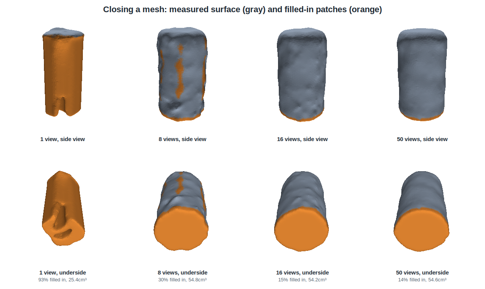
  <br><sub><b>REAL DATA.</b> The green cylinder's full scan, from 1, 8, 16 and 50 views</sub>
</p>

| Green cylinder | 1 view | 2 views | 4 views | 8 views | 16 views | 32 views | 50 views |
|---|---|---|---|---|---|---|---|
| Measured share | 8% | nothing measured | not closed | 80% | 87% | 87% | 87% |
| Closed volume | 25.6cm³ | | | 55.5cm³ | 55.0cm³ | 55.0cm³ | 55.3cm³ |

**Making the mesh watertight** (how it's done: [§5.8](#58-closing-the-mesh-with-a-flat-bottom)):

- **The bottom is always filled in.** The camera can never see under the object. For these cylinders the bottom is 10-13% of the surface, which is why both the real 50-view scan (87%) and the synthetic 37-view scan (88%) top out just under 90%.
- **With few views, the walls are mostly guessed.** The best single-view closed mesh looks like a plausible cylinder, but 92% of it is assumption rather than data, and its volume (25.6cm³) is 54% below the 50-view result and 39% below the volume from the average caliper measurements. The closed meshes alone would overstate what a few views achieve, which is why I save `observed.obj` next to every `mesh.obj`.
- **About 16 views see all of this cylinder**, and from 16 views on, the closed mesh's volume stops changing.
- **The filled-in parts are only right for objects shaped like these,** with a flat bottom and walls that are roughly vertical where they weren't seen. An overhang or a hollow would be filled in wrong, and the measured share says how much of the model depends on that guess.

### 3.3 Synthetic objects: scored against the true shape

To score the pipeline against an exact answer, I ran it on rendered views of known shapes (`python scan.py demo --progression`), with RealSense-like noise and a deliberate 2.5mm / 0.8° camera-mount error:

<p align="center">
  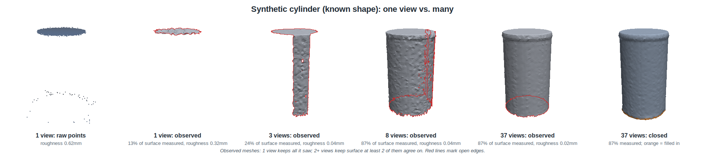
  <br><sub><b>SYNTHETIC DATA.</b> Simulated RealSense views of a cylinder whose exact shape is known</sub>
</p>

| Object | Views | Roughness | Closed mesh error vs. truth (median / p90) | Volume (true) |
|---|---|---|---|---|
| Cylinder Ø50 × 90mm | raw, 1 view | 0.621mm | – | – |
| | 1 (best single-view mesh) | 0.324mm | 1.60 / 2.39mm | 152.6cm³ |
| | 2 | 0.049mm | 1.52 / 8.54mm | 127.6cm³ |
| | 8 | 0.035mm | 0.12 / 0.45mm | 177.8cm³ |
| | 37 | **0.017mm** | **0.07 / 0.25mm** | **177.8cm³** (176.7) |
| Box 70 × 40 × 55mm | raw, 1 view | 0.662mm | – | – |
| | 1 (best single-view mesh) | 0.417mm | 1.45 / 1.93mm | 135.8cm³ |
| | 2 | 0.113mm | 2.33 / 3.59mm | 122.3cm³ |
| | 10 | 0.076mm | 0.29 / 0.63mm | 151.4cm³ |
| | 37 | **0.025mm** | **0.25 / 0.41mm** | **151.4cm³** (154.0) |

- **Many views vs. one:** the cylinder's closed mesh goes from a 1.60mm median error with the best single view to 0.07mm with 37 views (23× better), and lands within 0.6% of its true volume. The box goes from 1.45mm to 0.25mm (6× better).
- **Edges:** the box is less accurate than the cylinder because fusion rounds its sharp edges by about one voxel (1.5mm), which also removes 1.7% of its volume ([§11](#11-shortcomings-and-proposed-solutions)).
- **2 views can be worse than 1.** Two views keep only the surface both of them saw, which here is less than one view keeps on its own, so the closed shape is a worse guess (for the box, 2.33mm vs. 1.45mm). From 3 views onward, the result improves steadily.

### 3.4 The two fixes that mattered most

Two fixes made the biggest difference in this project: calibrating where the camera sits on the arm, and aligning all of the views together.

**Calibrating the camera mount.** Both meshes below come from the same 25 real captures, aligned and fused in exactly the same way. The only difference is the camera mount:

<p align="center">
  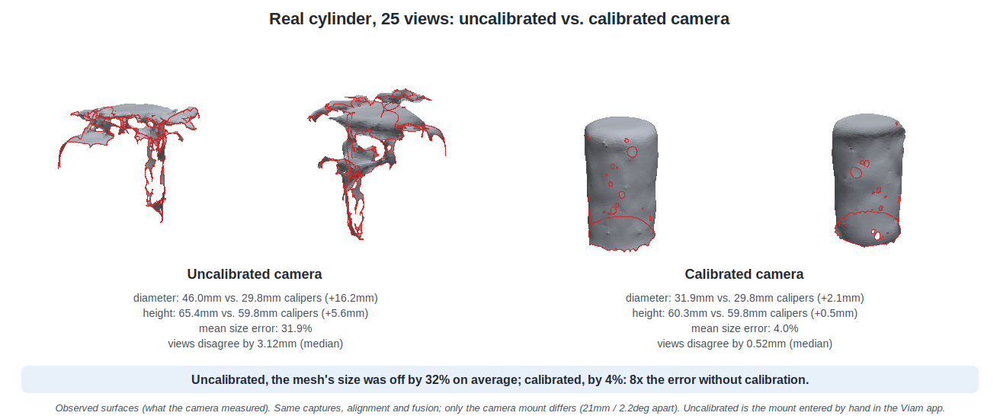
  <br><sub><b>REAL DATA.</b> The same 25 real views of the green cylinder</sub>
</p>

"Uncalibrated" is the camera mount as I first entered it in the Viam app, measured by hand, which turned out to be 21mm and 2.2° off from the calibrated one. These views were captured with it. **Uncalibrated, the mesh's size was off by 32% on average, and calibrated, by 5%: 7× the error without calibration.** Both meshes use the alignment step, which can't rescue a mount that far off: it rejected 14 of the 25 views' corrections.

The figure measures the **observed** surface (what the camera saw, from the table up) rather than the closed mesh, because Poisson can't reliably close views as badly misaligned as the uncalibrated ones and sometimes balloons ([§5.8](#58-closing-the-mesh-with-a-flat-bottom)). Rebuilt from the same saved views (stable to 0.1mm across reruns):

| Camera mount | Alignment | Views disagree by (median) | Diameter | Height | Roundness |
|---|---|---|---|---|---|
| Uncalibrated | off | 3.66mm | 50.9mm | 64.3mm | 2.5mm |
| Uncalibrated | on | 2.48mm | 45.4mm | 66.0mm | 2.35mm |
| Calibrated | off | 0.76mm | **28.9mm** | 60.3mm | 0.75mm |
| Calibrated | on | 0.53mm | 32.2mm | 60.3mm | **0.29mm** |

Roundness is the median distance of the wall's points from the best-fitting circle. The paragraph below compares these diameters with the average caliper measurement.

This leaves an open question: with the calibrated mount, turning alignment *off* gives a diameter 0.9mm under the average caliper measurement, against 2.4mm over with it on, though a less round one. The full scans point the same way: without alignment, the orange block's size error falls from 10.8% to 4.1%, and the green cylinder's diameter error from +4.40 to +3.33mm, while the views disagree almost twice as much ([§6.4](#64-what-can-be-tuned)). How the alignment moves objects, and how much of the size error it explains, is something scans of more objects will test.

**Aligning all views together.** The same 37 synthetic views, aligned two different ways:

<p align="center">
  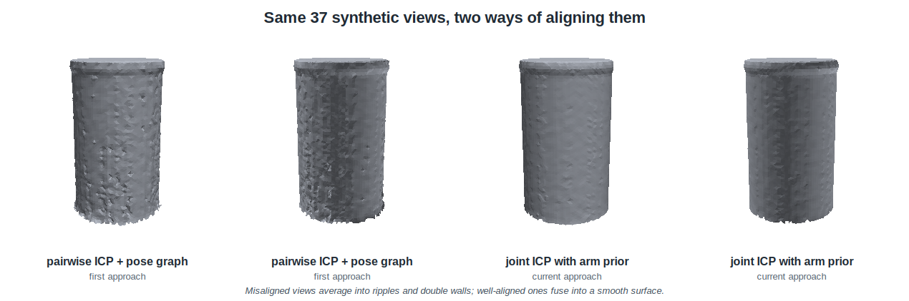
  <br><sub><b>SYNTHETIC DATA.</b> 37 simulated views with deliberate pose errors</sub>
</p>

### 3.5 The real cylinder against calipers

I measured the test objects many times with calipers, at both ends and in the middle, and every reading is in `ground_truth.toml` with each dimension's average and spread. The objects are inexpensive toys whose paint thickness varies, and a reading shifts by a few hundredths of a millimeter with how firmly the calipers are closed, so the comparisons use the average of all of the readings. `scan.py compare` measures a reconstructed mesh the same way (width, length and height for the blocks, diameter and height for the cylinder) and reports its errors against those averages.

The cylinder's 25-view reconstruction, against the average caliper measurements:

| | Reconstruction | Error vs. the average caliper measurement |
|---|---|---|
| Diameter | 32.22mm (circle fit to the walls) | **+2.4mm (+8%)** |
| Height | 60.45mm | +0.7mm (+1.1%) |
| Volume | 49.0cm³ (closed mesh) | +18% |

The shape is right (round, straight and the right height), but the walls sit about 1.2mm too far out on every side. Breaking the error down over the 25 views:

- **Edge fattening, near the silhouette.** Wall points within 3 pixels of the object's outline in the image are 2.2mm too far out, while points 20 or more pixels in are 0.9mm out. Stereo depth blends the foreground and background near edges, so objects look fatter than they are. Dropping pixels within 2px of a depth edge (the default) takes the diameter from 32.62 to 32.22mm. Dropping more gains nothing on the real cylinder and costs accuracy on clean data.
- **A uniform part, about 0.9-1.1mm**, even where the wall faces the camera head-on, far from any edge. Because it inflates the object equally from every direction, the views still agree with each other, so neither the mount calibration nor the alignment can see it. Only an absolute reference can. Adding a flat 1mm to all depth readings doesn't remove it, so it isn't a simple depth offset.
- **Not the camera mount, and not flat-surface depth.** The ChArUco board calibration ([§5.5](#55-camera-calibration)) puts the camera mount within 4.7mm / 0.5° of the scan-based one, and measures depth on a flat surface to within about half a millimeter. Rebuilt with the board's mount, the cylinder is 32.86mm wide, and adding the board's depth correction makes it 33.13mm.

| Rebuilt with | Diameter | Height | Diameter error | Height error |
|---|---|---|---|---|
| Scan-based mount, no edge filter | 32.62mm | 60.57mm | +2.84mm | +0.77mm |
| Scan-based mount, 2px edge filter (the default) | 32.22mm | 60.45mm | +2.44mm | +0.65mm |
| Board mount, 2px edge filter | 32.52mm | 60.43mm | +2.74mm | +0.63mm |
| Board mount + depth correction, 2px edge filter | 32.90mm | 60.21mm | +3.12mm | +0.41mm |

The errors are against the average caliper measurements. From this cylinder, I concluded that the extra width (about 1.2mm per side after the edge filter) comes from how the RealSense measures the object's walls and edges, not from where the camera is or how it measures flat surfaces. The synthetic objects, whose simulated noise has no edge fattening, come out within 0.6-1.7% of their true volume, so it isn't the reconstruction method either. Closing this gap is the first item in [§13](#13-future-work).

---

## 4. System Architecture

### 4.1 Pipeline

<p align="center">
  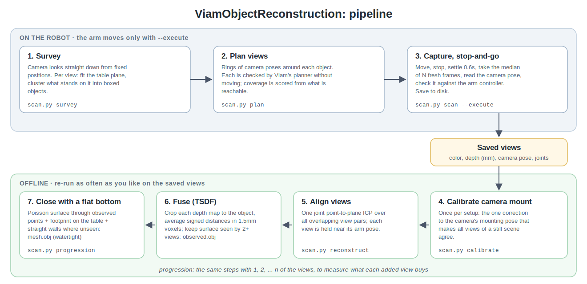
  <br><sub><b>DIAGRAM.</b> No data</sub>
</p>

The pipeline has two halves. The top half runs on the robot: it moves the arm and saves every view (color, depth and the camera's pose) to disk. The bottom half only reads those saved views and never talks to the robot. Because the views are saved, I can rebuild the same captures with different settings or methods and compare the results directly, and most of the findings in [§8](#8-what-i-tried-that-didnt-work) came from doing exactly that.

### 4.2 Where each view's pixels go

Every depth pixel goes through the same chain of transforms to land in the world. Each link in that chain has its own source of error, and its own fix:

<p align="center">
  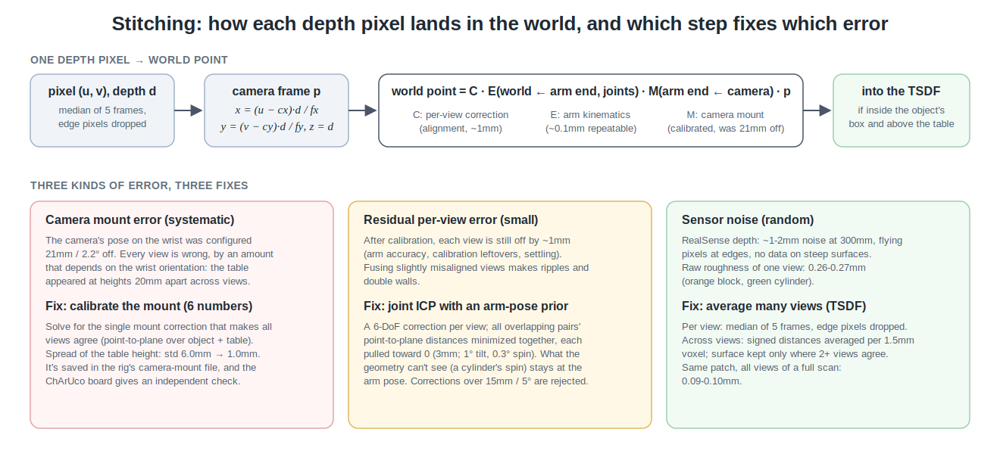
  <br><sub><b>DIAGRAM.</b> No data</sub>
</p>

---

## 5. Methodology

This section follows the pipeline in order, from finding the objects on the table to closing each object's mesh.

### 5.1 Survey: finding the table and what's on it

**Survey vs. scan.** A survey answers *what's on the table, and where?* It takes a few quick overhead views and puts a rough box around each object, without building any meshes. A scan answers *what exactly does each object look like?* It captures views all around one object, stopping at each one, and fuses them into a mesh. A scan runs its own survey first unless it's given `--reuse-survey`. Calibration isn't part of either; it's done once per setup ([§5.5](#55-camera-calibration)).

#### Where the camera looks

During the survey, the camera looks straight down from positions on a grid over the search region (`[workspace] x_range, y_range`), 600mm above the table. I chose the grid spacing from how much of the table one view covers. A pinhole camera with a vertical [field of view](https://en.wikipedia.org/wiki/Field_of_view) (FOV), at height *h* above the table, sees a patch whose short side is

```math
w = 2h\,\tan\!\left(\tfrac{\text{FOV}}{2}\right), \qquad \tfrac{\text{FOV}}{2} = \arctan\frac{H/2}{f_y} = \arctan\frac{360}{916} \approx 21.4^\circ
```

At *h* ≈ 612mm (600mm plus the 12mm the table sits below the arm's base), the short side covers about 480mm and the long side about 850mm. Positions 340mm apart therefore overlap by about 30%, even when the camera's roll turns the short side along the grid. Only the positions right over the arm's base (within 200mm) are left out.

The survey does look at the table within 400mm of the base, even though no scan target can stand there ([§9.2](#92-machine-configuration)). The table near the base can still be right next to a target, and without that strip, a block 400mm from the base would fail the open-table test (below).

#### Following the table

The survey doesn't visit every grid position; it follows the table. It starts at the reachable position nearest the camera, which must be over the table. After each view, it looks at the strip of points toward each of the four neighboring positions (beyond a quarter of the way there), and only moves to a neighbor if at least 30% of that strip is table, meaning within 10mm of the table plane found in the first view. The floor (about 270mm lower), walls, and empty space beyond the camera's range don't count. The next position it visits is always the nearest one still waiting.

#### Finding objects in each view

Each survey view is processed on its own, in six steps:

1. **Points:** the depth image is turned into world points ([§5.4](#54-placing-each-view-in-the-world)), dropping the "flying pixels" next to depth jumps.
2. **Table:** a plane is fit to the points with [random sample consensus](https://en.wikipedia.org/wiki/Random_sample_consensus) (RANSAC, in [`recon/scene.py`](recon/scene.py); 3 points at a time, with a 4mm inlier distance), and only a plane within 10° of horizontal counts as the table.
3. **Candidates:** the points 8-500mm above the table, inside the search region, and at least 250mm from the arm's base are kept. That's 100mm closer than `min_base_distance`, so an object sitting near that line keeps its near side. They're averaged into 2mm voxels, and statistical outliers are removed.
4. **Clusters:** the candidates are grouped with [density-based spatial clustering of applications with noise](https://en.wikipedia.org/wiki/DBSCAN) (DBSCAN, in [`recon/scene.py`](recon/scene.py); points within 10mm of each other belong together). Clusters whose footprints overlap are then joined, since a shadow or missing depth can split one object in two.
5. **Boxes:** each cluster gets the smallest rectangle that fits around its footprint (rotating calipers on its convex hull), which gives its center, length, width and heading. The 2% of its points farthest from its middle are left out, so a few stray points can't stretch or turn the box. The height runs from the table to the 98th-percentile top. A cluster whose center is within `min_base_distance` (350mm) of the arm's base is the arm itself or its cables, and is dropped. Each object's median color is printed next to its id (green, yellow, ...) only to help a person tell the objects apart; nothing selects or treats objects by color, and `--objects` takes ids.
6. **Scan targets only.** Not everything standing on a table is something to scan. There's no size limit: whether an object can be scanned all the way around is up to the view planner (§5.2). A cluster is skipped, with the reason printed, if it is:
   - under 25mm tall (cords and cables lying flat), or
   - not in open table, judged by **the ring** (below): less than 90% of the part of the ring the camera saw is bare table, or more than 25% of the ring went unseen.

**The ring.** To tell a scan target apart from clutter, the survey looks at the table *around* each cluster. It lays a 5mm grid over a band around the cluster's box, from 5mm to 60mm outside it on every side (a rectangular ring, like a picture frame), and sorts each grid cell into one of three kinds:

- **Bare table:** a point within 5mm of the table plane lies within 5mm of the cell.
- **Something else:** the camera saw a point there, but not at table height (another object, a cable, or a gap with the floor in range).
- **Unseen:** there's no point at all. The floor beyond the table's edge is out of the camera's range, so it's unseen, and so is the table hidden behind a tall object (its "shadow" from the survey camera).

<p align="center">
  
  <br><sub><b>DIAGRAM.</b> The cells are classified with the same rule as the code (<a href="tools/make_ring_diagram.py"><code>tools/make_ring_diagram.py</code></a>); the scenes are illustrations</sub>
</p>

To count as a target, at least 90% of the **seen** cells have to be bare table, and at most 25% of the ring can be unseen. A block in open table scores 98-100% bare with 0-3% unseen. The power strip at the table's edge has cables and floor around it (72-91% bare, 17-57% unseen), and cables at the edge are 31-37% unseen, so both are skipped. The 60mm band also means that two objects closer than about 60mm reject each other. Each view judges its own detections, and an object only needs to pass in one view (usually the one most nearly above it).

I judge the unseen cells separately because a tall object hides some of the table from the survey camera 600mm up. Seen from 72mm off to the side, a 200mm-tall pumpkin hid 11% of its ring, and counting that as "not table" rejected it (87% < 90%). Anything that's rejected, or too short, is still kept as an obstacle (below).

**Choosing what to scan.** `python scan.py` lists every target with its id, color, size and center, and asks before scanning each one (Enter to scan, `n` to skip, `a` for all the rest, `q` to stop). The step-by-step commands take `--objects` with the ids.

#### Combining the views

The same object usually shows up in several survey views. Each object is taken from the view that saw it closest to straight below the camera, where it's least distorted, and any other detection whose center falls within that object's footprint (plus 15mm) is treated as the same object or a fragment of it. I detect objects in each view separately rather than merging all of the views' point clouds first: when the camera calibration was off, the merged clouds smeared each block into a box over 100mm wide ([§8.2](#82-detection)). One limit is that in steep, oblique views a real block's own sides and shadow fill part of its ring, so it may only pass the open-table test from a view more directly above it. The overhead grid provides such a view for anything on the table.

**Views must agree.** A patch of bad depth can look like a small object in one view: on bare, featureless table near the edge of an image, the RealSense sometimes reads a blob 30mm too close. So an object is only kept if at least half of the survey views that saw its spot also saw something standing there, meaning the highest points (95th percentile) within its outline reach half its height. The whole outline counts, not just its middle, so a bowl passes by its rim. In the saved surveys, every one of these phantoms (gray, about 25-30mm tall, over empty table) appeared in only 1 of 3-5 views, while every real object, including the black printed sphere and bowl, appeared in at least half.

**A numbered map.** Each survey also saves `survey_map.png` in its session folder and shows it in the live viewer. It's the table seen from straight above, put together from the survey views (each 1.5mm cell takes its color from the view looking most directly down on it), with each scan target boxed in green and numbered the same way the terminal lists it, and each obstacle outlined in gray. `tools/survey_map.py data/<session>` draws one for any saved session.

<p align="center">
  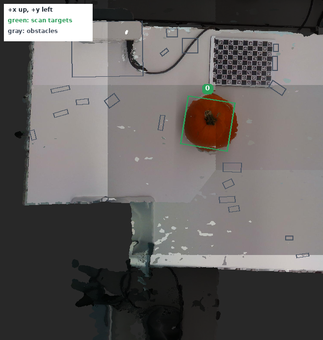
  <br><sub><b>REAL DATA.</b> The survey of 2026-10-29 15:55: +x up, +y left</sub>
</p>

#### Everything else is an obstacle

Things that are skipped aren't scanned, but the arm still has to go around them. The survey saves them with the session as clutter, every plan treats them as obstacles, and the touch-off spots keep clear of them. Some of them are RealSense noise (10-20mm bumps in bare table near the edge of a survey view). As obstacles, those sit below the table slab, and for the touch-off they only rule out a few spots on a large table.

The table plane kept for the session is the one from the view closest to the objects.

#### The calibration board

Every survey view is also searched for the ChArUco board. If the board is found, the survey checks that it looks level (it lies on the table, so through a correct camera mount it has to), then moves straight over the board's center, 330mm up, for a head-on view with all 88 inner corners in the image. It records the board's pose, how well its corners fit, and a depth check against it.

#### Speed

Each survey view costs a move, 0.6s to settle, one color-only frame to read the camera's clock (0.15s), and one color-plus-depth frame (2-3s over the cloud connection, almost all of it the 1.8MB depth image). Finding objects doesn't need the median of several frames that scanning uses, so the survey takes just one.

### 5.2 View planning and reachability

<p align="center">
  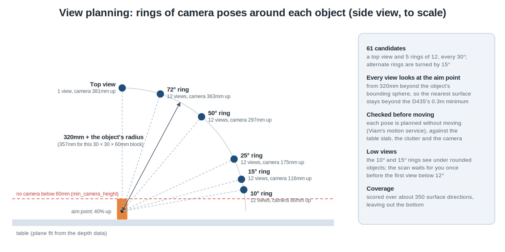
  <br><sub><b>DIAGRAM.</b> The planned view layout (the layout used on the arm)</sub>
</p>

Around each object, I lay out a top view plus rings of camera poses at several heights, all aimed at a point 40% of the way up the object. To find out which of them the arm can actually reach, every candidate pose is sent to Viam's builtin motion service as a **plan-only** request (`do_command({"plan": ...})`). That runs the real planner (inverse kinematics, joint limits, and collisions with the configured table and walls, every detected object, and the measured table) without moving anything. Each candidate is a pose for the camera, which the code turns into a pose for the arm's end through the calibrated camera mount ([§5.5](#55-camera-calibration)).

The low rings are there because on rounded objects, like the pumpkin and the printed sphere, the surface below the widest point is only seen head-on from low views. Views that would put the camera less than 60mm above the table (`min_camera_height`) are dropped before planning, as a guard that doesn't depend on the planner's table model; on the test objects, the 10° ring puts the camera 81-95mm up. Before an object's first view below 12° (`views.confirm_below_deg`), the scan waits once for the operator (Enter to go on, `n` to skip those views), so that someone is watching when the arm goes that low.

Coverage is scored over about 350 surface directions, leaving out the bottom.

### 5.3 Stop-and-go capture

At each view, the arm moves, waits until it reports that it has stopped, and waits another 0.6s. Then the camera takes 5 frames and keeps the per-pixel median depth. A frame only counts if the camera **stamped it after the settle time, by the robot's own clock**, so nothing captured while the arm was moving can slip in. The camera pose is read after settling and checked against the arm controller ([§10](#10-working-safely-on-a-shared-real-arm)).

Each view is saved as `color.jpg`, `depth.png` (16-bit millimeters) and `view.json` (pose, joints, timestamps and camera mount). Each view also gets a colored `depth_preview.jpg` for looking at, since a 16-bit depth image looks almost black in an image viewer.

### 5.4 Placing each view in the world

A depth pixel (u, v) with depth d becomes a point in the camera's frame using the camera's intrinsics (focal lengths fx, fy and image center cx, cy), and then a point in the world through three transforms:

```math
p_\text{world} = C_i \; T_{\text{world} \leftarrow \text{arm end}}(\text{joints}) \; M_{\text{arm end} \leftarrow \text{camera}} \; p_\text{camera}
```

- **T** comes from the arm's joint angles and kinematics. The arm, a UFactory 850, returns very precisely to the same pose, so this part is trustworthy.
- **M** is the camera's mounting pose on the wrist, from the calibrated camera mount file. If it's wrong, every view is wrong by a different amount, because the error rotates with the wrist.
- **Cᵢ** is a small correction for view *i*, found by the alignment step.

These three terms line up with the three sources of error and the three fixes in the next sections.

### 5.5 Camera calibration

Every point in every mesh passes through the camera's calibration, so any error in it lands directly in the result ([§1.1](#11-breaking-down-the-problem)). I calibrate three things:

| What | Symbol | Where it comes from |
|---|---|---|
| **Intrinsics:** focal lengths and image center | $f_x, f_y, c_x, c_y$ | The RealSense's factory calibration, read through Viam ($f_x \approx f_y \approx 916$px at 1280 × 720). The board fits it to 0.1-0.3px per view, so it's left as is. |
| **Camera mount:** the camera's pose on the arm's end | $M$ | Calibrated two ways: from a scan, and from the ChArUco board (below). |
| **Depth error:** how the depth readings differ from true distance | $a + b\,z$ | Measured against the board. |

The arm's end pose $E$ comes from the arm's joint angles and kinematics (the UFactory 850 returns very precisely to the same pose), so the camera pose for a view is $T_\text{world←camera} = E\,M$.

**The camera frame in the Viam app is only used for its 3D scene.** Every move targets the arm's end, computed from where the camera should be through the calibrated mount, and every captured pose is the arm controller's end pose combined with that same mount (the file named by `[machine] camera_mount_file` in `config.toml`). This means recalibrating never requires editing the machine's configuration.

#### The camera model

A point $p = (X, Y, Z)$ in the camera's frame ($Z$ along the optical axis) appears at pixel

```math
u = f_x \frac{X}{Z} + c_x, \qquad v = f_y \frac{Y}{Z} + c_y
```

and a depth reading $d$ at pixel $(u, v)$ is the point $\big((u - c_x)\,d / f_x,\ (v - c_y)\,d / f_y,\ d\big)$. The RealSense aligns its depth image to the color image, so both use the color camera's intrinsics, and its distortion coefficients are zero.

#### Method 1: calibrating the mount from a scan

The first method, `scan.py calibrate --objects N`, works from any scan of a scene that holds still. With a wrong mount, every view of the same scene lands in a slightly different place, by an amount that depends on how the wrist is turned. A single correction $\Delta$ to the mount (6 numbers: a rotation vector and a translation) should make all of the views agree. For view $i$, a point $p$ in its camera frame lands at $E_i M \Delta\, p$. Between overlapping views $i$ and $j$, each point $p$ of view $i$ is matched to the nearest point $q$ of view $j$, which has the surface normal $n$ there, and the method minimizes the point-to-plane distances:

```math
\min_{\Delta} \sum_{(i,j)} \sum_{(p,q)} \rho\Big( \big(R_j n\big)^{\!\top} \big( E_i M \Delta\, p - E_j M \Delta\, q \big) \Big)
```

where $R_j$ is the rotation of $E_j M \Delta$, and $\rho$ is a robust (soft-L1) loss so that occasional bad matches don't dominate. The points come from the object and a 60mm ring of table, since the table pins down height and tilt. The matches are recomputed as the estimate improves, with the match distance shrinking from 25mm to 3mm, and each round is solved with SciPy's `least_squares`.

On the real cylinder's 25 views, the mount I had first entered in the Viam app turned out to be off by 21mm and 2.2°:

| | Spread of table height across 25 views | Spread of the cylinder's top | Single views vs. fused surface |
|---|---|---|---|
| Uncalibrated mount | 20mm (std 6.0mm) | 21mm (std 6.1mm) | 2.48mm median |
| Calibrated mount | 4.4mm (std 1.0mm) | 5.0mm (std 1.1mm) | 0.52mm median |

On synthetic data, it recovers a known 12mm / 2° mount error to within 1.5mm / 0.3°.

**What it can't see.** Anything that changes the scene's size equally from every direction (a depth bias, or a camera sitting a little farther along its own axis than calibrated) leaves all of the views in agreement, so this method can't detect it. That's why I also needed an absolute reference.

#### Method 2: the ChArUco board

The second method, `scan.py calibrate-board` (which `calibration.py` runs), uses a ChArUco board lying on the table: a checkerboard with an ArUco marker in each white square. Mine is a calib.io mat (12 × 9 squares of 15mm, 11mm markers, dictionary DICT_5X5). The markers make every corner identifiable even when only part of the board is visible, and the checker corners can be located to a fraction of a pixel. calib.io sells targets and calibration software, but this project only uses the printed mat and free, open-source tools: OpenCV for finding the corners, and my own solver.

**One view: the board's pose.** OpenCV finds the markers, then the checker corners between them, which gives pixel positions $x_k$ for corners whose positions $X_k$ on the board are known in mm. The board's pose relative to the camera ($R, t$) is the one that best reproduces them, which is the *Perspective-n-Point* problem:

```math
\min_{R,\,t} \sum_k \big\lVert \pi\big(R X_k + t\big) - x_k \big\rVert^2
```

where $\pi$ is the camera model above. This uses the color image only, so it's independent of the depth sensor.

**Many views: hand-eye calibration.** The board doesn't move, so its pose in the world, $B$, has to be the same for every view $i$: $B = E_i\, M\, C_i$, where $C_i$ is the board's pose in that view's camera. Finding $M$ from pairs like these is the classic *hand-eye* problem, often written $AX = XB$ (Tsai & Lenz 1989; Park & Martin 1994), which has closed-form solutions. I instead solve for $M$ and $B$ together (12 numbers) by minimizing the reprojection error of every corner in every view:

```math
\min_{M,\,B} \sum_i \sum_k \rho\Big( \big\lVert \pi\big( (E_i M)^{-1} B\, X_k \big) - x_{ik} \big\rVert^2 \Big)
```

with a Huber loss $\rho$, starting from the current mount (within a few cm and degrees). Minimizing the error in pixels, where the measurement noise actually is, is the maximum-likelihood formulation (as in Zhang's camera calibration), and it uses every corner rather than one pose per view. OpenCV's closed-form `calibrateHandEye` would also have been a fine starting point, but its Python binding is missing in the OpenCV 5 build I used.

**Depth error.** At every detected corner, the depth reading $d$ is compared with the corner's true distance $z$ from the board fit, and a line is fit to the difference: $d - z \approx a + b\,z$.

**Choosing the views.** The command first finds the board (from wherever the camera is, then from overhead positions using color-only images, which take about 0.15s each), looks at it head-on, and checks that it looks level. A mat lying on the table has to be level, so if it isn't, the mount in use is wrong and the command stops. Through the camera frame I had entered in the Viam app (θ 129.489°, [§8.1](#81-hardware-and-platform)), the mat looked 10.5° from level, and through the scan-calibrated mount, 0.5-0.8°. The command then plans views from 300-460mm away and from many directions (hand-eye calibration needs the wrist to rotate about different axes between views), keeps 12 that are reachable and spread out, and captures them. On synthetic corners with 0.3px of noise, it recovers a known mount to within 1mm / 0.1° from a starting guess 20mm / 3° off.

#### Results

| | Value |
|---|---|
| Views, corners | 12 views, 1,027 corners (76-88 of 88 per view) |
| Reprojection error, single views | 0.09-0.33px |
| Reprojection error, all views together | 4.59px with the scan-based mount → 1.61px with the board mount |
| Board mount vs. scan-based mount | 4.7mm / 0.50° apart |
| Depth vs. board, 258-505mm | median −0.47mm; fit $a = −1.66$mm, $b = +0.34\%$; rms 0.78mm |

- **The two calibrations agree to 4.7mm / 0.5°**, even though they come from entirely different data (an object's geometry vs. a printed pattern).
- **Depth on a flat surface is accurate to about half a millimeter** at scanning distances (at 300mm, the fit gives −0.6mm).
- **The remaining 1.6px** (about 0.6mm at 350mm) is larger than the single views' 0.1-0.3px. The most likely cause is the arm's absolute accuracy, which is worse than its 0.1mm repeatability.
- **Neither explains the cylinder's size error** ([§3.5](#35-the-real-cylinder-against-calipers)). With the 2px edge filter, the cylinder rebuilt with the scan-based mount is 32.22mm wide, with the board mount 32.52mm, and with the board's depth correction as well 32.90mm, all 2.4-3.1mm wider than the average caliper measurement. So the mount and the flat-surface depth are good to well under a millimeter, and the extra ~1.2mm per side comes from how the RealSense measures the object's walls and edges.

Running `calibration.py` (or `calibrate-board --save-mount`) makes the board's mount the one used for every move and capture.

#### The gripper: touch-off

> [!NOTE]
> I took the gripper off on 2026-10-29 (`[machine] gripper = ""`), because without it the camera can reach many more views. The touch-off is turned off until a gripper is back ([§13.8](#138-moving-objects-the-arm-cant-scan-all-the-way-around)), but the code and the measurements below are kept.

The planner keeps the gripper off the table using the gripper's collision model, but if the real fingertips reach further than the model, the planner can drive them into the table. `scan.py touch-off` measures the real reach the way machinists set up a tool: at three spots of bare table, clear of everything the survey saw, the closed gripper comes straight down and then steps 1mm at a time while you slide a sheet of paper under the fingertips, until the paper drags. On the test arm, the fingertips reach **76.2mm** past the gripper frame (three spots within 2.1mm of each other), compared with the model's **50mm**. That's 26mm further than the planner thought, and the most likely reason the gripper hit the table on the low views ([§8.1](#81-hardware-and-platform)). The result is saved in `calibration/`, and every plan's table slab ([§10](#10-working-safely-on-a-shared-real-arm)) adds the extra reach to its margin.

#### References

- Z. Zhang, "A flexible new technique for camera calibration," *IEEE TPAMI*, 2000. [doi:10.1109/34.888718](https://doi.org/10.1109/34.888718)
- R. Tsai and R. Lenz, "A new technique for fully autonomous and efficient 3D robotics hand/eye calibration," *IEEE Trans. Robotics and Automation*, 1989. [doi:10.1109/70.34770](https://doi.org/10.1109/70.34770)
- F. Park and B. Martin, "Robot sensor calibration: solving AX = XB on the Euclidean group," *IEEE Trans. Robotics and Automation*, 1994. [doi:10.1109/70.326576](https://doi.org/10.1109/70.326576)
- S. Garrido-Jurado et al., "Automatic generation and detection of highly reliable fiducial markers under occlusion" (ArUco), *Pattern Recognition*, 2014. [doi:10.1016/j.patcog.2014.01.005](https://doi.org/10.1016/j.patcog.2014.01.005)
- OpenCV: [ChArUco detection tutorial](https://docs.opencv.org/4.x/df/d4a/tutorial_charuco_detection.html), [calib3d module (solvePnP, calibrateHandEye)](https://docs.opencv.org/4.x/d9/d0c/group__calib3d.html)
- calib.io: [calibration pattern generator](https://calib.io/pages/camera-calibration-pattern-generator) (ChArUco boards, DICT_4X4 to DICT_7X7)
- Intel RealSense: [tuning depth cameras for best performance](https://dev.intelrealsense.com/docs/tuning-depth-cameras-for-best-performance) (depth accuracy vs. distance, edge effects)
- Viam's `viam:camera-calibration` module (ChArUco pose tracker and hand-eye service), suggested for comparison ([§13.4](#134-calibration-that-just-works))

#### My solver vs. Viam's camera-calibration module

A technical interviewer suggested I compare my calibration with Viam's [camera-calibration](https://github.com/viam-labs/camera-calibration) module. It solves the same problem with OpenCV's closed-form hand-eye method (Tsai), working from the board's pose in each image, while mine fits the board corners' pixels directly (least squares over the mount and the board's pose together). `tools/compare_calibration.py` runs both on the same saved board views, along with OpenCV's other four methods. Viam's runs through its own `solve.py`, unchanged; it needs OpenCV 4, so it runs in a separate environment (see [`recon/handeye.py`](recon/handeye.py)).

- **Simulated, with a known mount:** every method recovers it exactly from perfect views. With 0.2px of corner noise, mine lands 0.03mm from the truth, Tsai 0.53mm, and the others 0.34-1.77mm. Fitting the pixels uses the measurements directly, while the closed-form methods work from each view's noisy board pose.
- **On the 6 real board runs** (12 views each): every method predicts a left-out view's corners about equally well (median 1.6-2.1px; Tsai is slightly better than mine in 5 of 6 runs, by 0.1-0.2px), and Tsai's mount consistently sits 1.7-1.9mm and 0.4-0.6° from mine.
- **What it does to a scan:** the 34-view scans of 2026-10-28, rebuilt with each method's mount from the board run made minutes before them:

| Mount from | Orange block: width, length error | Green cylinder: diameter error | Views disagree |
|---|---|---|---|
| Mine | +3.9, +4.0mm | +2.50mm | 0.57-0.58mm |
| Tsai (Viam's) | +4.1, +4.3mm | +2.78mm | 0.57mm |
| Park, Horaud | +4.0 to +4.2mm | +2.75mm | 0.56-0.58mm |
| Andreff, Daniilidis | +3.8 to +4.3mm | +2.65 to +2.85mm | 0.56-0.57mm |

Mine is slightly closer to the calipers on both objects, but by only 0.2-0.3mm, so for reconstruction the two are equivalent, and the 2.5-4mm of extra width isn't the calibration's doing. Viam's module also chooses its own views (about 20, at random rolls), but this comparison uses my 12 views for both, so it compares only the solvers. The data is in `data/experiments/20261029-183837-calibration/` and `...-calibration-methods-object0/1/`.

### 5.6 Stitching: aligning the views

Even after calibration, the views still disagree by about a millimeter, from the arm's accuracy and what's left of the calibration error. Fusing them as they are would average slightly shifted copies of each surface into ripples. The alignment step, a joint form of [iterative closest point](https://en.wikipedia.org/wiki/Iterative_closest_point) (ICP, in [`recon/reconstruct.py`](recon/reconstruct.py)), solves for all of the per-view corrections **Cᵢ** at once:

1. Each view's points near the object (plus a 10mm ring of table) are downsampled to 2mm, cleaned, and given surface normals.
2. Every pair of views pointing within 60° of each other counts as an overlapping pair. For 1500 points in each pair, the nearest point in the other view with a similar normal is taken as its match.
3. Each match contributes a **point-to-plane** residual: the distance from a point to the plane of its match. Point-to-plane lets flat surfaces slide along themselves, which is correct, since a flat patch says nothing about sliding.
4. Each correction is also pulled toward zero by a **prior** that reflects the arm's expected accuracy: 3mm, 1° of tilt, and 0.3° of spin about the vertical axis. Where the geometry pins a correction down, the thousands of matches outweigh the prior. Where it can't (a cylinder spinning about its own axis looks identical), the prior keeps the arm's pose. Spin gets the tighter prior because it's exactly the motion a round object can't constrain, and noise would otherwise pretend to.
5. Gauss-Newton solves for all of the corrections together (6 numbers per view), re-matching on each iteration while the match distance shrinks from 6mm to 3mm, for up to 25 iterations. Rotations are measured about the object's center rather than the robot's base 500mm away, so they mean something physically.
6. Any correction over 15mm or 5° is rejected, and that view keeps its arm pose. On the real, calibrated cylinder, 1 of the 25 views was rejected.

On synthetic views, this cuts the relative pose error from 1.87mm to 0.48mm, and it's the difference between the two meshes in [§3.4](#34-the-two-fixes-that-mattered-most).

### 5.7 Fusing the views (TSDF)

Before fusing, the object's box is **refit from the scan itself**. Every view's points above its own table, within 40mm of the survey's box, are clustered, and a new box is fit around the main cluster (once with the arm's poses before alignment, and again after). The survey's box can be wrong by more than the crop margin, and a box in the wrong place cuts the same slice off the object in every view ([§8.2](#82-detection)).

Each view's depth map is then cropped to the object: inside its box (plus 12mm), and at least 2.5mm above **that view's own fit of the table** in a 30mm ring around the object, since the survey's table can be several mm off near the object. The cropped depth maps go into a TSDF (Open3D's `VoxelBlockGrid`, on the GPU when one is available):

<p align="center">
  
  <br><sub><b>DIAGRAM.</b> Illustrative numbers, not measurements</sub>
</p>

- **Space is divided into 1.5mm voxels.** Along every pixel's ray, each view writes the signed distance from each voxel to the surface that pixel measured: positive in front of it, and negative behind it.
- **Only a ±6mm band is updated.** Signed distances are truncated to ±6mm. Voxels farther in front are marked as free space, and voxels more than 6mm *behind* the reading are left alone, since that region is hidden from this view and another view may see it.
- **Readings are averaged, not thrown out.** Each voxel keeps a weighted average of every view's signed distance, so random noise cancels out. The surface is where the average crosses zero (found with marching cubes).
- **Data is thrown out before and after fusion, not during it.** Before fusion, pixels at or within 2px of depth edges (below) and anything outside the object's box or below its table are removed. After fusion, surface seen by fewer than 2 views, and small fragments, are removed.

**The edge filter** works on each depth *image*, not on the table. Wherever the depth jumps between neighboring pixels (an object's outline against the table behind it), the RealSense's readings are unreliable. Some pixels float between the near and far surfaces ("flying pixels"), and a few pixels further in, stereo matching blends the foreground and background, pushing the object's outline outward ("edge fattening"). On the real cylinder, wall points within 3 pixels of the outline sat 2.3mm too far out. The filter drops pixels at a jump of more than 5mm (or 2% of the distance), plus 2 pixels beyond it (`[reconstruct] edge_grow`), and pixels without a reading are never treated as edges. I chose these thresholds for the RealSense; another camera behaves differently at edges, so they'll need testing again with it ([§13.7](#137-a-second-camera-the-orbbec-astra-2)). The edge filter is unrelated to the survey's table-edge rule ([§5.1](#51-survey-finding-the-table-and-whats-on-it)), which decides where the *table* ends so the survey doesn't look at the floor.

The surface that comes out of fusion is `observed.obj`. Everything in it was measured, and it's open wherever nothing was seen.

**The voxel size and the truncation band** are the fusion's two main settings. Smaller voxels keep finer detail, but each one averages fewer readings, so the surface gets noisier. The truncation band sets how far from its reading each view updates the grid: a wide band lets views that disagree by a millimeter or two still overlap and average, but it also lets the two sides of a thin wall overwrite each other; a narrow band keeps thin walls apart, but leaves gaps wherever the views disagree by more than the band. The figures below show both on the orange block (solid) and the 3D-printed bowl (a wall a few millimeters thick). The numbers are in [§6.4](#64-what-can-be-tuned). *From the full scans at the 280mm standoff; to be updated after the 320mm re-scans.*

<p align="center">
  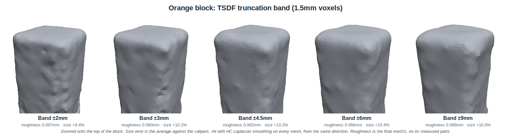
  <br><sub><b>REAL DATA.</b> The orange block's full scan, rebuilt with each truncation band</sub>
</p>

<p align="center">
  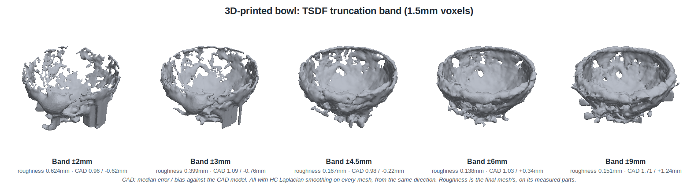
  <br><sub><b>REAL DATA.</b> The bowl's full scan, rebuilt with each truncation band</sub>
</p>

<p align="center">
  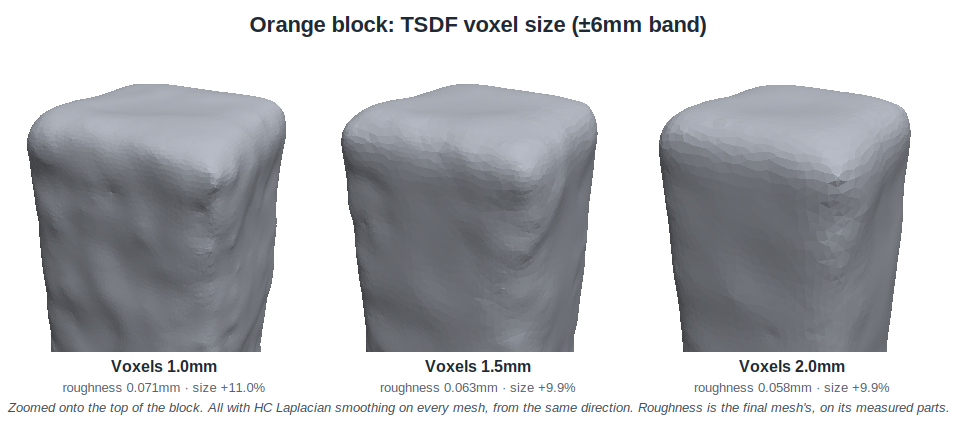
  <br><sub><b>REAL DATA.</b> The orange block's full scan, rebuilt with each voxel size</sub>
</p>

<p align="center">
  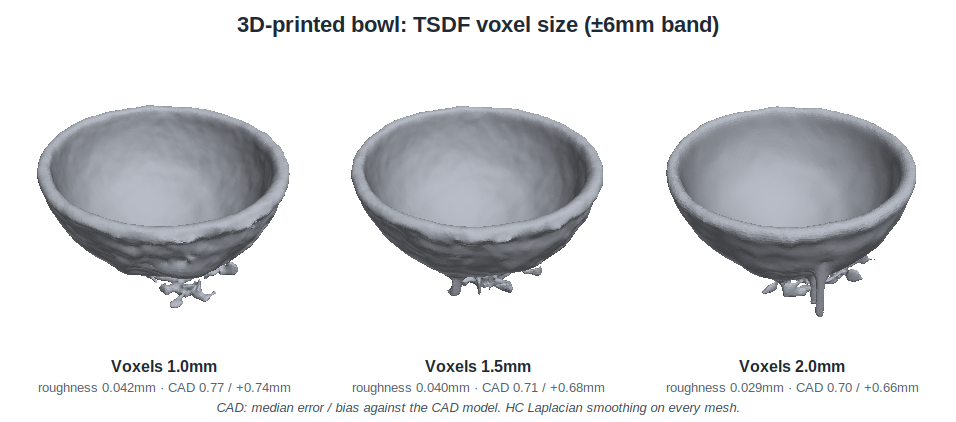
  <br><sub><b>REAL DATA.</b> The bowl's full scan, rebuilt with each voxel size</sub>
</p>

### 5.8 Closing the mesh with a flat bottom

The camera can never see under an object, so the measured surface is always open at the bottom. Because the objects rest flat on the table, I fill in what wasn't seen with two assumptions (priors):

- The **bottom** is the object's outline seen from above, lying flat on the table plane.
- A **wall that was never seen** most likely drops straight down from the **lowest place the surface was seen**. On a block, that's the outline itself. On a rounded object like a pumpkin, the surface curves back in below its widest point, so the wall drops from where the camera last saw it, tucked in underneath, rather than from the widest outline. Looking inward from the outline, only the first surface met counts (a gap of more than 10mm along the line ends the search). Otherwise, inside an open cup the line would reach the far side's inner wall, which faces the same way and reaches lower.

To find that place, the closing looks inward from each point of the outline (up to 60mm, along a 3mm-wide line) for the lowest observed surface whose normal faces outward along that line, so the top and the opposite wall don't count. The lowest point is taken as the 5th percentile by height, so one stray reading can't set it, and neighboring outline points (within 6mm) are smoothed together. The wall hangs from there, and the flat bottom shrinks to match. Where nothing facing outward was seen, the wall drops straight from the outline.

Before closing, scraps of table are dropped: points less than 15mm above the table that lie more than 3mm outside the outline of everything higher. An object's outline seen from above contains all of its surface, even what's tucked in underneath, so a low point outside it is table that fusion kept (from the object's shadow, or from flared depth pixels).

Poisson can't close a thin sliver, such as 2 views of a pumpkin's top; it balloons into a surface far bigger than the object. A closed mesh that reaches more than 20mm past the points it was fit to (checked after flattening it onto the table) is discarded, and the result says "too little seen to close" instead of reporting a meaningless volume.

The final `mesh.obj` is a screened Poisson surface fit through the observed surface points (with their normals), plus points filling the bottom (with normals pointing down), plus straight-wall points only where no observed surface lies within 3mm. The lowest 5mm of observed surface is replaced by the straight-wall prior, since the depth pixels where the wall meets the table flare outward. Anything below the table is flattened onto it, and the outline is shrunk by 1mm because edge noise pads it. The result is closed (it has no open edges), so it has a volume. [§6.2](#62-measured-vs-filled-in-observedobj-and-meshobj) shows which parts are measured and which are filled in.

**Example: the pumpkin (real scan, 2026-10-28, 30 views).** The 25° views saw the side facing the arm's base down to about 15mm above the table, curving in from a radius of 85mm at the widest point to about 62mm. Hanging the walls from the widest outline would make the closed mesh a cylinder of radius 87-91mm all the way down, as if the pumpkin had been projected onto the table. With the walls hung from the lowest seen surface, the closed mesh follows the measured curve on that side (radius 67-74mm in the lowest 30mm; a second scan of the same pumpkin gave 69-74mm). The far side had too few 25° views, since it was out of reach (590-640mm from the base), so nothing below its widest point was measured, and its wall still drops straight from the outline (radius 86-88mm).

---

### 5.9 Smoothing the mesh

Fusion averages away most of the sensor noise, but some ripple remains, so every mesh is smoothed: the measured surface (`observed.obj`) and the final, closed mesh (`mesh.obj`), which is built from the fused points. I use 5 steps of **HC Laplacian** smoothing ([PyMeshLab](https://pymeshlab.readthedocs.io/)): like plain Laplacian smoothing it moves each vertex toward its neighbors, but it then pulls each vertex part of the way back toward where it started, so the mesh shrinks much less.

The main risk with any smoothing is changing the object itself: rounding off edges that are really there, or creating features that aren't. So I compared seven methods on the full scans, judging each on both how smooth the final mesh came out and how accurate it stayed against the calipers and the bowl's CAD model ([§6.4](#64-what-can-be-tuned)). HC Laplacian gave the smoothest final meshes and the most accurate sizes, and the bowl's error against its CAD model went slightly down, so it doesn't add anything. *From the full scans at the 280mm standoff; to be updated after the 320mm re-scans.*

<p align="center">
  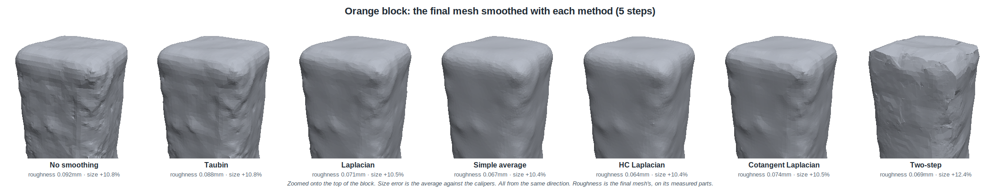
  <br><sub><b>REAL DATA.</b> The orange block's full scan, its final mesh smoothed with each method</sub>
</p>

<p align="center">
  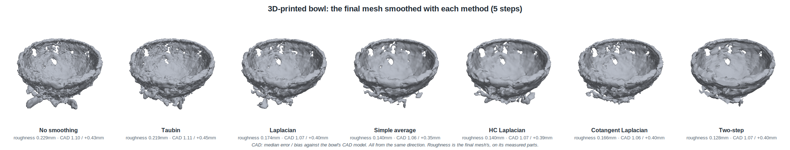
  <br><sub><b>REAL DATA.</b> The bowl's full scan, its final mesh smoothed with each method. The holes through its thin wall come from fusion (above), not from smoothing</sub>
</p>

The live viewer's preview mesh isn't smoothed, so that it stays fast ([§9.5](#95-watching-a-scan-live)).

---

## 6. Evaluating and Tuning

Building a mesh is only half of the job: I also needed to know how good each mesh is, and which settings make it better. This section covers how I measure quality, the difference between what was measured and what was filled in, the tool I use to compare settings, and what I've learned from tuning them so far.

### 6.1 Measuring quality

`scan.py progression` aligns all of the views once, then fuses the first *k* views for every *k*, adding each next view from the most different direction (so 3 views means 3 different sides). Each subset keeps the surface seen by at least min(2, *k*) of its views. A single view keeps everything it saw, so the 1-view mesh is the best that one view can give, and 2 or more views keep only what at least 2 of them agree on. `--min-views` overrides this for every subset.

| Metric | What it measures | Needs ground truth? |
|---|---|---|
| **Roughness** | Median [root mean square](https://en.wikipedia.org/wiki/Root_mean_square) (RMS) distance of 3mm surface patches from their best-fit plane, on either mesh: the **measured surface** (`observed.obj`) or the **final mesh** (`mesh.obj`, only where it lies on measured data, since the filled-in bottom and walls are smooth by construction). In the progression, it's measured only on the patch the first view saw, which every subset includes, so rows compare the same surface. | No |
| **Deviation from final** | Distance from this subset's observed surface to the all-views closed mesh (median and 90th percentile). | No |
| **Completeness** | Share of the all-views observed surface that this subset saw (within 2mm). It's relative: the all-views scan is 100% by definition, and a region no view ever saw (the bottom) can't count against it. That's why the figures label each panel with the measured share instead. | No |
| **Measured share** | Share of the closed mesh's surface that lies within 2mm of measured data ([§6.2](#62-measured-vs-filled-in-observedobj-and-meshobj)). | No |
| **Volume** | Enclosed volume of the closed mesh. | No |
| **Error vs. truth** | Distance from the mesh to the true shape after the best rigid fit, so it scores shape rather than placement. | Yes (synthetic) |

The results go to `recon/progression/summary.csv`, along with `mesh.obj` and `observed.obj` for each *k*, and the first view's raw points.

### 6.2 Measured vs. filled in: `observed.obj` and `mesh.obj`

Every closed mesh is part measurement and part assumption. The **measured share** is the fraction of the closed mesh's surface area that lies within 2mm of a point the camera actually measured (fused from at least 2 views). The rest, shown in orange below, comes from the two priors in [§5.8](#58-closing-the-mesh-with-a-flat-bottom): the flat bottom, and straight walls where nothing was seen.

To keep that distinction visible, every scan writes two meshes of each object (in `data/<session>/object_NN/recon/`), both built from the same fused data:

- **`observed.obj` is only what was measured.** It's the surface the TSDF fusion extracted where at least 2 views agreed ([§5.7](#57-fusing-the-views-tsdf)), and nothing else. Wherever the camera never looked, it's simply open: there's no bottom (the object stands on it), and the red edges in the figure mark where the measurement stops. Its bottom rim is ragged because fusion keeps the walls down to 2.5mm above the table, and the views disagree a little on where that is.
- **`mesh.obj` is the finished, closed model.** It adds the two assumptions from [§5.8](#58-closing-the-mesh-with-a-flat-bottom) (a flat bottom on the table, and straight walls down to it where unseen) and rebuilds one watertight surface through everything with screened Poisson reconstruction. Orange marks what was filled in rather than measured.

<p align="center">
  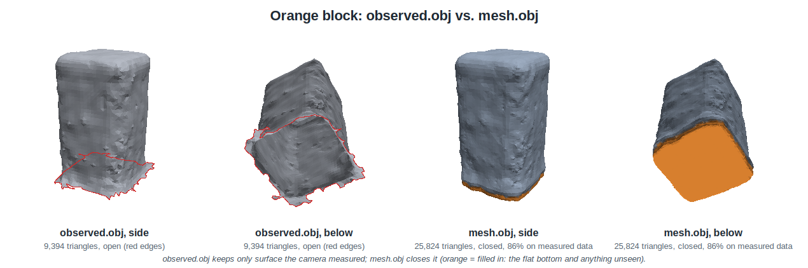
  <br><sub><b>REAL DATA.</b> Orange block, full scan (49 views)</sub>
</p>

<p align="center">
  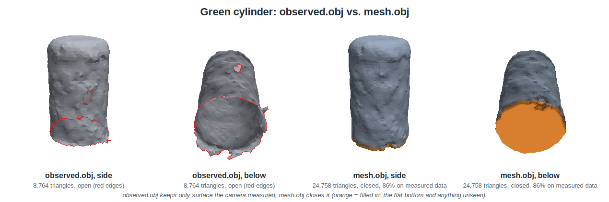
  <br><sub><b>REAL DATA.</b> Green cylinder, full scan (50 views)</sub>
</p>

| | `observed.obj` | `mesh.obj` |
|---|---|---|
| What it contains | Measured surface only (seen by 2+ views) | Measured surface plus a flat bottom and straight-wall fill, as one surface |
| Closed (watertight)? | No: open bottom, and holes wherever nothing was seen | Yes: has a volume, can be 3D printed or used for collision and grasp planning |
| Orange block, 49 views | 9,394 triangles, 79cm² of surface, 0.7MB | 25,824 triangles, 92cm², 1.8MB, 86% on measured data |
| Green cylinder, 50 views | 8,764 triangles, 70cm², 0.7MB | 24,758 triangles, 81cm², 1.7MB, 86% on measured data |
| Use it to | Judge what the camera actually captured, and measure accuracy without assumptions | Use the object: volume, simulation, printing, planning around it |

Most of the difference in area (13cm² for the block and 11cm² for the cylinder) is the bottom, which the camera can never see. `mesh.obj` also has about three times as many triangles, because Poisson builds its surface on a finer, uniform grid instead of reusing the fusion's triangles. Both meshes are smoothed lightly (5 steps of HC Laplacian, [§5.9](#59-smoothing-the-mesh)), so both keep some of the RealSense's few-tenths-of-a-millimeter ripples.

### 6.3 Comparing settings, methods and cameras

To compare the choices in [§5](#5-methodology) fairly, I built one tool that works offline on saved scans: [`tools/compare.py`](tools/compare.py). It rebuilds a scan several different ways (or compares scans of the same object from different rigs), measures every result the same way, and writes a table and a side-by-side figure to `data/experiments/<time>-<name>/`:

```bash
python tools/compare.py data/<session> --vary frames=1,5,10,50                       # frames per view (full scans)
python tools/compare.py data/<session> --vary reconstruct.closing=flat_bottom,poisson,none
python tools/compare.py data/<session> --vary reconstruct.align=true,false --vary reconstruct.edge_grow=0,2,4
python tools/compare.py data/<session> --vary views=8,16,all                         # fewer views, spread out
python tools/compare.py data/<session> --vary mount=<a.json>,<b.json>                # calibrations
python tools/compare.py data/<realsense scan> data/<orbbec scan>                     # two rigs
```

- **What can vary:** `frames` rebuilds each view's depth from its first k raw frames, which `scan.py --full-scan` keeps (by default as the median; using all 50 reproduces the saved depth exactly). `mount` re-places every view with another camera mount, starting from the poses as captured. `views` uses a subset spread over all directions. Any setting can also be varied by its name in `config.toml`, and several `--vary` options give every combination.
- **What is measured:** how far single views lie from the fused surface ("views disagree"), roughness, volume, the measured share, the size against the calipers (`ground_truth.toml`), and, for the 3D-printed objects, the surface error against their CAD model.
- **CAD comparison** ([`recon/cad.py`](recon/cad.py)): the printed object's STL is stood on the table where the scan found it, and the scan's measured surface is fitted onto it. The fit is rigid (rotation and shift, never scale, so a scan that's too big stays too big) and is tried from 12 starting rotations. Then every measured point's signed distance from the true surface is taken, positive outside. The figure colors the surface red where it's outside and blue where it's inside. On the CAD model itself the fit is exact, and a scan made 5% too big shows a positive bias.
- **Two rigs:** each session records its rig's name (`[machine] rig`), which is used to label it. A second rig gets its own config file ([`config_orbbec.toml`](config_orbbec.toml) is a template) with its own address, camera names, calibration file and ready pose. With no ready pose set, a run starts from wherever the arm is.

`tools/compare_calibration.py` compares hand-eye calibration methods on saved board runs (§5.5).

### 6.4 What can be tuned

The table below lists the settings that most change how smooth and how accurate the final mesh is. Every setting, with its default and an explanation, is in [`recon/config.py`](recon/config.py), and any of them can be overridden in `config.toml`. "How chosen" says what each value rests on: **real** (measured on real scans), **synthetic** (tuned on simulated scans), or **judgment** (a reasoned default that hasn't been tuned yet). Settings marked † were chosen for the RealSense and need testing again for another camera.

| Setting | Now | What it trades | How chosen |
|---|---|---|---|
| `capture.frames_per_view` | 5 | More frames: less per-pixel noise (median), slower views | **real** (below) |
| `views.standoff` † | 320mm + object radius | Closer: more pixels on the object and less noise (it grows with distance²), but the D435i's ideal range starts at 0.3m | **spec**: keeps every surface beyond 0.3m (the scans so far used 280mm, which put some surfaces at 276-300mm; a comparison is planned) |
| `views.elevations_deg`, `views.azimuth_step_deg`, `--max-views` | 10/15/25/50/72°, 30° (61 candidates) | More views: more averaging and coverage, longer scans | **real**: 16 spread views measured every side ([§3.2](#32-scanning-an-object-with-multiple-views)) |
| `reconstruct.edge_grow` † | 2px | Wider: removes more edge fattening, loses more wall data | **real**: 32.62 → 32.22mm diameter at 2px, nothing gained beyond |
| `reconstruct.voxel` † | 1.5mm | Smaller: finer detail and sharper edges, but fewer readings per voxel (noisier) and more memory | judgment |
| `reconstruct.sdf_trunc` † | 6mm (4 voxels) | Wider: views that disagree still overlap and average (smoother), but thin parts blur together; narrower: sharper, but small misalignments leave holes or double walls | **real** (below): 4.5mm looks like a better compromise; to be confirmed on the 320mm re-scans |
| `reconstruct.min_views` | 2 | Higher: only surface confirmed by more views (cleaner, more holes) | judgment |
| `reconstruct.align` | true | The alignment step on or off ([§3.4](#34-the-two-fixes-that-mattered-most): off was closer to the calipers on one cylinder) | open question |
| `reconstruct.closing` | flat_bottom | `flat_bottom`, `poisson` (Poisson through the measured surface alone) or `none` (the observed surface, open) | judgment |
| `reconstruct.smoothing`, `smoothing_iterations`, `smooth_target` | hc_laplacian, 5 steps, both meshes | Which smoothing, how strong, and on which mesh | **real** (below) |

#### Frames per view: 1 to 50

To see how many frames each view needs, I took the orange block's full scan (49 views, 50 frames each, 2026-11-02) and rebuilt it with each view's depth as the median of its first 1, 5, 10 or all 50 frames (`tools/compare.py --vary frames=1,5,10,50`). The views and poses are identical; only the frame count changes.

| Frames per view | Views disagree (median) | Roughness | Width, length error | Height error | Capture per view |
|---|---|---|---|---|---|
| 1 | 0.74mm | 0.115mm | +3.1, +4.4mm | +1.1mm | |
| 5 | 0.64mm | 0.100mm | +4.0, +4.1mm | +1.0mm | about 20s |
| 10 | 0.61mm | 0.101mm | +4.1, +4.2mm | +1.0mm | |
| 50 | 0.58mm | 0.091mm | +4.4, +4.7mm | +1.1mm | about 2.1 minutes |

- **More frames make the views agree better and the surface smoother**, by 9% from 5 to 50 frames, with most of the gain between 1 and 5.
- **They don't make it more accurate.** From 5 to 50 frames, the block gets 0.3-0.6mm wider. A likely reason, which I haven't confirmed yet: the median keeps any pixel with a reading in at least half the frames, so with more frames, more of the flickering pixels at the object's edges pass (1-3% more valid pixels near depth edges in the views I checked), and edge pixels read too far out ([§3.5](#35-the-real-cylinder-against-calipers)).
- **Views matter more than frames.** At 5 frames, going from 16 to 34 views takes the roughness from 0.124 to 0.101mm and the size error from 13.1% to 10.5%. At 34 views, going from 5 to 50 frames takes them to 0.093mm and 11.1%.
- **A separate 5-frame scan of the same block** (34 views, placed elsewhere on the table) has 0.119mm roughness and +3.9, +4.0mm width and length errors. The placement and views differ too, so the comparison within one scan above is the fair one.

**Median, mean or trimmed mean.** In theory, averaging the frames should reduce noise more than taking their median, so I also combined the same 50 frames per view three ways (`--vary reconstruct.frame_combine=median,mean,trimmed --vary reconstruct.frame_min_valid=0.5,0.9`): the median (what a capture saves), the plain mean, and a trimmed mean that first drops readings more than 3 robust standard deviations from the pixel's median. A pixel is kept if it has a reading in at least 50% (the default) or 90% of the frames.

| Combine | Pixel kept if read in | Roughness | Views disagree | Width, length error | Size error |
|---|---|---|---|---|---|
| **Median** | **50%** of frames | 0.091mm | 0.58mm | +4.4, +4.7mm | 10.8% |
| Median | 90% | 0.106mm | 0.50mm | +3.8, +4.7mm | 10.2% |
| Mean | 50% | 0.084mm | 0.55mm | +4.4, +4.6mm | 10.6% |
| Mean | 90% | 0.104mm | 0.49mm | +4.1, +4.6mm | 10.3% |
| Trimmed mean | 50% | 0.086mm | 0.57mm | +4.5, +4.8mm | 10.9% |
| Trimmed mean | 90% | 0.105mm | 0.51mm | +3.9, +4.9mm | 10.5% |

- **The mean is 8% smoother than the median** and the views agree slightly better: for random noise, averaging 50 frames beats taking their median.
- **Trimming adds nothing:** at one pose a pixel rarely gives a wild reading. The stray points in a fused cloud come from edges and from views that disagree, not from single frames.
- **None of them fixes the size.** The extra width is a bias that every frame repeats, so averaging can't remove it.
- **Requiring a reading in 90% of frames** drops some flickering edge pixels (the width comes in by about 0.5mm and the views agree better), but also wall pixels that read only some of the time, so the surface gets rougher.

For now, 5 frames stays the default, and `--full-scan` is for collecting datasets like this one. The results are in `data/experiments/20261102-160853-orange-frames/`, `...-161453-orange-frames-views/` and `...-165634-orange-frame-combine/`.

#### Smoothing methods

*From the full scans at the 280mm standoff; to be updated after the 320mm re-scans.* Each method was applied with 5 steps to the final mesh of each full scan ("none" leaves it as fusion and Poisson built it). Roughness is the final mesh's, on its measured parts; size errors are against the average caliper measurements, and the bowl's CAD numbers are the median error and the bias (positive: too big) against its CAD model.

| Method | Final-mesh roughness (block / cylinder / bowl) | Block width, length / height | Cylinder diameter / height | Bowl: CAD median / bias / height |
|---|---|---|---|---|
| none | 0.092 / 0.095 / 0.229mm | +4.40, +4.72 / +1.08mm | +4.74 / +1.22mm | 1.10 / +0.43 / +1.38mm |
| taubin | 0.088 / 0.092 / 0.219mm | +4.36, +4.72 / +1.14mm | +4.40 / +1.23mm | 1.11 / +0.45 / +1.64mm |
| laplacian | 0.071 / 0.082 / 0.174mm | +4.25, +4.65 / +0.99mm | +4.55 / +1.11mm | 1.07 / +0.40 / +1.04mm |
| simple | 0.067 / 0.076 / 0.140mm | +4.20, +4.61 / +0.94mm | +4.59 / +1.13mm | 1.06 / +0.35 / +0.93mm |
| **hc_laplacian** | **0.064 / 0.076 / 0.140mm** | **+4.18, +4.61 / +0.95mm** | **+4.27 / +1.07mm** | 1.07 / +0.39 / **+0.89mm** |
| cotangent_laplacian | 0.074 / 0.079 / 0.166mm | +4.28, +4.63 / +0.96mm | +4.62 / +1.15mm | 1.06 / +0.40 / +0.92mm |
| two_step | 0.069 / 0.083 / 0.128mm | +4.89, +5.07 / +2.16mm | +4.30 / +2.35mm | 1.07 / +0.40 / +4.31mm |

- **The smoothest (least rough) final mesh: HC Laplacian**, 30-39% less rough than no smoothing (tied with the simple average on the cylinder and the bowl).
- **The most accurate: HC Laplacian against the calipers** (the block's and cylinder's sizes and every height), and **the simple average against the bowl's CAD model**, by 0.01mm in median error, which is within rebuild noise.
- **Taubin, the method used before, barely smooths** at 5 steps. **Two-step makes every object 1-3mm taller** (it sharpens and lifts the top edges: an added feature), so it's out. Rebuilding with identical settings varies by about ±0.15mm, so size differences under about 0.3mm aren't meaningful.

#### TSDF truncation band and voxel size

*From the full scans at the 280mm standoff; to be updated after the 320mm re-scans.* Each setting changed on its own (1.5mm voxels for the bands, a ±6mm band for the voxels), with HC Laplacian smoothing on every mesh; figures in [§5.7](#57-fusing-the-views-tsdf).

| Band | Orange block (width, length / height) | Green cylinder (diameter / height) | Bowl: CAD median / bias, measured share | Cup / mug: final-mesh roughness |
|---|---|---|---|---|
| 2mm | +4.0, +4.2 / +0.4mm | +3.8 / +0.7mm | 0.96 / −0.62mm, 70% | 0.348 / 0.243mm |
| 3mm | +4.3, +4.5 / +0.5mm | +4.3 / +0.8mm | 1.09 / −0.76mm, 82% | 0.142 / 0.168mm |
| 4.5mm | +4.1, +4.6 / +0.8mm | +4.4 / +1.0mm | **0.98 / −0.22mm**, 87% | 0.086 / 0.103mm |
| **6mm** (default) | +4.2, +4.6 / +0.9mm | +4.3 / +1.1mm | 1.03 / +0.34mm, 89% | 0.074 / 0.083mm |
| 9mm | +4.2, +4.7 / +1.1mm | +4.7 / +1.3mm | 1.71 / +1.24mm, 85% | 0.083 / 0.084mm |

- **On the solid objects, a narrower band mainly improves the height** (by up to 0.6mm), and the cylinder's diameter by 0.5mm at 2mm; the block's width hardly changes.
- **On the thin-walled bowl, the band decides whether the wall survives:** at 2-3mm it falls apart (the views disagree by 2-3.6mm and the wall shrinks inward), at 9mm it thickens (+1.24mm bias), and **4.5mm is the most accurate** (bias −0.22mm). The cup's and mug's volumes change two- to three-fold with the band, so it shapes thin walls strongly.
- **Voxel size:** on the block and cylinder, 2.0mm voxels come out slightly smoother and more accurate than 1.5mm, and 1.0mm worse. On the bowl, only 1.5mm works: at 1.0mm only 25% of the surface was measured and the closing ballooned, and at 2.0mm the closing failed.

#### Evaluating Tuning Parameters

Next, I rebuilt the same 49-view, 50-frame scan of the orange block with one setting changed at a time (defaults in bold; errors against the average caliper measurements):

| Setting | Width, length error | Size error | Roughness | Views disagree |
|---|---|---|---|---|
| **Alignment on** | +4.4, +4.7mm | 10.8% | 0.091mm | 0.58mm |
| Alignment off | +0.7, +2.5mm | 4.1% | 0.116mm | 0.95mm |
| Edge filter 0px | +4.4, +4.5mm | 10.6% | 0.092mm | 0.58mm |
| Edge filter 4px | +4.2, +4.2mm | 10.0% | 0.090mm | 0.58mm |
| Edge filter 6px | +4.1, +4.0mm | 9.7% | 0.091mm | 0.56mm |
| Grazing limit 75° | +4.4, +4.5mm | 10.6% | 0.091mm | 0.55mm |
| Grazing limit 60° | +4.4, +4.8mm | 10.8% | 0.112mm | 0.53mm |
| Voxel 1.0mm | +4.7, +4.8mm | 11.2% | 0.122mm | 0.56mm |
| Voxel 2.0mm | +4.3, +4.7mm | 10.6% | 0.094mm | 0.55mm |

- **Turning alignment off more than halves the size error**, but the views disagree almost twice as much and the surface is 27% rougher. On this scan, the alignment makes the views agree with each other and, in doing so, makes the object bigger. The cylinder in [§3.4](#34-the-two-fixes-that-mattered-most) showed the same direction, more weakly. Two objects aren't enough to say that alignment is the main source of the size error, so scans of more objects, including the 3D-printed ones, will test it.
- **A wider edge filter helps a little** (6px: 10.8% → 9.7%) without costing smoothness.
- **The grazing limit and the voxel size barely change the size**, and smaller voxels make the surface rougher.

The results are in `data/experiments/20261102-163728-orange-edge_grow/`, `...-164103-orange-max_incidence_deg/`, `...-164331-orange-align/`, `...-164434-orange-voxel/`.

**The green cylinder.** I ran the same studies on the green cylinder's full scan (50 views, 50 frames each; errors against the average caliper measurement), changing one setting at a time. Rebuilding with identical settings gives diameter errors from +4.40 to +4.65mm, because the table fit and the GPU fusion aren't perfectly repeatable, so differences under about 0.3mm are noise:

| Setting | Diameter error | Roughness | Views disagree |
|---|---|---|---|
| **Defaults** (median of 50 frames, alignment on, 2px edge filter, 1.5mm voxels) | +4.40 to +4.65mm | 0.098-0.103mm | 0.52mm |
| Alignment off | +3.33mm (height +1.9mm) | 0.128mm | 0.79mm |
| 1 frame per view | +3.98mm | 0.115mm | 0.67mm |
| 5 frames per view | +4.54mm | 0.110mm | 0.56mm |
| Mean instead of median | +4.64mm | 0.102mm | 0.52mm |
| Pixel kept if read in 90% of frames | +4.41 to +4.51mm | 0.096-0.100mm | 0.48mm |
| Edge filter 0px | +4.80mm | 0.100mm | 0.52mm |
| Edge filter 6px | +4.54mm | 0.102mm | 0.52mm |
| Grazing limit 75° | +4.48mm | 0.094mm | 0.50mm |
| Voxel 2.0mm | +4.41mm | 0.091mm | 0.51mm |

- **Alignment makes the cylinder bigger too, but only by about 1.1mm.** On the orange block, turning it off narrowed the block by 2.2-3.7mm. Here, it also makes the height worse and the views disagree 50% more, and the cylinder is still 3.3mm too wide without it, so something else contributes most of this object's error.
- **More frames make it wider again** (1 frame: +4.0mm; 50 frames: +4.4mm), as on the orange block.
- **The mean is no smoother than the median here**, unlike on the orange block, so averaging the frames doesn't help consistently.
- **Requiring a reading in 90% of frames** gives the best agreement between views on both objects.
- **The edge filter, grazing limit and voxel size barely change the size** on either object. 2mm voxels and a 75° grazing limit come out slightly smoother.

The results are in `data/experiments/20261103-110726-cylinder-frames/`, `...-111245-cylinder-frame-combine/`, `...-112721-cylinder-align/`, `...-112824-cylinder-edge_grow/`, `...-113139-cylinder-max_incidence_deg/` and `...-113400-cylinder-voxel/`.

### 6.5 Full-Scan Datasets

Saving every view to disk means that each scan can be rebuilt and measured offline as many times as I like, without the robot. To make the most of that, I took a few "full scans" with many more views than a normal scan (about 50, from every reachable direction) and 50 frames per view, and kept every raw frame. With all of that data, I can quantitatively evaluate how the tuning parameters, the choice of meshing algorithm, and the choice of smoothing affect the quality and accuracy of the final mesh, without scanning again: any subset of the views or frames, and any setting, can be tried on the same captures ([§6.3](#63-comparing-settings-methods-and-cameras), [§6.4](#64-what-can-be-tuned)).

Several of these full scans are available through this repo for you to experiment with:

| Dataset | Object | Views × frames per view | Ground truth | Download |
|---|---|---|---|---|
| `20261102-141308-orange-block` | Orange block | 49 × 50 | Calipers: many readings and their averages, in `ground_truth.toml` | [zip, 546MB](https://github.com/cameron-lerch/ViamObjectReconstruction/releases/download/datasets-v1/20261102-141308-orange-block.zip) |
| `20261103-091105-green-cylinder` | Green cylinder | 50 × 50 | Calipers: many readings and their averages, in `ground_truth.toml` | [zip, 548MB](https://github.com/cameron-lerch/ViamObjectReconstruction/releases/download/datasets-v1/20261103-091105-green-cylinder.zip) |

Each dataset is a complete session folder: the survey, the head-on view of the calibration board, and every scan view, each with its color image, its median depth image (16-bit millimeters), the camera's pose and the arm's joints when it was captured, and its 50 raw color and depth frames. The meshes the scan built are included too. To use one, unzip it into `data/` and run any offline command on it:

```bash
python data_viewer.py 20261102-141308-orange-block                                       # replay the scan in the viewer
python scan.py reconstruct --session data/20261102-141308-orange-block                  # rebuild the meshes
python tools/compare.py data/20261102-141308-orange-block --vary frames=1,5,50          # or any setting, as in §6.3
```

I'd welcome feedback from anyone who finds a way to improve these meshes, whether through the way the views are captured, fused, smoothed or closed. Please open an issue on GitHub with what you tried and how it changed the results.

---

## 7. Critical Design Decisions

These are the decisions that shaped the project the most, the alternatives I considered, and why I chose what I did.

| Decision | Alternatives considered | Why |
|---|---|---|
| **Start fresh instead of extending my earlier script** | Build on the earlier ViamOpenLab script | It was a single 636-line script that moved the arm but saved nothing and had no reconstruction. Its hand-written reach limits became unnecessary once Viam's planner could report reachability, and its hand-measured camera offsets were replaced by one calibrated camera mount. I kept its good ideas: the credentials file, detected objects as obstacles, and previewing moves before making them. |
| **Stop, settle, then capture** | Capture while moving | From earlier experience, the point clouds were cleaner when the arm was stopped. Frames are only accepted if they were stamped after settling, by the robot's clock. |
| **Depth images + intrinsics, not the point-cloud API** | `camera.get_point_cloud()` | The full point cloud dropped the cloud connection. Depth images are smaller, and doing the back-projection myself allows per-pixel filtering and combining several frames. |
| **Reachability from Viam's planner, plan-only** | Own [inverse kinematics](https://en.wikipedia.org/wiki/Inverse_kinematics) (IK) from the arm's kinematics | The planner already knows the joint limits and the cell's collision geometry, and asking it guarantees that "reachable" means the same thing at plan time and at move time. |
| **Save raw views, reconstruct offline** | Reconstruct live | Robot time is the scarce resource. Saving the raw views let me compare every method in this README on the same captures. |
| **Simulator with deliberate errors** | Develop on the real arm only | Ground truth makes it possible to tell "better" from just "different", and the arm is shared, so time on it is limited. |
| **Median of 5 frames per view** | 1 frame | Cuts per-pixel noise cheaply, since the arm is standing still anyway. 50 frames were smoother but no more accurate ([§6.4](#64-what-can-be-tuned)). |
| **Calibrate the camera mount, two independent ways** | Trust the mount measured by hand | The hand-measured mount was 21mm and 2.2° off. Calibrating from scan data needs no board and uses exactly the data being fused, and the ChArUco board gives an independent, absolute check; the two agree to 4.7mm / 0.5° ([§5.5](#55-camera-calibration)). |
| **Joint ICP with an arm-pose prior** | Pairwise ICP + pose graph (tried first) | The pose graph trusted directions the geometry can't observe and spun symmetric objects. The joint solve with a prior handles that by construction. |
| **TSDF fusion, keeping surface seen by 2+ views** | Merge point clouds; keep everything | Averaging signed distances removes random noise, and the 2-view rule removes surface that no second view confirms. |
| **Refit the object's box from the scan** | Trust the survey's box | The survey sees the object from far away, while the scan sees it from dozens of sides. |
| **Two meshes per object: observed and closed** | Only a closed mesh | The closed mesh is what you'd 3D print or simulate with, while the observed mesh is the honest record of what was measured. The measured share connects the two. |
| **Flat bottom + straight-wall prior, via Poisson** | Leave meshes open; cap only the bottom rim | Real scans have holes in the walls, so a bottom cap alone can't close them ([§8](#8-what-i-tried-that-didnt-work)). |

---

## 8. What I Tried That Didn't Work

These are the approaches that didn't work, roughly in the order I ran into them. I found each problem by measuring, and the numbers come from those measurements.

### 8.1 Hardware and platform

| What I tried | What went wrong | What I did instead |
|---|---|---|
| `camera.get_point_cloud()` | The full 1280×720 cloud dropped the connection to the cloud-hosted machine. | `get_images()`, which returns color plus raw depth (`image/vnd.viam.dep`: a header, then big-endian uint16 mm), and I back-project it myself. |
| Open3D's legacy `ScalableTSDFVolume` | On Open3D 0.20 / Python 3.14 it integrated nothing, even for a flat wall straight in front of the camera. | Switched to the tensor `VoxelBlockGrid`, which also runs on the GPU. |
| A view-count threshold of 2.0 in the `VoxelBlockGrid` | Extraction keeps weights strictly *above* the threshold, so "at least 2 views" really meant "at least 3". The real meshes had more holes than they should have. | `min_views` (an integer) is now passed as `min_views − 0.5`. The real 25-view surface grew from 4,237 to 7,386 triangles. |
| Widening the edge filter (drop pixels within 5px of a depth edge) | Pixels with no depth reading (dropouts, a few percent, scattered) counted as "edges", so widening the filter spread holes across whole surfaces. On the real cylinder that looked like an improvement (31.6mm) because it threw away wall pixels; on synthetic data the 1-view mesh shrank to 25 triangles. | Dropouts are never treated as edges. Measured properly, the filter's whole benefit on the cylinder comes from its first 2 pixels (32.62 → 32.22mm), so that's the default. |
| A measured-table obstacle around each object, 3mm *below* the surface | The gripper hit the table while moving between two views of the lowest (25°) ring, and the run was stopped with the e-stop. At both views' end poses, the gripper's model is 62-158mm above the table, so the contact happened during the move, while the wrist swung around. At the time, the planner's only protection was the configured table (6-11mm below the real one) plus patches just ±165mm around the object, placed a little below the surface. | A slab over the whole table, 15mm *above* the measured surface, checked along every path, and a touch-off to measure the real fingertip reach ([§5.5](#55-camera-calibration)). |
| Starting a run from wherever the arm was left (2026-10-29) | After the gripper came off, the arm had been moved by hand into a pose with joint 4 (the forearm roll) at 290°. The calibration's first move, a planned move to the usual camera-down view of the mat, turned joint 4 by 290° while every other joint turned 40-80°, all at once. The arm moved very fast, away from the person beside it, until the xArm controller stopped it ("Linear speed exceeds limit in ServoJ mode"). The target was the same pose that had worked in four earlier runs; the starting pose was the problem. | Every run that moves the arm now starts by moving to a fixed ready pose (the camera about 322mm over the mat, looking down). At first this went one joint group at a time, with each step confirmed by the person at the arm. Since 2026-10-30, it's a single planned move through Viam's motion service, without a prompt, so `scan.py` only asks which objects to scan. The planner picks the camera roll that needs the least joint motion and won't wind the wrist past its limit. |
| The first touch-off: straight to each spot, with only the table as an obstacle | On the way to its first spot, the gripper went through one of the blocks, because the touch-off's moves didn't pass the objects to the planner. Things the survey skipped (anything that wasn't a scan target) weren't obstacles for *any* plan. And with the gripper model 26mm short, the "30mm above the table" starting height was really about 4mm. | Every object, and everything else the survey sees standing on the table, is now an obstacle for every plan (the clutter is saved with the survey). The touch-off lifts until the fingertips are 600mm above the table, moves over a spot with 120mm of bare table around it, comes straight down to 10mm above the table by the measured reach, and then steps down 1mm at a time. |
| The SDK's default connection check | It allows 1s for a reply, but during a 1.8MB download the reply comes late, and the SDK closes the channel mid-download. | Turned it off for this script. A real disconnect still raises an error on the next call, and viam-server's session heartbeat (which stops the arm if the client disappears) is unaffected. |
| Entering the calibrated mount in the Viam app as an orientation vector `(0.00678, -0.00574, 0.99996)`, θ 129.5° | Within 1e-4 of the pole, Viam reads θ as the *total* turn about z, ignoring the axis's longitude. The camera ended up 40.3° off, and the pose guard stopped the run before any motion. | My pose math now implements Viam's pole rule (in the app's terms, the value is θ 89.233°). Since then, the code uses its own calibration file for the camera mount, so the app's camera frame no longer affects moves or poses. |
| The frame system, once | During one survey, Viam's frame system reported the camera exactly at its planned target, while the joint readings (and the image) put it rolled 180° away. It hasn't happened again. | A pose guard ([§10](#10-working-safely-on-a-shared-real-arm)) checks the frame system against the arm controller after every move and at every capture. |
| The first roll that worked for each pose | The first survey move would have turned the wrist 140°, and a 25-view scan wound it to −280°, tangling the camera cable. | Now every roll is planned, the one needing the least joint motion is kept, and the wrist stays within ±200°. |

### 8.2 Detection

| What I tried | What went wrong | What I did instead |
|---|---|---|
| Clustering every point above the table | Flying pixels between an object's top edge and the table shifted the synthetic cylinder's center by 36mm, and noise on the table formed flat fake objects. | Drop pixels next to depth jumps, and require objects to stand at least 20mm tall. |
| Merging the survey views' clouds, then detecting | With the camera-mount error, two views placed the same block 7-26mm apart, and once merged, the blocks smeared into 121 × 92mm boxes (and once, into one 493 × 303mm blob). | Detect objects in each view separately, and keep each object from the view that saw it most directly from above. |
| Cropping each view to the survey's box | The survey (taken before the mount was calibrated) placed the real cylinder 17mm off. With a 12mm crop margin, every view lost the same 60-90° slice of wall, so the 25-view closed mesh was only 64-73% measured. The fitted diameter came out 29-30mm, close to the average caliper measurement only by coincidence, because the missing slice hid the inflation of the rest. | Refit the box from the scan's own points ([§5.7](#57-fusing-the-views-tsdf)). Every 30° sector of the wall now has data and 87% is measured, which exposed the real 1.5mm-per-side size error ([§3.5](#35-the-real-cylinder-against-calipers)). |
| Using the survey's table plane to separate object from table | Near the object, the real table was about 7mm higher than the survey measured, so table points leaked into the object. | Fit the table per view from a ring around the object, in that view's own (aligned) pose. |

### 8.3 Stitching

| What I tried | What went wrong | What I did instead |
|---|---|---|
| **Pairwise ICP + Open3D pose graph** (multiway registration) | Open3D's information matrix assumes point-to-point matching, so it claimed certainty about motions the surface can't constrain, such as a cylinder's spin. Low views of the cylinder were "corrected" by up to 125°. | Point-to-plane information matrices. This was better, but pairwise ICP still drifted 27° along the spin before the graph ever saw it. |
| Projecting each pairwise result onto its well-constrained directions (eigenvalue cutoff) | It was fragile. The table ring dominated the eigenvalues, so the box's real in-plane constraints fell below the cutoff, and its 90th-percentile error jumped to 8mm. | Dropped the pose graph entirely for a joint solve with a prior ([§5.6](#56-stitching-aligning-the-views)). |
| The joint solve, first version | Every view shared a ~10° rotation. The target-side Jacobian ignored that the target's normal rotates with its view; done right, the two sides cancel exactly for a shared motion. A finite-difference check found the bug. | Fixed it (J_target = −J_source), and the relative pose error went from 1.87 to 1.02mm. |
| Default ICP settings | It didn't converge, with a wide match distance and a large table ring. | Shrinking the match distance from 6 to 3mm over 25 iterations, with a 10mm table ring and 1500 points per pair, brought the error to 0.48mm. |
| One rotation prior (1°) for all three axes | On the real, calibrated cylinder, 21 of 25 views wanted 5-33° of spin about the vertical and were rejected, so the result was effectively the arm's poses only. | A separate 0.3° prior on spin. Rejections went from 21 to 1, wall roundness from 0.99 to 0.35mm, and single views vs. the result from 0.74 to 0.52mm. The synthetic objects are unchanged. |
| Per-view alignment on the real 25-view scan | It wanted corrections of 7-44mm and up to 33°, which the 15mm / 5° safety limit rejected. The views weren't slightly off; the camera mount was wrong. | Mount calibration ([§5.5](#55-camera-calibration)), then alignment for what's left. |

### 8.4 Closing the mesh

| What I tried | What went wrong | What I did instead |
|---|---|---|
| A vertical "skirt" from the observed bottom rim down to the table, capped with a flat polygon | Exact on synthetic meshes, which have a clean bottom rim. Real meshes have large holes in the walls, so the "rim" ran 60mm up the side, and pinch points between holes broke the loop tracing. | Poisson with a flat-bottom prior ([§5.8](#58-closing-the-mesh-with-a-flat-bottom)). |
| Open3D's `is_watertight()` and `get_volume()` | Both refuse meshes with tiny self-intersections, which marching cubes and smoothing always leave. | "Closed" now means "no open edges", and the volume comes from the divergence theorem. |
| Poisson with a tight working box | Few-view surfaces ran into the box and stayed open. | A box 3× larger. |
| Poisson alone with few views | With nothing to go on for the unseen sides, the 1-view synthetic cylinder ballooned to 2,521cm³ (true 177). | The straight-wall prior, only where nothing was observed: 153cm³ from 1 view, and no effect from 8 views onward. |
| Wall prior points on the 1mm outline grid | The grid's staircase left vertical ribs. | A smoothed outline with sub-cell positions. |
| The observed surface right down to the table | Pixels where the wall meets the table flare outward, giving the base a lip. | The lowest 5mm is replaced by the straight-wall prior. |

### 8.5 Measuring progress

| What I tried | What went wrong | What I did instead |
|---|---|---|
| Roughness over each subset's whole surface | It *rose* with more views (0.08 → 0.24mm), because few views see mostly the flat top and more views add the curved, noisier walls. | Roughness on the patch the first view saw, which every subset contains. |
| Completeness alone as the coverage measure | It's relative to the all-views surface, so a slice that every view lost (the crop bug above) still scored 100%. | The measured share, which compares against the closed mesh, showed the missing side as a persistent orange band. |
| Judging the real result by self-consistency | Round to 0.35mm, the same volume from 18 views onward, and views agreeing to 0.5mm were all true, and the cylinder was still about 2.5mm too wide. | Calipers ([§3.5](#35-the-real-cylinder-against-calipers)). Consistency measures precision, not accuracy. |
| Correcting the size error with a flat depth offset | Adding 1mm to all depth made the diameter slightly *larger* (the alignment and table fits move with it). | Measure the depth error against the ChArUco board instead of guessing ([§5.5](#55-camera-calibration)). |
| Applying "seen by 2+ views" to every subset, including 1 view | The 1-view mesh was empty, so there was no single-view result to compare the others against. | Each subset keeps surface seen by min(2, k) views, so the 1-view mesh is the best that one view can give. |

---

## 9. Setup and Usage

The [Quick Start](#quick-start) covers the shortest path. This section has everything else: the setup, every command and option, the live viewer, what each scan writes, and the tests.

### 9.1 Prerequisites

- Python 3.14 with the packages in [`requirements.txt`](requirements.txt) (Viam SDK, Open3D 0.20, PyMeshLab, NumPy, SciPy). `cairosvg` is optional, for PNG copies of figures.
- The hardware used here: a **UFactory 850** arm, and an **Intel RealSense D435i** depth camera on its wrist, at 1280 × 720. Intel specifies the D435i's depth accuracy as under 2% at 2m, its ideal range as 0.3-3m, and its minimum depth as about 28cm at this resolution ([Intel's specifications](https://www.intel.com/content/www/us/en/products/sku/190004/intel-realsense-depth-camera-d435i/specifications.html)). Against the calibration board, flat-surface depth measured within about 0.5mm at 0.26-0.5m ([§5.5](#55-camera-calibration)).
- A Viam machine with an arm, a depth camera whose frame is attached to the arm, the builtin motion service, and the work area's static obstacles (table, walls) as geometry in the frame system.

### 9.2 Machine Configuration

`config.toml` holds the cell's settings, and every setting and its default is documented in [`recon/config.py`](recon/config.py). These are the values I used during development:

| Setting | Value | Notes |
|---|---|---|
| `[machine] address` | `<machine>.viam.cloud` | resources `arm`, `cam` and `builtin` (and `gripper`, when one is mounted) |
| `[workspace] x_range, y_range` | −350..700, −650..350mm | clear of the walls (front x=800, side y=425) |
| `[workspace] survey_height, survey_spacing` | 600mm, 340mm | overhead grid over the search region |
| `[workspace] min_base_distance` | 350mm | the arm's base and the cables around it are ignored (default 200mm); an object centered past it keeps its points up to 100mm closer |
| `[machine] camera_mount_file` | `calibration/<rig>_camera_mount.json` | the calibrated camera mount; the app's camera frame is display-only |
| `[views] standoff` | 320mm | keeps the nearest surface beyond the D435i's 0.3m minimum |
| `[views] min_camera_height` | 60mm | views that would bring the camera lower above the table are skipped |
| `[capture]` | settle 0.6s, 5 frames | |

The camera mount is a 4 × 4 transform (the camera's pose relative to the arm's end, in mm) stored in `calibration/<rig>_camera_mount.json`, and it's written by `calibration.py`, `scan.py calibrate --save-mount` or `calibrate-board --save-mount`. These commands also print the equivalent Viam frame values, in case you want the app's 3D scene to match, but the code doesn't read them.

### 9.3 Running step by step

The [Quick Start](#quick-start) runs everything with the defaults. These are the same steps with more control, which is useful for troubleshooting and for watching the arm closely.

**Previewing moves.** With the step-by-step commands, nothing moves without `--execute`; without it, every command only looks and plans. With it:
- `--confirm-moves` shows every move (its target and joint changes) and waits for Enter.
- `--confirm-above 45` only waits when a joint would turn 45° or more.
- `--step` asks before each object.

**Calibrating one step at a time.** `calibration.py` runs these three steps in order. Run separately, each one can be planned first and then watched move by move:

```bash
python scan.py calibrate-board                        # find the mat from where the camera is and plan its views (no motion)
python scan.py calibrate-board --execute --confirm-above 45 --save-mount   # about 2 minutes
python scan.py survey --execute                       # finds the table (touch-off needs it)
python scan.py touch-off                              # plan only: check the 3 touch spots are open table
python scan.py touch-off --execute                    # with you at the arm and a sheet of paper
```

**Scanning in stages.** `python scan.py` runs the whole scan. A **survey** finds what's on the table and where, and a **scan** builds each object's mesh. `scan --execute` on its own runs a survey first. To check the survey (and the plan) before scanning, run them separately and then scan with `--reuse-survey`:

```bash
python scan.py survey --execute                       # overhead views across the table; prints each object's id, center and color
python scan.py plan                                   # reachable views per object (no motion)
python scan.py scan --execute --reuse-survey          # every object found (or --objects 0,2); about 15 minutes per object
python scan.py scan --execute --reuse-survey --max-views 16   # about half the time: 16 views spread over all directions
```

**After scanning (no arm needed):**

```bash
python scan.py compare                                # measure each mesh and compare with ground_truth.toml (calipers), if it resembles a measured object
python scan.py reconstruct --objects 1                # rebuild meshes from the saved views: mesh.obj (closed) and observed.obj
python scan.py progression --objects 1                # meshes, metrics and progression.png from 1, 2, ... n views
```

**Without a robot:**

```bash
python -m pytest                                      # 103 tests, about 3 minutes
python scan.py demo --progression                     # synthetic table scene: survey, plan, render noisy views, reconstruct, score
```

### 9.4 Commands

Every command, whether it moves the arm, and what it does:

| Command | Moves the arm? | What it does |
|---|---|---|
| `calibration.py [--plan-only] [--touch-off ask\|yes\|no]` | yes (asks first) | The whole calibration: camera (board), table (survey), gripper (touch-off, asks first). `--plan-only` plans every step without moving the arm |
| `scan.py [--plan-only] [--max-views K] [--full-scan]` | yes | The whole scan: survey, list the objects, ask before each, scan, park over the mat, build meshes and figures, compare with the calipers where possible. `--plan-only` plans every view without moving the arm. `--max-views 16` captures 16 views spread over all directions, in about half the time. `--full-scan`: 50 frames per view and every raw frame saved in `views/view_NNN/frames/` (about 10MB and, over a cloud connection, about 2 minutes per view), a dataset for comparing settings later ([§6.3](#63-comparing-settings-methods-and-cameras)) |
| `scan.py [--full-scan] --resume data/<session>` | yes | Finish an interrupted scan in the same session: reuses its survey, moves to the ready pose, looks again from each started object's first view and refuses if the object moved more than 3mm, refuses if the frame settings differ from the first part, then captures only the views still missing (numbered after the existing ones) and builds the meshes from all of them |
| `scan.py survey [--execute]` | with `--execute` | Overhead grid over the table: objects, table plane, calibration board (then a head-on board view); without `--execute`, from the current pose |
| `scan.py plan [--new-survey]` | no | Reachable views and coverage per object |
| `scan.py scan --execute [--objects N] [--max-views K] [--reuse-survey]` | yes | Plan and capture every object, return home over the mat, then build each mesh and its progression figure. `--max-views K` captures K views spread over all directions (16 is enough to measure every side of the test blocks) |
| `scan.py calibrate --objects N [--save-mount]` | no | Camera mount from a scan; `--save-mount` makes it the mount for all moves and captures |
| `scan.py calibrate-board [--execute] [--save-mount]` | with `--execute` | ChArUco mat: level check, board views, hand-eye mount and depth error |
| `scan.py reconstruct [--objects N] [--no-refine]` | no | Re-run reconstruction on saved views |
| `scan.py progression --objects N [--counts 1,2,5,25] [--order spread\|capture] [--min-views M]` | no | Meshes and metrics for 1..n views |
| `scan.py compare [--objects N] [--truth NAME]` | no | Measure each mesh like calipers and compare with the `ground_truth.toml` entry it resembles (by shape and size; skipped if none), or with `--truth NAME` |
| `scan.py touch-off [--execute]` | with `--execute` | Touch bare table with the closed gripper (paper test) to measure the real fingertip reach (off while no gripper is mounted) |
| `scan.py demo [--progression]` | no | Everything on synthetic data, scored against the truth |
| `tools/camera_height_check.py [--height 100] [--execute]` | with `--execute` | A ruler check of the camera mount: the lens straight above the calibration board at a known height, with the predicted heights of the camera's face and of its collision box |
| `tools/compare.py data/<session> [more sessions] --vary KEY=V1,V2 [--object N] [--truth NAME]` | no | Rebuild saved scans several ways (frames per view, mount, views, any setting) or compare rigs; a table and a figure ([§6.3](#63-comparing-settings-methods-and-cameras)) |
| `tools/compare_calibration.py [data/board-...]` | no | My hand-eye solver against Viam's (and OpenCV's other methods) on saved board runs; saves each method's mount |
| `tools/survey_map.py data/<session>` | no | Draw the numbered map of the table for a session surveyed before maps existed |
| `data_viewer.py [<session>] [--object N] [--seconds 3]` | no | Watch a saved scan in the viewer, as it looked while it ran, with playback and the final mesh (default: the most recent scan) |
| `tools/depth_previews.py data/<session>` | no | Add colored `depth_preview.jpg` files to a session saved before they existed |
| `tools/make_figures.py`, `tools/make_tsdf_diagram.py`, `tools/make_ring_diagram.py` | no | Regenerate this README's figures, the fusion diagram and the ring diagram |

### 9.5 Watching a scan live

<p align="center">
  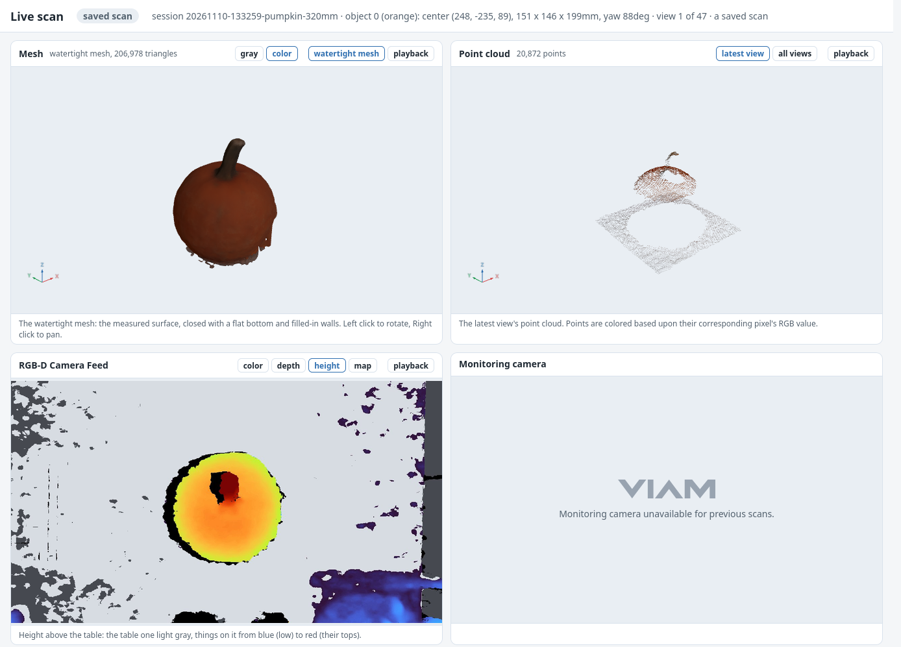
  <br><sub><b>REAL DATA.</b> The pumpkin's scan (2026-10-30) in <code>data_viewer.py</code></sub>
</p>

I wanted to see what the scanner was doing while it ran, without waiting for the final mesh. Every arm run (`scan.py` and `calibration.py`) starts a small web server on this computer and prints its link, `http://localhost:8765`, and the page follows the scan:

- **Mesh**, in 3D, in gray or in color: each captured view is fused into a preview while the arm moves on to the next one, so the scan takes no longer. The preview skips the alignment, closing and smoothing, so it's roughly the final `observed.obj`, unsmoothed. **Final mesh** shows the closed `mesh.obj` once the scan is done.
- **Point cloud**, in 3D: the latest view's points near the object, or every view so far.
- **RGB-D Camera Feed**: the latest capture, shown as color, as depth, or by height above the table. **Map** shows the survey's numbered map (§5.1).
- **Monitoring camera**: an optional second camera that watches the whole cell (any Viam camera component, `[live] monitor_camera`), streamed as live video.
- **Pause** holds the arm still before its next move, **End Scan** ends the run before the next move, and **STOP** halts the arm at once, mid-move (`arm.stop()`). The e-stop remains the real safety.

**Watching a saved scan:** `python data_viewer.py` (the most recent scan) or `python data_viewer.py 20261030-110809` shows a finished scan on the same page, stepping through its views, with the final mesh. It doesn't talk to the robot at all.

### 9.6 Output files

Each reconstruction writes these files to `data/<session>/object_NN/recon/`:

| File | What it is |
|---|---|
| `mesh.obj`, `mesh.ply` | Closed mesh with a flat bottom (the final model). PLY keeps vertex colors; OBJ doesn't. |
| `observed.obj`, `observed.ply` | Only the surface seen by 2+ views; open where nothing was seen. |
| `cloud.ply` | The fused surface points with normals (what Poisson closes). |
| `report.json` | Alignment corrections per view, per-view table offsets, how far each raw view lies from the result, mesh statistics. |
| `refined_poses.json` | Each view's camera pose after alignment. |
| `progression/views_NN/` | `mesh.*` and `observed.*` from the first N views; `views_01/raw_points.ply` is the first view's raw points. |
| `progression/summary.csv` | The metrics in [§6.1](#61-measuring-quality) for every N. |

### 9.7 Testing

`python -m pytest` runs 103 tests in about 3 minutes, without a robot. Besides unit tests (pose math against the machine's own numbers, depth decoding, edge filtering, detection, view geometry, the pose guard, ChArUco detection, and hand-eye recovery of a known mount), several tests run the whole pipeline on synthetic scenes and check it against the truth: fused meshes beat single views, mount calibration recovers a known error, closed meshes have the right volume, and the progression improves with more views.

### 9.8 Repository structure

```
calibration.py           the whole calibration in one command: camera, table, gripper
data_viewer.py           watch a saved scan in the viewer, with playback and the final mesh
scan.py                  command line: survey, plan, scan, calibrate, calibrate-board, reconstruct, progression, demo
config.toml              this cell's settings (address, workspace, survey grid, calibration files)
config_orbbec.toml       a template for a second rig (the Orbbec arm): fill in the lines marked SET
ground_truth.toml        caliper measurements of the test objects
calibration/             calibrated camera mounts (used for every move and capture)
  printed_objects/       3D-printed reference objects, one folder each: CAD (STEP), printed mesh (STL), info.toml
recon/
  config.py              every setting, with defaults and explanations
  robot.py               everything that talks to Viam: plan-only checks, moves, previews, pose guard, capture
  pipeline.py            survey → plan → capture → reconstruct, and calibration I/O
  scene.py               table plane, object detection, merging detections across views
  views.py, planner.py   candidate viewpoints, coverage, reachability and roll choice
  relocate.py            grasps, scan stations, pick and place (future work, disabled; §13.8)
  calibrate.py           camera-mount calibration from a scan
  board.py               ChArUco board: detection, hand-eye calibration, depth error model
  touchoff.py            touch-off: the real fingertip reach, by touching the table
  measure.py             measure meshes like calipers; compare with ground_truth.toml
  reconstruct.py         per-view table, joint alignment, TSDF fusion, observed mesh, reports
  bottom.py              closed mesh: flat bottom, straight-wall prior, Poisson
  progression.py         1..n view comparison and its metrics
  render.py, figures.py  offscreen renders and the figures saved with each scan (and used here)
  rgbd.py, transforms.py depth decoding and filtering, view files, depth previews, pose math (Viam conventions)
  live.py                the live viewer: preview fusion, pause/stop, its local web server
  survey_map.py          the numbered map of the table after a survey
  experiment.py          rebuild saved scans in variants and measure them (tools/compare.py)
  cad.py                 fit a printed object's CAD model to a scan; signed surface error
  handeye.py             hand-eye methods compared on board runs (ours, and Viam's solver)
  session.py             data/<session>/ layout
  synthetic.py           noisy synthetic RGB-D renderer with a camera-mount error
web/
  live.html              the viewer's page (three.js)
  viam_logo.svg          the Viam logo, shown in panels with nothing to show yet
tools/
  compare.py             compare variants of saved scans, or rigs (a table and a figure)
  compare_calibration.py compare hand-eye calibration methods on saved board runs
  viam_solve_batch.py    runs Viam's own hand-eye solver (needs .venv-opencv4, see recon/handeye.py)
  survey_map.py          draw the numbered map for an older session
  depth_previews.py      colored depth previews for older sessions
  render_mesh.py         render meshes to a PNG from the command line
  make_figures.py        this README's result figures
  make_noise_figure.py   one view at a time: color image and raw points per view
  make_object_gallery.py the scanned-objects gallery: final meshes, point clouds and their numbers
  package_dataset.py     zip a full scan for publishing (machine address removed)
  make_tsdf_diagram.py   the fusion diagram
  make_ring_diagram.py   the open-table ring diagram
tests/                   103 tests, mostly against synthetic ground truth
media/                   diagrams (SVG + PNG) and figures
```

---

## 10. Working Safely on a Shared Real Arm

The arm I developed on is shared and remote, so the code assumes that nobody may be watching it closely. These are the safeguards, many of which came out of the incidents in [§8.1](#81-hardware-and-platform):

- **Plan before moving.** The step-by-step commands only look and plan unless they're given `--execute`, `calibration.py` asks once before the arm moves, and `--plan-only` plans a whole scan or calibration without moving anything.
- **Every move can be previewed**, with its target and the joint changes from a plan-only check, before waiting for Enter. Typing `n` stops cleanly before the move.
- **Pose guard.** At startup, after every move, and at every capture, the arm's end pose according to Viam's frame system is compared with the arm controller's own. If they disagree by more than 2mm or 1°, the run stops before any further motion. It caught a 40° camera-configuration error before the first move ([§8.1](#81-hardware-and-platform)).
- **Every move must reach its target.** After each move, the arm's end is compared with where it was sent. If it finished more than 10mm or 5° away, the same move is tried again from wherever the arm ended up (`[capture] move_retries`, once by default), and if it still misses, the view is skipped rather than captured from the wrong place. During one bowl scan, the motion service reported two moves as complete while the camera had ended up facing away from the object.
- **The table is a slab 15mm above where it was measured.** The machine's configured table sat 6-11mm below the real one. Every plan, including the paths between views and not just their end points, treats the table as a slab over the whole search region, with its top 15mm above the measured surface at its highest point (plus any extra fingertip reach found by the touch-off) and a 200mm square cut out around the arm's base. The slab covers the whole path because the gripper once hit the table between two views ([§8.1](#81-hardware-and-platform)).
- **The camera has its own collision boxes.** With the gripper off, nothing in the machine's model covered the wrist, and the camera frame configured in the Viam app sat 44-75mm from the real camera. Every plan attaches two boxes to the arm's end through the calibrated mount: the camera body (a RealSense plus 20mm all round) and its bracket. When I tested a plan-only move with the camera 30mm above the table, the planner refused it for exactly that reason.
- **Everything on the table is an obstacle**, with a 15mm margin: the scan targets, and anything the survey skipped as a target (too big, too flat, or too crowded), which is saved with the survey as clutter.
- **Wrist limit.** Camera rolls that would take the last joint past ±200° are never chosen.
- **Every run that moves the arm starts at a ready pose.** Unless the camera is already within 10mm of it, one planned move through Viam's motion service takes the camera to the ready pose (about 322mm over the mat, looking straight down; `[machine] ready_camera_mm`), avoiding the table. It doesn't ask first, so once `scan.py` starts, the only questions are which objects to scan. Ctrl+C, the live viewer's STOP, or the e-stop stops it.
- **Ctrl+C sends `arm.stop()`** before disconnecting. The e-stop remains the real safety.
- **Pause, End Scan and STOP** are always available in the live viewer ([§9.5](#95-watching-a-scan-live)).
- **No view puts the camera less than 60mm above the table** (`min_camera_height`). This is checked before planning, independently of the planner's table slab.
- **The lowest ring asks first.** Before an object's first view below 12° (the 10° ring), the scan waits once at the terminal, so that the operator is watching.
- **Board level check.** `calibrate-board` refuses to plan views if the mat doesn't look level through the camera mount in use, which is what a wrong mount looks like.

---

## 11. Shortcomings and Proposed Solutions

Known gaps in the current version, and how I'd address each one.

| Shortcoming | Impact | Proposed solution |
|---|---|---|
| **Real objects come out 1.2-2.4mm too large on every side**, compared with the average caliper measurements. | Volumes are 15-33% high for objects this size, while heights are right to about 2%. The board calibration ruled out the camera mount and flat-surface depth, and the alignment step is a suspect ([§6.4](#64-what-can-be-tuned)). | Find out how the alignment step inflates the object, drop pixels near depth edges (on the cylinder's full scan, 0 → 2px takes the diameter error from +5.05 to +4.82mm), weight each reading by how squarely it sees the surface, and try the RealSense's own filters or a close-range camera. |
| **Real meshes are lumpy** at a scale of a few mm to a centimeter, where synthetic ones are smooth. | Smoothing settings barely change it (Poisson depth 7-9 and 5-15 smoothing steps all give a roughness of 0.112-0.116mm), so it's in the data. The likely cause is edge fattening varying from view to view: each view pushes the wall near its own silhouette outward by up to 2mm, and the views' silhouettes fall at different places around the object. The synthetic noise is independent from pixel to pixel and has no edge fattening, so it averages away. | Weight each reading by how squarely its view sees the surface, or drop grazing readings ([§13.5](#135-telling-noise-from-surface)), and compare with the calipers each time. |
| **Real noise levels off at about 0.10mm roughness.** | Beyond a few views, more views tighten the shape but don't make the surface smoother, because the RealSense's noise is partly correlated across pixels and views. | Vary the views more (distances and rolls), use the RealSense's own spatial and temporal filters, or use a camera better suited to close range (such as the D405). |
| **Scan-based calibration is blind to uniform scale.** | No scan-based calibration can see an error that inflates everything equally, and a good fit to one scene could hide a direction the scene can't constrain. | Calibrate with the ChArUco board (what `calibration.py` does), or calibrate from two or three objects, or against an object of known size. |
| **Sharp edges are rounded** by about one voxel. | The box's error is 0.25mm vs. the cylinder's 0.07mm, and it loses 1.7% of its volume. | Use smaller voxels near edges, less smoothing, or fit planes and edges for box-like objects. |
| **Priors assume flat bottoms and vertical unseen walls.** | Overhangs, hollows or tilted objects would be filled in wrong. | Use the measured share to flag models that lean on the priors, capture more views where it's low, or build a visual hull from many silhouettes for the unseen regions. |
| **Capture is slow over the cloud connection** (about 20s per view). | A full 37-view scan takes about 15 minutes, and a 50-frame full scan about 2 minutes per view. | Run the scanner next to the arm as a Viam module, stream depth only, or use 3 frames per view. |
| **A symmetric object's spin is unobservable.** | It's fine for shape, but texture would be smeared on a textured cylinder. | Colored ICP when the object has texture. |
| **The intermittent frame-system flip** has no known cause. | The pose guard catches it, but the run stops. | Log joints and frame-system poses at high rate around moves to reproduce it, then report it. |
| **Stop-and-go vs. continuous capture** hasn't been measured. | Stop-and-go is the slower, assumed-better choice. | Capture the same object both ways and compare them with the progression metrics. Capture already records timestamps and joints for every frame. |

---

## 12. Lessons for Other Developers

What I learned building this, for anyone attempting something similar:

- **Build a simulator with your real errors in it.** Noise alone isn't enough. Add a camera-mount error too, and every alignment idea can be scored against the truth before it touches the robot.
- **Calibrate the camera mount before anything else.** A 21mm / 2° mount error looked like noisy views that wouldn't align, and no amount of per-view alignment fixes a systematic error.
- **Keep the raw views.** Nearly every improvement here came from re-running reconstruction on captures that already existed.
- **Know what your geometry can't see.** A cylinder's spin and a flat surface's sliding can't be observed, and an optimizer that doesn't know that will invent motion along them. A weak prior toward the measured pose is the cleanest fix.
- **Check derivatives numerically.** A missing term in one Jacobian made every view rotate together by 10°, and a finite-difference check found it in a minute.
- **Check every threshold's exact meaning.** "Weight > 2" vs. "≥ 2", and Viam's pole rule for orientation vectors, each produced results that looked plausible and were wrong.
- **Self-consistency isn't accuracy.** Views agreeing to half a millimeter, a round cylinder and a stable volume were all true of a reconstruction that was about 2.5mm too wide. Caliper measurements found it.
- **Report what's measured and what's assumed.** A closed mesh always looks complete, and the measured share tells the truth about it.
- **On a shared arm, verify the world model, not just the commands.** The pose guard compares two independent sources of where the camera is, and it stopped a run with a camera configuration that was 40° wrong before the first move.
- **Make sure every crop contains the whole object.** A crop box from a coarser, earlier step quietly removed the same slice of the object from every view, and only a metric that compared against an independent closed surface exposed it.

---

## 13. Future Work

Fixes for the known shortcomings are in [§11](#11-shortcomings-and-proposed-solutions). Beyond those, these are the directions I'd like to take the project next.

### 13.1 Closing the size gap

The real cylinder and block come out 2.5-4.7mm too wide ([§3.2](#32-scanning-an-object-with-multiple-views), [§3.5](#35-the-real-cylinder-against-calipers)), even with the low rings, and the board calibration showed that it isn't the camera mount or flat-surface depth. The block's flat faces, seen head-on, come out too far out as well, so it isn't only curved surfaces or edges. Next, I'd like to:

- **Find out whether the alignment step inflates objects.** Turning it off more than halved the orange block's size error ([§6.4](#64-what-can-be-tuned)); scans of more objects, including the 3D-printed ones, will show whether that holds.
- **Drop or down-weight readings near depth edges and at grazing angles.** The 2px edge filter takes the cylinder's diameter from 32.62 to 32.22mm.
- **Try the RealSense's own depth settings** (the "High Accuracy" preset, and its spatial and temporal filters), and a camera made for close range (the D405).

### 13.2 Choosing the next best view

The scan currently visits fixed rings of viewpoints. A next-best-view planner would instead choose each next pose for what it's expected to add:

- **Information gain:** cast rays from each candidate pose into the current TSDF, and count the voxels it would see for the first time (unknown) or improve (low weight or high variance). This is the classic next-best-view formulation, and the voxel grid already holds what it needs.
- **Objectives to compare:** the fastest route to a watertight, mostly measured mesh (measured share per second of robot time, including travel), the smoothest surface (the largest expected drop in roughness or per-voxel variance), the most accurate result where it matters (edges, or a region a task cares about), or the least arm motion for a given coverage.
- **Constraints already in place:** every candidate can be checked with plan-only motion requests, and the travel cost can come from the planned joint change.
- **How to judge it:** the progression metrics already measure what each added view buys. A next-best-view planner should reach, say, 85% measured or a given roughness in fewer views (and seconds) than the fixed rings, on the same objects.

### 13.3 Learning which objects to scan, and how

- **Recognize and separate objects** with a vision model (open-vocabulary detection and segmentation, served through Viam's ML model and vision services) instead of clustering points above the table. That would also separate objects that touch, which clustering merges into one.
- **Prioritize** with a vision-language model (or a [vision-language-action](https://en.wikipedia.org/wiki/Vision-language-action_model) (VLA) policy: a model that takes camera images and a task described in words and outputs the robot's actions directly): which objects matter for the task, which are likely to be hard (shiny, transparent, thin, hollow), and which sides are probably still unseen. A model's uncertainty, or the mesh's measured share, can say which object needs more views next.
- **Use semantic priors** where the camera can't see. A mug has a handle and a hollow inside, and a box has flat, square faces. For known types of objects, priors like these could replace the generic straight-wall prior ([§6.2](#62-measured-vs-filled-in-observedobj-and-meshobj)).

### 13.4 Calibration that just works

- **Board-based:** run `calibrate-board` routinely (or on a schedule), and keep its mount, depth model and intrinsics check with each session.
- **Known objects:** a caliper-measured object, such as the green cylinder, is itself a calibration target. The depth model could be fit so that the scanned object matches its known size.
- **Compare with Viam's camera-calibration module.** A technical interviewer suggested looking at `viam:camera-calibration`, which Viam's team is using to calibrate cameras for its surface-finishing project. It provides a ChArUco pose tracker (`viam:camera-calibration:charuco`) and a hand-eye calibration service (`viam:camera-calibration:handeye`). My earlier lab setup had both configured but disabled. I've compared its solver with mine on saved board runs ([§5.5](#55-camera-calibration)); the next step is running the module end to end, including its own choice of views, on the same arm and board.
- **Self-calibration at startup:** turn the camera on, look at whatever is on the table from a few poses, and solve for the mount and the depth error together. The table plane (flat and level) and the board's level check already show that a few frames carry this information.
- **A 3D-printed calibration artifact:** a shape designed for this job and printed with precisely known dimensions (flat faces at several angles, a sphere or cylinder, steps of known height, and a few sharp edges). Scanning around it would give ground truth for every part of the pipeline at once: the mount and the depth error (fit so the scan matches the design), the edge fattening (from its edges), and the meshing choices (smoothing, voxel size and edge handling, scored against the true shape).
- **Watch for drift:** RealSense depth changes with temperature and time, so the scanner should re-check (the level test takes one frame) and warn when it changes.

### 13.5 Telling noise from surface

Fusion averages every reading that lands near the surface. That cancels random noise, but a bad reading still pulls its voxels' average a little, and a consistently bad one (a flying pixel that keeps coming back, or a reflective spot) can survive into the mesh. These are ways to recognize and drop readings like that instead of averaging them in:

- **Use surface smoothness:** the surfaces of objects like these are locally smooth, so a reading that disagrees sharply with its neighbors' local plane or curvature (a large depth gradient or normal change across a few pixels) is likely noise. It could be weighted down or dropped, as the edge filter already does for jumps at silhouettes.
- **Use agreement between views:** each voxel can track the spread of the readings it receives, not just their average. Readings far from the others are outliers, and voxels whose readings disagree widely can be flagged or re-measured.
- **Use the viewing angle:** readings of a surface seen at a grazing angle are noisier (and the edge fattening is worst there), so each reading could be weighted by how squarely its view sees the surface.
- **Use robust fusion:** combine readings with a median-like (robust) average rather than a plain mean, so a minority of bad readings can't move the surface.
- **Use color:** the color image shows an object's outline more sharply than the depth image, so a pixel whose color matches the table but whose depth puts it on the object is likely edge fattening or a flying pixel. On the orange block, 73% of the points more than 5mm outside the true outline weren't orange.

### 13.6 Two arms

A second arm could hold and turn the object while the camera arm scans it, or the camera could stay still while one arm presents every side of the object. Either way, the camera would see the bottom (removing the flat-bottom assumption), reach sides a single arm can't, and avoid moving the object to a scan station. It would need:

- both arms in one frame system, with their relative pose calibrated (the ChArUco mat again),
- collision checking between the arms and the carried object,
- the gripper masked out of the depth images (its geometry is known from the frame system), and
- the object's pose tracked as it moves, either from the gripper's pose or by registering each view to the growing model.

### 13.7 A second camera: the Orbbec Astra 2

Next, I'd like to scan the same objects with an Orbbec Astra 2, which is expected to give cleaner depth, and compare it with the RealSense side by side. Several settings here were chosen for the RealSense and need choosing again, on real scans, for the Orbbec: the edge filter (thresholds and growth), the depth range, the scan distance (each camera has a minimum range, 60cm for the Orbbec), the voxel size and truncation band, and the depth correction from the board. Each one is marked in [`recon/config.py`](recon/config.py). To compare the two cameras fairly, each is calibrated with the board and scans the same planned views of the same objects, and then I'd compare:

- **per view:** the depth error against the ChArUco board, noise on flat table, the share of pixels with no reading, flying pixels at edges, and noise across the frames taken at one pose;
- **fused:** the error against the calipers (how much too wide), wall roughness, volume, and how many views each camera needs to measure the whole object.

**Getting started on the Orbbec arm:** fill in [`config_orbbec.toml`](config_orbbec.toml) (every line marked `SET`: the address, credentials file, component and image-source names, workspace, and a ready pose for that arm), then run `python calibration.py --config config_orbbec.toml --plan-only`, then the same with the arm moving, and then `python scan.py --config config_orbbec.toml`. Capture accepts depth in Viam's format or as a 16-bit PNG. To compare, run `python tools/compare.py data/<realsense scan> data/<orbbec scan>`.

### 13.8 Moving objects the arm can't scan all the way around

Some objects sit where the arm can't reach enough of the way around them, for example close to its base or near the edge of the table. The next step would be to pick such an object up and move it somewhere it can be scanned:

1. **Find a scan station:** a free spot on the table where the planned views would cover the object fully.
2. **Grasp it:** a top-down grasp across the object's narrow side, with the approach, grasp and place poses all checked by the planner first.
3. **Carry it:** while it's carried, the object is attached to the gripper in the planner's world state, so it avoids obstacles too.
4. **Scan it, then put it back** where it was found.

A first version of this is in the code (`recon/relocate.py`), turned off (`[relocate] enabled = false`) and not yet tested on hardware. I took the gripper off on 2026-10-29 so the camera could reach more views, and so far every object has been fully coverable where it stood. With a gripper back on, the steps are:
- set `[machine] gripper`, and run the touch-off again to measure the real fingertips ([§5.5](#55-camera-calibration); the code is kept in `recon/touchoff.py`);
- measure the gripper's opening and jaw direction;
- test pick and place on its own before turning relocation on during scans.

### 13.9 Also

- **More kinds of objects.** So far I've scanned blocks, cylinders, a pumpkin, a mug, a cup, and 3D-printed objects; next could be a can, a water bottle, or a roll of tape.
- **Stop-and-go vs. continuous capture**, compared on the same objects.
- **Colored meshes.** Vertex colors are already fused; texture maps would need colored ICP and better color calibration.
- **Package the scanner as a Viam module** running next to the arm. Over the cloud connection, each 1.8MB depth frame takes about 2s to arrive, and running locally would cut a 50-frame view from about 2 minutes to a few seconds.

---

## 14. Feedback on Viam

### What Worked Well

- **Plan-only motion requests** (`do_command({"plan": ...})`) made reachability checks exact and fast (0.03-0.6s per pose), without writing any IK.
- **Targeting any frame in `motion.move`** makes it possible to aim the camera directly, which removes a whole class of transform bugs. (This scanner goes through its own calibrated camera mount instead, so the app's camera frame is only for display.)
- **The frame system's collision geometry** for the table and walls was enforced automatically, and `WorldState` transforms let a carried object be attached to the gripper.
- **`transform_pose`** gave me an authoritative check for my own pose math.

### Issues and Suggestions

- **Orientation vectors near the pole** read θ as the total turn about z. That's sensible but surprising, and nothing warns you when a configured value falls inside that zone. A warning in the app, or accepting quaternions everywhere, would prevent a silent 40° error.
- **`RotationMatrix.elements` is column-major**, and a note in the docstring would help.
- **The Python SDK's connection check** uses a fixed 1s timeout, which closes healthy connections during large transfers. It should be configurable, or skipped while a call is streaming.
- **`get_point_cloud()` over a cloud connection** dropped the connection at 1280×720. Documenting a size limit, or adding a decimation option, would help.
- **Once, the frame system reported a pose 180° off the arm's joints.** I couldn't reproduce it, but a built-in consistency check (frame system vs. controller) would be valuable on shared arms.

---

## Temp Section - Research Notes on Reconstruction Methods

*Working notes, gathered in October 2026, to guide what to try next; this section may be removed. The goal throughout: the most accurate 3D model possible from a noisy RGB-D camera. Every candidate should be judged on our real scans, against the calipers and, soon, against the CAD models of 3D-printed objects, not on synthetic data.*

### What this project uses now, with the original papers

| Step | Method | Paper / documentation |
|---|---|---|
| Fusing views | TSDF: a weighted average of each view's truncated signed distance in a voxel grid | Curless & Levoy, [A Volumetric Method for Building Complex Models from Range Images](https://graphics.stanford.edu/papers/volrange/) (SIGGRAPH 1996); the same idea run live in [KinectFusion](https://www.microsoft.com/en-us/research/publication/kinectfusion-real-time-dense-surface-mapping-tracking/) (ISMAR 2011) |
| Observed mesh | Marching cubes at the TSDF's zero crossing | Lorensen & Cline, [Marching Cubes](https://doi.org/10.1145/37402.37422) (SIGGRAPH 1987) |
| Closed mesh | Screened Poisson surface reconstruction | Kazhdan & Hoppe, [Screened Poisson Surface Reconstruction](https://hhoppe.com/proj/screenedpoisson/) (ACM TOG 2013), building on Kazhdan, Bolitho & Hoppe, [Poisson Surface Reconstruction](https://hhoppe.com/proj/poissonrecon/) (SGP 2006) |
| Smoothing | Taubin λ\|μ smoothing: two Laplacian passes with opposite signs, so the surface doesn't shrink | Taubin, [A Signal Processing Approach to Fair Surface Design](https://doi.org/10.1145/218380.218473) (SIGGRAPH 1995; [PDF](https://faculty.cc.gatech.edu/~jarek/graphics/papers/09FairingTaubin.pdf)). Plain Laplacian smoothing, which shrinks, and its implicit form: Desbrun et al., [Implicit Fairing of Irregular Meshes](https://doi.org/10.1145/311535.311576) (SIGGRAPH 1999). Both are in [Open3D's mesh filtering](https://www.open3d.org/docs/release/tutorial/geometry/mesh.html) |

### 1. Better depth before fusion (most promising for our size error)

Our meshes are 3-4mm too wide while the views agree with each other, so the error is in the depth readings themselves, near edges and at grazing angles. Fixing the input is likely worth more than any meshing change.

- **Weight each reading by how much to trust it.** Depth-camera noise grows with distance squared and sharply at grazing angles ([Nguyen, Izadi & Lovell, 3DIMPVT 2012](https://computer.org/csdl/proceedings-article/3dimpvt/2012/4873a524/12OmNAlvHUP), measured on the Kinect). TSDF systems use that as a per-reading weight: [Voxblox](https://arxiv.org/abs/1611.03631) weights by distance; a [directional TSDF](https://arxiv.org/abs/2301.12796) adds the viewing angle without per-sensor calibration. Our fusion weights every reading equally. **Cheap to try on our saved scans.**
- **The camera's own processing.** Intel's [tuning guide](https://dev.intelrealsense.com/docs/tuning-depth-cameras-for-best-performance) covers presets ("High Accuracy"), spatial/temporal filters and the RMS error model (noise ∝ distance² / (focal length × baseline)). Needs new captures.
- **Learned stereo on the RealSense's own infrared pair.** The RealSense computes depth by matching its two infrared images. [FoundationStereo](https://nvlabs.github.io/FoundationStereo) (NVIDIA, CVPR 2025, [arXiv](https://arxiv.org/abs/2501.09898)) is a zero-shot stereo model; its authors report it works on RealSense D4xx infrared pairs, with sharper edges than the onboard matcher. This attacks edge fattening at its source. Needs the infrared images captured (if the Viam camera module exposes them) and a GPU.
- **Depth refinement with foundation-model priors.** [Prompt Depth Anything](https://arxiv.org/abs/2412.14015) (CVPR 2025) uses low-resolution metric depth as a "prompt" for a monocular depth model and outputs sharp, high-resolution metric depth; [Perfecting Depth](https://arxiv.org/abs/2506.04612) (2025) targets noisy sensor depth with uncertainty estimates to drop unreliable pixels. Both were trained on other sensors; whether they help a close-range RealSense needs testing.

### 2. Fusion and surfaces beyond averaging

- **Learned depth fusion.** [RoutedFusion](https://arxiv.org/abs/2001.04388) (CVPR 2020) and [NeuralFusion](https://arxiv.org/abs/2011.14791) (CVPR 2021) replace TSDF averaging with networks that learn a sensor's noise and outliers. They need training data from the sensor (our scans plus CAD ground truth could become that).
- **Neural implicit surfaces from RGB-D.** [Neural RGB-D Surface Reconstruction](https://arxiv.org/abs/2104.04532) (CVPR 2022) stores the TSDF in a network and uses color to fill where depth is missing; [BundleSDF](https://arxiv.org/abs/2303.14158) (CVPR 2023) reconstructs a single unknown object from RGB-D video while tracking it, which matches our object-centered setting. Minutes of GPU training per object.
- **Gaussian splatting surfaces.** The most active area: [2D Gaussian Splatting](https://arxiv.org/abs/2403.17888), [PGSR](https://github.com/zju3dv/PGSR) and Gaussian Opacity Fields report 0.5-0.8mm Chamfer error on the DTU benchmark (from images alone; numbers vary between papers). With depth: [DN-Splatter](https://arxiv.org/abs/2403.17822) (WACV 2025) found sensor depth a much stronger signal than monocular depth; [AGS-Mesh](https://arxiv.org/abs/2411.19271) filters noisy sensor depth by checking it against predicted normals. Most still extract meshes by TSDF fusion or Poisson at the end, so they would slot in ahead of our existing steps.
- **Learned meshing from points.** [Neural Kernel Surface Reconstruction](https://research.nvidia.com/labs/toronto-ai/NKSR) (NVIDIA, CVPR 2023) is a drop-in alternative to Poisson for large, noisy point clouds.

### 3. Smoothing and denoising

- **Feature-preserving mesh denoising** smooths flat regions but keeps sharp edges, which Taubin and Laplacian smoothing round off (our blocks lose about one voxel at each edge). Bilateral normal filtering ([Zheng et al., 2011](https://i.cs.hku.hk/GraphicsGroup/publications/pdf/Feature-Preserving%20Mesh%20Denoising%20via%20Bilateral%20Normal%20Filtering.pdf)) and guided normal filtering are the standard choices; [this survey](https://arxiv.org/abs/2209.00841) (ACM TOMM 2023) compares geometric and learned methods.
- **Point cloud denoising before meshing:** [Score-Based Point Cloud Denoising](https://arxiv.org/abs/2107.10981) (ICCV 2021) moves noisy points toward the most likely surface.
- **Caution:** smoothing reduces roughness but can't fix a systematic offset (our walls being too far out); judge it against the calipers and CAD, not only roughness.

### 4. Concave and convex shapes

- **TSDF fusion already handles concavities**: it records free space in front of every reading, so a mug's cavity is carved out wherever a view sees into it. The limits are visibility and closing:
  - **Visibility:** a cavity is only seen from views looking into its opening, at steep angles where depth is noisiest. That argues for next-best-view planning (aim views where the model is still unknown) over fixed rings.
  - **Closing:** our flat-bottom, straight-wall closing assumes a solid; for a mug it would cap the opening. A visual hull (from silhouettes) can't help either: it is always the convex envelope ([space carving](https://doi.org/10.1023/A:1008191222954), Kutulakos & Seitz, IJCV 2000). Options: leave unseen regions open, or close only where views confirm the inside is empty.
- **Shape completion** fills unseen parts (like the bottom) with learned priors: [RealDiff](https://arxiv.org/abs/2409.10180) (trained on real scans), [SC-Diff](https://arxiv.org/abs/2403.12470) (completes TSDFs), [ComPC](https://arxiv.org/abs/2404.06814) (ICLR 2025, no category training). Their output is a plausible guess, not a measurement, so it belongs in the "filled in" share, never the measured one.

### 5. Using the color image to sharpen depth

The color camera has no edge fattening: an object's outline in the color image is sharp to about a pixel, while the depth image pushes it outward by a few pixels. That suggests fusing the two:

- **Object masks from a segmentation model.** [SAM 2](https://ai.meta.com/research/sam2/) (Meta, 2024, [paper](https://arxiv.org/abs/2408.00714)) outlines an object in an image from a single click or box (or follows it through a sequence of frames). We already know where each object is, so the scan could prompt it automatically.
- **Silhouette carving.** With a mask per view, any voxel that projects *outside* the object's mask in some view must be empty space. That trims exactly the outward-bulging edge readings that make our meshes too wide, using views we already capture. It is the visual-hull idea ([§4 above](#4-concave-and-convex-shapes)) used as a check on the depth, not as the shape.
- **Color-guided edge repair in each depth image.** Pixels that look alike in color are likely on the same surface: [Color-Guided Flying Pixel Correction](https://arxiv.org/abs/2410.08084) (2024) uses this to re-estimate flying pixels; classic joint bilateral and guided filters do the same more simply.
- **Learned depth refinement from RGB:** [Prompt Depth Anything](https://arxiv.org/abs/2412.14015) and [Perfecting Depth](https://arxiv.org/abs/2506.04612) (§1 above) take color plus sensor depth and return sharper metric depth.
- **What it depends on:** the depth and color images must line up to within a pixel or so. The RealSense aligns them itself; how well can be checked on our saved views at the board's corners.

### 6. Suggested order, judged on real scans

1. **Angle- and distance-weighted fusion** on the saved 34-view block and cylinder: offline, no new captures. Measure the width error against the calipers.
2. **Feature-preserving denoising vs. Taubin** on the same scans.
3. **Silhouette carving with object masks** (SAM 2 or a simpler color mask) on the same scans: no new captures, aimed straight at the size error.
4. **Scan closer** (within the camera's minimum range) and try the RealSense presets/filters: new captures.
5. **FoundationStereo on the infrared pair**: new captures and a GPU model.
6. **Test on harder objects** (mug, bottle, pumpkin, tape roll, 3D-printed shapes) to see where the flat-bottom closing and the fixed rings break down.
7. **A neural or Gaussian method** (BundleSDF, a depth-supervised 2DGS) as a heavier comparison, once the 3D-printed objects give exact ground truth.

---

## Temp Section - Review

*Earlier text replaced by code changes, kept here for review. Newest first; each entry says what replaced it.*

### 2026-10-30: the live preview's table (§9.5)

Replaced by cropping each view at its own table fit:

> | Where the table is (pixels just above it are left out) | The survey's table | Each view's own fit of the table nearby |

### 2026-10-30: the ready pose (§10, §8.1, §9)

Replaced by one planned move through Viam's motion service, without a prompt, so a `scan.py` run only asks which objects to scan; the start-up "Start? [y/N]" question was removed too. Old text:

> - **Every run that moves the arm starts at a ready pose.** It reads the arm's joints, and if they aren't already at the ready pose (camera about 320mm over the mat, looking down; `[machine] ready_joints_deg`), steps there one joint group at a time: forearm roll, wrist, shoulder and elbow, then base, each shown and confirmed at the terminal. See the free-move incident in [§8.1](#81-hardware-and-platform).

### 2026-10-30: candidates near the arm's base, and the box (§5.1)

Replaced after two pumpkin surveys in a row rejected the pumpkin as "not in open table": the base cut-off at 350mm removed its near third, and the leftover part counted against it in the ring. Old text:

> 3. **Candidates:** keep points 8-500mm above the table, inside the search region, and away from the arm's base; average them into 2mm voxels; remove statistical outliers.

> 5. **Boxes:** for each cluster, the smallest rectangle around its footprint (rotating calipers on its convex hull) gives the center, length, width and heading; the height runs from the table to the 98th-percentile top.

### 2026-10-29: uncalibrated vs. calibrated table (§3.4)

Replaced after the closing changes of 2026-10-28 (walls from the lowest seen surface, table scraps, the balloon check): the numbers below were measured on closed meshes, which the uncalibrated views can't reliably produce any more. The new table measures the observed surface, from the table up. Old text:

> | Camera mount | Alignment | Views disagree by (median) | Diameter (calipers 29.53mm) | Roundness |
> |---|---|---|---|---|
> | Uncalibrated | off | 3.66mm | 57.05mm | 2.13mm |
> | Uncalibrated | on | 2.47mm | 52.87mm | 3.55mm |
> | Calibrated | off | 0.76mm | 30.87mm | 1.22mm |
> | Calibrated | on | 0.53mm | 32.22mm | 0.29mm |
>
> One open question: with the calibrated mount, turning alignment *off* gives a diameter 1.35mm closer to the calipers, though a far less round one.

### 2026-10-28: the straight-wall prior (§5.8)

Replaced by walls that hang from the lowest place the surface was seen, after the pumpkin's closed mesh came out as a cylinder below its widest point even where the 25° views had measured the surface curving in. Old text:

> - a **wall that was never seen** most likely drops straight down from that outline.
>
> The final `mesh.obj` is a screened Poisson surface fit through the observed surface points (with their normals), plus points filling the bottom outline (normals pointing down), plus straight-wall points only where no observed surface lies within 3mm.

### 2026-10-28: the open-table rule (§5.1)

Replaced by the seen-only rule with a cap on unseen table, after the survey rejected a 200mm-tall pumpkin: its own shadow hid 11% of its ring and counted as "not table" (87% < 90%). Old text:

> - not in open table: less than 90% of a ring 5-60mm around its footprint is bare table (within 5mm of the plane). That rules out cords at the table's edge, things in a gap between tables, and things beside a power strip. It also means two objects closer than about 60mm reject each other.

> On the armfarm14 table, the survey found 10 things above the table: the three blocks, the arm's base and its cables, a clamp-on power strip at the table's edge, and cords. The rules above keep exactly the three blocks.

---

## Temp Section - temp-important-results

*Results from comparisons that aren't written up in the sections above yet, collected 2026-11-03 for review. Size errors are against the average caliper measurements (cylinder errors from before 2026-11-03 converted to the new average); CAD errors are for the 3D-printed objects. Results folders are in `data/experiments/`.*

**1. Turning alignment off helps the toy objects but hurts the 3D-printed block** (E1, 2026-10-29, 34-view 5-frame scans; `20261029-1857..1902-E1-align-edge-*`). This complicates the open question about alignment in §3.4 and §6.4.

| Object | Alignment on | Alignment off |
|---|---|---|
| Orange block (width, length) | +3.9, +4.0mm | **+2.2, +2.2mm** |
| Green cylinder (diameter) | +2.5mm | **+1.2mm** |
| 3D-printed block (width, length; CAD bias) | **+0.6, +1.4mm; −0.41mm** | +1.6, +2.8mm; −0.29mm |

With alignment off, the views disagree almost twice as much (0.57 → 1.0mm) and the measured surface is rougher on every object. On the full scans (§6.4), alignment off helped the orange block a lot (+4.4 → +0.7mm) and the cylinder less (+4.4 → +3.3mm).

**2. Leaving grazing readings out of the alignment makes the toy objects smaller, and the printed block more accurate in size but worse in shape** (E7, `align_max_incidence_deg`, same scans; `...-E7-align-incidence-*`). The alignment only uses readings that see the surface within the given angle; fusion still uses everything.

| Limit | Orange block | Green cylinder | 3D-printed block (width, length; CAD median, bias) |
|---|---|---|---|
| 90° (the default: no limit) | +3.9, +4.0mm | +2.5mm | +0.5, +1.5mm; 0.89mm, −0.54mm |
| 75° | +3.4, +3.6mm | +2.1mm | +0.0, +1.5mm; 1.02mm, −0.59mm |
| 60° | **+3.2, +3.2mm** | **+2.1mm** | −0.4, +0.6mm; 1.18mm, −0.72mm |
| 45° | +3.4, +3.5mm | +2.2mm | +0.1, +0.2mm; 1.24mm, −0.79mm |

**3. A narrower TSDF truncation band is more accurate, at the cost of noise and some holes** (E3; `...-E3-voxel-trunc-*`). With 1.5mm voxels, a 3mm band (vs. the default 6mm) took the cylinder from +2.5 to +2.0mm and the block from +3.9, +4.0 to +3.3, +3.3mm, and the heights 0.2mm closer. The measured surface's roughness rose 10-15%, and the block's measured share fell from 88% to 80%. A 9mm band was worse on every count.

Re-run on 2026-11-03 with HC Laplacian on every mesh (`...-hc-trunc-*`, `...-hc-voxel-*`; figures `media/images/tsdf_truncation_*.png`, `tsdf_voxel_*.png`):

| Band (1.5mm voxels) | Orange block, full scan (width, length / height) | Green cylinder, full scan (diameter / height) | Bowl, full scan: CAD median / bias, measured share | Cup / mug: final-mesh roughness |
|---|---|---|---|---|
| 2mm | +4.0, +4.2 / +0.4mm | +3.8 / +0.7mm | 0.96 / −0.62mm, 70% | 0.348 / 0.243mm |
| 3mm | +4.3, +4.5 / +0.5mm | +4.3 / +0.8mm | 1.09 / −0.76mm, 82% | 0.142 / 0.168mm |
| 4.5mm | +4.1, +4.6 / +0.8mm | +4.4 / +1.0mm | 0.98 / −0.22mm, 87% | 0.086 / 0.103mm |
| 6mm (default) | +4.2, +4.6 / +0.9mm | +4.3 / +1.1mm | 1.03 / +0.34mm, 89% | 0.074 / 0.083mm |
| 9mm | +4.2, +4.7 / +1.1mm | +4.7 / +1.3mm | 1.71 / +1.24mm, 85% | 0.083 / 0.084mm |

On the full scans, a narrower band mainly improves the height of the solid objects (up to 0.6mm). On the thin-walled bowl, 2-3mm breaks the wall apart (the views disagree by 2-3.6mm and it shrinks inward), 9mm thickens it, and 4.5mm is the most accurate (bias −0.22mm). The cup's and mug's volumes change two- to three-fold with the band, so it strongly shapes thin walls. Voxel size (6mm band): 2.0mm voxels are slightly smoother and more accurate than 1.5mm on the block and cylinder, and 1.0mm worse; on the bowl only 1.5mm works (1.0mm: 25% measured and the closing balloons; 2.0mm: the closing fails). These scans are from the 280mm standoff; confirm on the 320mm re-scans before changing the defaults (4.5mm looks like a good compromise).

**4. Smoothing the measured surface with Laplacian instead of Taubin makes it much smoother without changing the size** (E4; `...-E4-mesh-*`): measured-surface roughness 0.12 → 0.09mm (block), 0.13 → 0.09mm (cylinder), 0.25 → 0.18mm (printed block), with size errors within 0.1mm. The final, closed mesh isn't smoothed at all (only the measured surface is), so it wasn't affected. The closing method (flat bottom vs. plain Poisson) changed nothing measurable on these objects.

**5. The full scans are less accurate than the older, lower-view scans of the same objects.** Green cylinder: +2.44mm (25 views, 2026-10-26) and +2.50mm (34 views, 2026-10-28) vs. +4.60mm (50 views, 2026-11-03, full scan). Orange block: +3.8, +4.0mm (34 views) and +3.7, +3.8mm (39 views, 50 frames) vs. +4.4, +4.7mm (49 views, full scan). The full scans added the 10° and 15° rings; rebuilding a full scan without its lowest views would show whether those views make objects wider.

**6. More frames per view don't make objects more accurate** (E5, the orange block's 39-view full scan of 2026-10-29): 1 frame gave a 6.6% size error, 5-50 frames 8.6-9.0%, while the roughness fell from 0.143 to 0.108mm. The same as on the 2026-11-02 full scan (§6.4).

**7. The stray points far outside an object are mostly the table's color** (the orange block's full scan): 73% of the wall points more than 5mm outside the true outline aren't orange, but 97% of all wall points are, and they still sit a median 1.5mm too far out. So color could remove strays, but not the size error.

**8. The cup and mug against the new caliper measurements** (their 5-frame scans of 2026-10-30): both come out short (cup 56.0mm vs. 57.0mm, mug 94.3mm vs. 95.9mm). The cup's rim is 76.2mm across vs. 72.7mm (+1.75mm per side, like the other objects). At its lowest visible height (6-12mm up) the cup is 66mm across, far from the roughly 48mm traced around its base: probably a narrower foot that no view can see.

**9. Rebuilding the same scan with identical settings varies by about ±0.15mm in diameter** (the table fit and the GPU fusion aren't perfectly repeatable), so differences smaller than about 0.3mm between settings aren't meaningful.

**10. The new caliper averages didn't change any decision** (2026-11-03): re-scoring all 36 saved comparisons of the orange block and green cylinder against the new averages left every ranking the same, because every setting overestimates the size.

**11. Glossy surfaces read too far away** (the mug, 2026-10-30; `20261030-mug-reflections/`): reflections on the glossy mug put some surface behind where it really is. Leaving out the views most affected changed the mesh (`mug_compare.png`), but there's no general fix yet (matte spray, a different camera, or skipping views).

**12. Smoothing methods on the final mesh** (2026-11-03, the full scans; `...-smooth-final-*`). Each method applied with 5 steps to the final mesh; "none" is how the final mesh was built until now (not smoothed):

| Method | Final-mesh roughness (block / cylinder / bowl) | Block width, length / height | Cylinder diameter / height | Bowl: CAD median / bias / height |
|---|---|---|---|---|
| none | 0.092 / 0.095 / 0.229mm | +4.40, +4.72 / +1.08mm | +4.74 / +1.22mm | 1.10 / +0.43 / +1.38mm |
| taubin | 0.088 / 0.092 / 0.219mm | +4.36, +4.72 / +1.14mm | +4.40 / +1.23mm | 1.11 / +0.45 / +1.64mm |
| laplacian | 0.071 / 0.082 / 0.174mm | +4.25, +4.65 / +0.99mm | +4.55 / +1.11mm | 1.07 / +0.40 / +1.04mm |
| simple | 0.067 / 0.076 / 0.140mm | +4.20, +4.61 / +0.94mm | +4.59 / +1.13mm | 1.06 / +0.35 / +0.93mm |
| hc_laplacian | 0.064 / 0.076 / 0.140mm | +4.18, +4.61 / +0.95mm | +4.27 / +1.07mm | 1.07 / +0.39 / +0.89mm |
| cotangent_laplacian | 0.074 / 0.079 / 0.166mm | +4.28, +4.63 / +0.96mm | +4.62 / +1.15mm | 1.06 / +0.40 / +0.92mm |
| two_step | 0.069 / 0.083 / 0.128mm | +4.89, +5.07 / +2.16mm | +4.30 / +2.35mm | 1.07 / +0.40 / +4.31mm |
| scale_dependent | 0.086 / 0.093 / broke the mesh | +4.35, +4.70 / +1.07mm | +4.61 / +1.18mm | – |

HC Laplacian and `simple` smooth the final mesh the most (30-39% less rough) and slightly improve accuracy, without adding anything (the bowl's CAD error and bias both go down slightly). Taubin, the method used so far, barely smooths at 5 steps. `two_step` makes every object 1-3mm taller (an added feature), and `scale_dependent` destroyed the bowl's mesh. Size differences under about 0.3mm are within rebuild noise.
