<p align="center">
  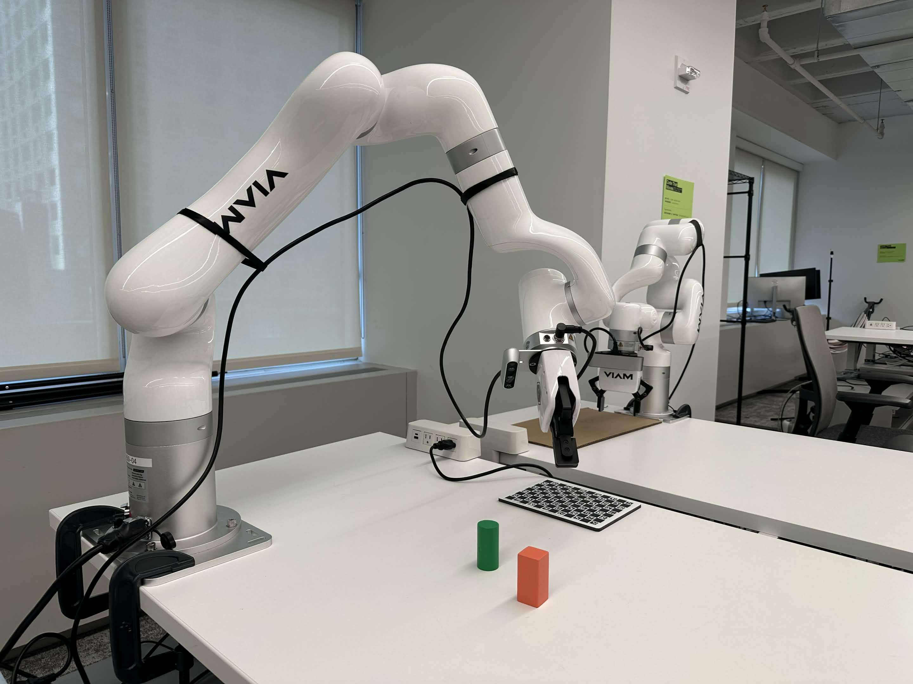
  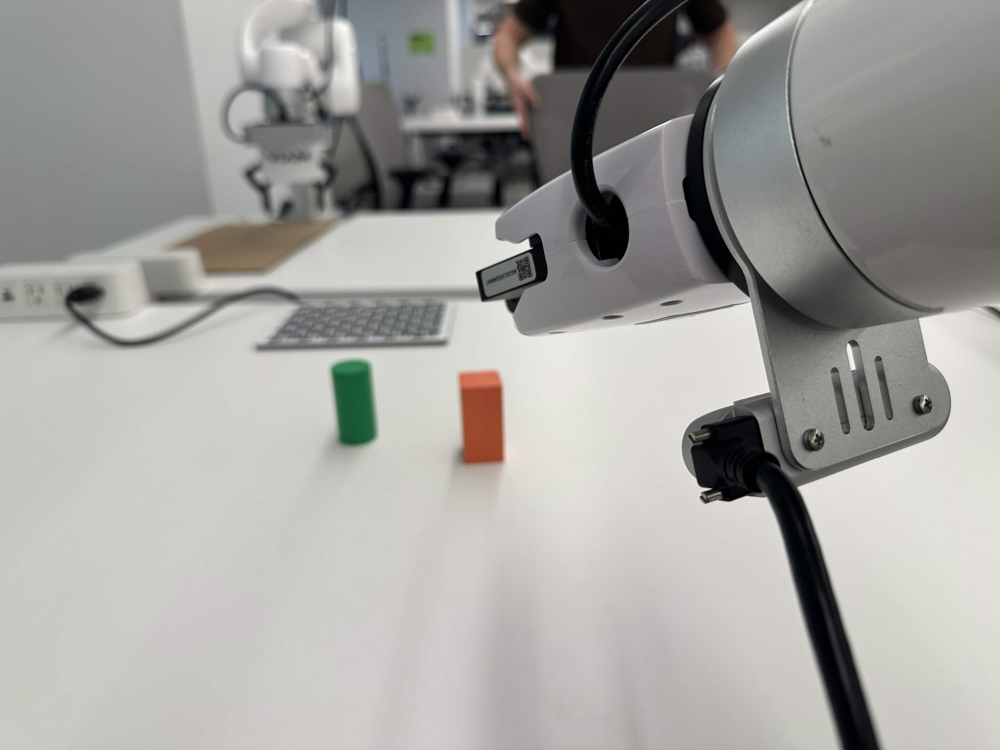
  <br>
  <em>The xArm6 on armfarm14 with its wrist-mounted RealSense, the ChArUco calibration mat, and two test objects.</em>
</p>

<h1 align="center">ViamObjectReconstruction by Cameron Lerch</h1>

ViamObjectReconstruction finds the objects sitting on a table, drives a [Viam](https://www.viam.com/)-controlled robotic arm with a wrist-mounted Intel RealSense depth camera around each one, and stitches the views into a separate 3D mesh per object. A single RealSense view is noisy and sees only one side; fusing many views from known arm poses averages the noise away and fills in the sides, and the result is closed with a flat bottom where the object rests on the table.

It runs on a UFactory xArm6 in a remote lab cell (armfarm14) and includes a synthetic RGB-D simulator, so the whole reconstruction pipeline can be developed and scored against known shapes without a robot.

---

## Quick Start

> [!NOTE]
> You need a Viam machine with an arm, a depth camera mounted on the arm, and the builtin motion service ([Machine Configuration](#102-machine-configuration)). This is the shortest path; every other command, option and setting, the tests, and running without a robot are in [Setup and Usage](#10-setup-and-usage).

**1. Install**

```bash
git clone git@github.com:cameron-lerch/ViamObjectReconstruction.git
cd ViamObjectReconstruction
python3 -m venv .venv && source .venv/bin/activate
pip install -r requirements.txt
```

Put the machine's API key in `apikey.json` as `{"key": "...", "key_id": "..."}` and its address in `config.toml`.

**2. Calibrate** (once per setup, with the ChArUco mat on the table)

```bash
python calibration.py
```

It asks once before the arm moves, then finds the mat and calibrates the camera, surveys the table, and (when a gripper is mounted) asks whether to run the touch-off (you at the arm, with a sheet of paper). `python calibration.py --plan-only` plans every step without moving.

**3. Scan**

```bash
python scan.py
```

It asks once before the arm moves, surveys the table, lists the objects it found (with their centers, sizes and colors), and asks before scanning each one. When it's done, the arm parks over the mat and every mesh and figure is built. While it runs, open the printed link (`http://localhost:8765`) to watch the scan live, with Pause and Stop buttons ([§5.12](#512-watching-a-scan-live)). `python scan.py --plan-only` plans without moving; `--max-views 16` scans in about half the time; `--full-scan` takes 50 frames per view and keeps every raw frame (a dataset to subsample later; about 2 minutes per view).

**4. Results** are in `data/<session>/object_NN/`: `recon/mesh.obj` (the closed model), `recon/observed.obj` (only what was measured) and `progression.png` (the model from 1 to all views). Open the meshes in Blender; units are millimeters, so scale the import by 0.001.

---

## Table of Contents

1. [Problem Statement and Goals](#1-problem-statement-and-goals) (including [Breaking Down the Problem](#11-breaking-down-the-problem))
2. [Approach](#2-approach)
3. [Results](#3-results)
4. [System Architecture](#4-system-architecture)
5. [Methodology](#5-methodology)
6. [Measured vs. Filled In](#6-measured-vs-filled-in)
7. [Critical Design Decisions](#7-critical-design-decisions)
8. [What I Tried That Didn't Work](#8-what-i-tried-that-didnt-work)
9. [Mesh Files and Their Sizes](#9-mesh-files-and-their-sizes)
10. [Setup and Usage](#10-setup-and-usage)
11. [Working Safely on a Shared Real Arm](#11-working-safely-on-a-shared-real-arm)
12. [Repository Structure](#12-repository-structure)
13. [Shortcomings and Proposed Solutions](#13-shortcomings-and-proposed-solutions)
14. [Lessons for Other Developers](#14-lessons-for-other-developers)
15. [Future Work](#15-future-work)
16. [Feedback on Viam](#16-feedback-on-viam)

---

## 1. Problem Statement and Goals

Use a robotic arm with a wrist-mounted RealSense camera to:

|  | Requirement |
|---|---|
| 1. | Automatically find the objects sitting on the table |
| 2. | Plan a path of camera viewpoints around each object that the arm can actually reach |
| 3. | If the arm can't reach enough of the way around an object, grasp it and move it somewhere it can be scanned |
| 4. | Stitch the point clouds from many views of the same object into a mesh that is much more accurate than any single view |
| 5. | Produce an individual 3D model of each object, separated from the table and the other objects |

**Additional goals:** treat the bottoms as flat (the objects rest on the table), quantify how much each additional view improves the result, and never surprise anyone on a shared lab arm.

One lesson carried over from an earlier attempt shaped the capture design from the start: point clouds were noticeably better when the arm **moved to a pose, stopped, and captured**, than when capturing on the fly while the arm moved.

### 1.1 Breaking Down the Problem

When I started, I assumed the main job was to stitch the views together and average their point clouds. It turned out to be one part of three, and the other two (knowing exactly where each view was taken, and how the averaged measurements become a mesh) were at least as important.

**1. Where to look: choosing the viewpoints**

- **Coverage:** every part of the surface has to be seen by some view, or it can only be guessed.
- **Repetition:** the same surface seen from several views is what averages the sensor noise away. Views that don't overlap add coverage but no noise reduction.
- **Overlap for alignment:** views are lined up with each other through the surface they share, so neighboring views must overlap.
- **Reachability and cost:** every view has to be reachable without collisions, and each one costs about 20s on this setup.

**2. Knowing exactly where each view was taken**

- **The camera's mount on the wrist** must be calibrated; here it was 21mm and 2.2° off ([§5.6](#56-camera-calibration)).
- **Each view's pose** is refined by aligning the views to each other ([§5.7](#57-stitching-aligning-the-views)).
- **The depth readings themselves** must be accurate. The real cylinder came out 3mm too wide while every view agreed with every other ([§3.5](#35-the-real-cylinder-against-calipers)).

No smoothing can fix a view that is in the wrong place, and this part has caused the largest errors in the project.

**3. Turning the measurements into a surface**

- **Averaging:** a TSDF averages every view's depth in 1.5mm voxels ([§5.8](#58-fusing-the-views-tsdf)); its zero crossing is the surface. Most of the "smoothing" happens here, as averaging, rather than as smoothing a rough mesh afterward.
- **Resolution:** the voxel size sets the mesh's resolution. Smaller voxels keep more detail but average fewer readings each.
- **What to keep:** surface seen by fewer than 2 views is dropped as untrustworthy.
- **Light smoothing** (5 Taubin steps) removes leftover ripple without shrinking the mesh.
- **Sharp edges** get rounded by about one voxel: the synthetic box's error is 0.25mm against the cylinder's 0.07mm.
- **Filling what was never seen** needs a best guess. Here that is a flat bottom and straight walls, joined to the measured surface by Poisson reconstruction, which continues it smoothly across gaps ([§5.9](#59-closing-the-mesh-with-a-flat-bottom)).

**Assumption: objects have flat bottoms.** The objects rest flat on the table, and the camera can never see underneath them, so the bottom is always filled in: the object's outline seen from above, laid flat on the table plane. This assumption is only true for objects like these. The [measured share](#6-measured-vs-filled-in) says how much of each final mesh comes from measurement and how much from this and the straight-wall guess.

**What "watertight" means.** A watertight (closed) mesh has no holes: every edge of every triangle is shared by exactly two triangles, so the surface completely encloses a volume, with a well-defined inside and outside. That is what makes a volume measurable and the mesh 3D-printable or usable in a physics simulator. The observed surface alone is never watertight: its underside is open and it has gaps wherever no view reached. Adding the flat bottom (and filling unseen walls) is what makes the final `mesh.obj` watertight. Strictly, a mesh with tiny self-intersections, which fusion always leaves, is still closed in this sense; [§8.4](#84-closing-the-mesh) explains why that distinction mattered.

**4. Measuring the result.** Consistency between views measures precision, not accuracy. The synthetic objects have a known true shape, and the real cylinder now has caliper measurements; both are needed to know whether a change actually helped.

---

## 2. Approach

I split the work into stages and tested each before moving on:

1. **Find and verify the hardware model.** Probe the machine read-only: arm kinematics, frame system, camera intrinsics, depth format, and whether the motion planner can check a pose without moving.
2. **Build the reconstruction offline first.** A synthetic RGB-D renderer ([`recon/synthetic.py`](recon/synthetic.py)) produces views of known shapes with RealSense-like flaws (depth noise growing with distance², flying pixels at edges, dropouts) and a deliberate camera-mount error. Every reconstruction idea was scored against the true shapes before it touched real data.
3. **Plan and capture on the real arm, carefully.** Plan-only checks first, then one move at a time with previews, then small scans (3 views), then larger ones (25 views).
4. **Let the real data drive the fixes.** Each real run exposed something the simulator hadn't: a 21mm camera-mount error, a table 7mm higher than measured, walls the RealSense can't see from steep angles, slow cloud downloads. Each one is documented in [§8](#8-what-i-tried-that-didnt-work).

---

## 3. Results

Every figure in this README is labeled under its caption: **REAL DATA** was captured on the armfarm14 arm; **SYNTHETIC DATA** comes from simulated RealSense views of shapes whose exact geometry is known, used where an exact answer is needed to score against; a **DIAGRAM** shows no data.

### 3.1 The latest scans: one view at a time, and 1 to 34 views

The most complete real scans so far (session 20261028-093620): an orange block and a green cylinder, 34 views each, including the low 25° ring. Each column below is one view: the color image on top, and under it that view's depth as points with nothing removed (no edge filter, no outlier removal), all drawn from the same side-on direction. Each color image is turned (in 90° steps) so the table is at the bottom, and the small arrows in each panel's corner show the world x, y and z axes (a circled dot is an axis pointing straight at the viewer, as z does in the views from directly above). One view sees only the faces turned toward it; its walls are wavy and ribbed where they should be flat, the table shows depth "stair steps", and edges smear into the table. All 34 views placed by the arm's poses overlap into a fuzzy shell several millimeters thick; fusion turns that into the mesh at the bottom right.

<p align="center">
  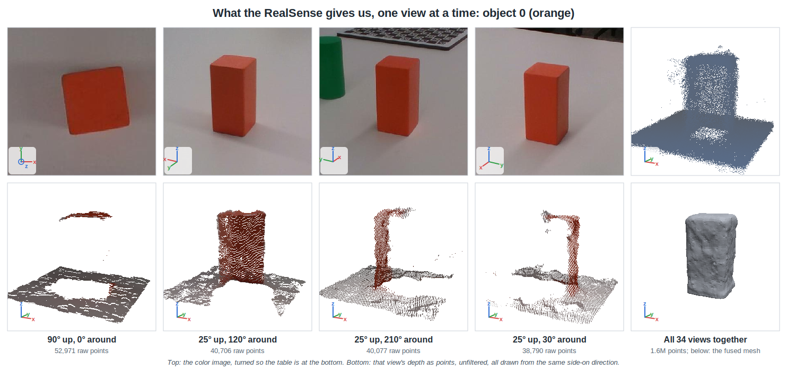
  <br><sub><b>REAL DATA.</b> Orange block, armfarm14, 2026-10-28. Each view's depth is the per-pixel median of the 5 frames taken at that pose</sub>
</p>

<p align="center">
  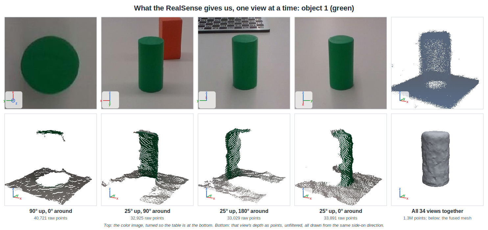
  <br><sub><b>REAL DATA.</b> Green cylinder, armfarm14, 2026-10-28</sub>
</p>

Every scan now also saves a figure of its reconstruction from 1, 2, 4, 8, 16 and all views (`object_NN/progression.png` in the session folder), seen from the arm's side, where the cameras could reach best (the two below predate that and use a fixed angle):

<p align="center">
  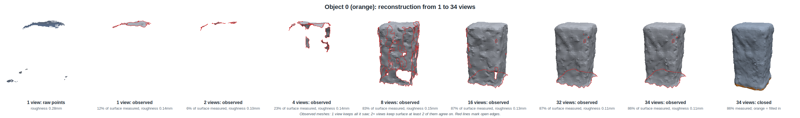
  <br><sub><b>REAL DATA.</b> Orange block, 34 views</sub>
</p>

<p align="center">
  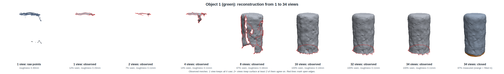
  <br><sub><b>REAL DATA.</b> Green cylinder, 34 views</sub>
</p>

| Views | Block: measured | Block: roughness | Block: closed volume | Cylinder: measured | Cylinder: roughness | Cylinder: closed volume |
|---|---|---|---|---|---|---|
| 1 | 12% | 0.14mm | 43.5cm³ | 12% | 0.15mm | 32.1cm³ |
| 2 | 6% | 0.10mm | 3.6cm³ | 8% | 0.11mm | 12.6cm³ |
| 4 | 23% | 0.14mm | 43.8cm³ | 20% | 0.11mm | 36.2cm³ |
| 8 | 83% | 0.15mm | 61.3cm³ | 78% | 0.16mm | 49.3cm³ |
| 16 | 87% | 0.13mm | 61.0cm³ | 87% | 0.14mm | 49.0cm³ |
| 34 | 86% | 0.11mm | 60.6cm³ | 87% | 0.11mm | 48.9cm³ |
| Calipers | | | 52.9cm³ | | | 41.0cm³ |

- **16 views measure everything the camera can reach; more views make it smoother.** "Measured" is the share of the closed mesh's surface that lies on measured data ([§6](#6-measured-vs-filled-in)). From 16 views (spread over the sphere) on it stays at 86-87%: every side and the top. The other 13-14% is the bottom, which no view can see. The volume settles at 16 views too, and from 16 to 34 views the roughness drops from 0.13-0.14mm to 0.11mm. A 16-view scan (`--max-views 16`, which picks 16 views spread over all directions) takes about half the time of a full one.
- **2 views measure less than 1.** With 2+ views, only surface that at least 2 views agree on is kept, and the two most different views share little.
- **Height is right; width isn't.** Against the calipers (`scan.py compare`, which recognized each object by its shape and size), the heights are within 0.9mm, but the block comes out 3.8-4.0mm too wide and the cylinder 2.8mm too wide in diameter, so the volumes are 15-19% too large. That is the open problem of [§3.5](#35-the-real-cylinder-against-calipers) and [§13](#13-shortcomings-and-proposed-solutions).

<p align="center">
  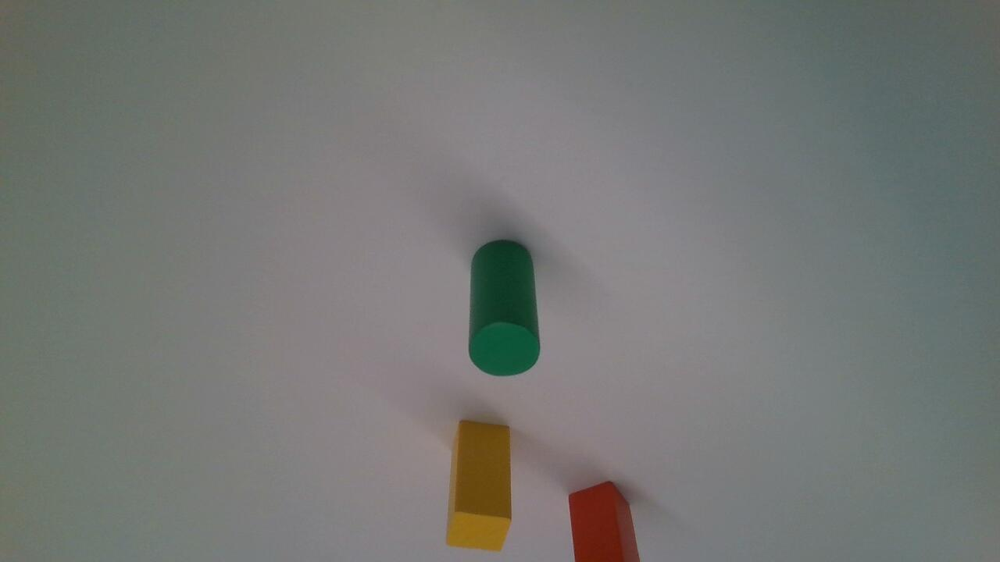
  <br>
  <em>One of the 25 views the arm took of the green cylinder (50° ring), straight from the wrist-mounted RealSense.</em>
  <br><sub><b>REAL DATA.</b> A photo straight from the wrist camera on armfarm14</sub>
</p>

### 3.2 Real cylinder: one view vs. many

25 views of a green cylinder (about 33mm × 60mm): the top view, the 72° ring and the 50° ring (this earlier scan stopped before the lowest, 25° ring; the scans in [§3.1](#31-the-latest-scans-one-view-at-a-time-and-1-to-34-views) include it).

<p align="center">
  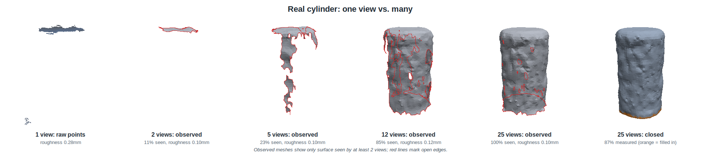
  <br><sub><b>REAL DATA.</b> 25 views of the green cylinder captured on armfarm14</sub>
</p>

| Views | Seen, of what all 25 views saw (completeness) | Roughness | Deviation from final (median / p90) | Closed volume | Measured share |
|---|---|---|---|---|---|
| raw points, 1 view | – | 0.278mm | 0.32 / 1.01mm | – | – |
| 1 (best single-view mesh) | 11% | 0.127mm | 0.29 / 0.80mm | 31.4cm³ | 11% |
| 2 | 11% | 0.095mm | 0.19 / 0.53mm | 28.1cm³ | 11% |
| 5 | 22% | 0.100mm | 0.19 / 0.69mm | 43.4cm³ | 32% |
| 12 | 76% | 0.127mm | 0.16 / 0.58mm | 50.8cm³ | 73% |
| 18 | 100% | 0.114mm | 0.08 / 0.48mm | 49.6cm³ | 87% |
| 25 | 100% | **0.104mm** | 0.05 / 0.15mm | **49.4cm³** | **87%** |

- **Coverage:** the best single-view mesh sees 11% of the object (essentially its top); its closed model is 89% assumption and holds 31.4cm³, 36% less than the 25-view result. It takes about 18 views to see all of this cylinder, and from 18 views the closed mesh's volume stops changing. With the 2px edge filter (now the default), 12 views measure 73% of it instead of the 82% measured before: the filter drops wall patches near silhouettes that only one or two of so few views saw. From 18 views on it makes no difference.
- **Noise:** the same patch of surface goes from 0.278mm roughness in one raw view, to 0.127mm once that one view is fused and lightly smoothed, to about 0.10mm with 2 or more views (2.8× smoother than raw), and then levels off. Real RealSense noise has a slowly varying, spatially correlated part that averaging removes much more slowly than the independent noise in the simulator (where roughness keeps falling, 38× over 37 views).
- **Consistency:** the 90th-percentile distance from a subset's surface to the final result falls from 1.01mm (one raw view) to 0.15mm, so each added view still tightens the shape after the coverage is complete.
- **Shape:** the reconstruction is round to 0.35mm and the right height, but about 1.5mm too large all the way around. [§3.5](#35-the-real-cylinder-against-calipers) compares it with caliper measurements.

The column definitions are in [§5.10](#510-measuring-quality).

### 3.3 Synthetic objects: scored against the true shape

The same pipeline on rendered views of known shapes (`python scan.py demo --progression`), with RealSense-like noise and a 2.5mm / 0.8° camera-mount error:

<p align="center">
  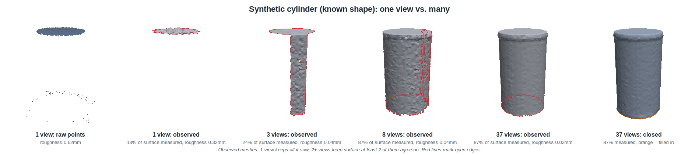
  <br><sub><b>SYNTHETIC DATA.</b> Simulated RealSense views of a cylinder whose exact shape is known</sub>
</p>

| Object | Views | Roughness | Closed mesh error vs. truth (median / p90) | Volume (true) |
|---|---|---|---|---|
| Cylinder Ø50 × 90mm | raw, 1 view | 0.621mm | – | – |
| | 1 (best single-view mesh) | 0.324mm | 1.60 / 2.39mm | 152.6cm³ |
| | 2 | 0.049mm | 1.52 / 8.54mm | 127.6cm³ |
| | 8 | 0.035mm | 0.12 / 0.45mm | 177.8cm³ |
| | 37 | **0.017mm** | **0.07 / 0.25mm** | **177.8cm³** (176.7) |
| Box 70 × 40 × 55mm | raw, 1 view | 0.662mm | – | – |
| | 1 (best single-view mesh) | 0.417mm | 1.45 / 1.93mm | 135.8cm³ |
| | 2 | 0.113mm | 2.33 / 3.59mm | 122.3cm³ |
| | 10 | 0.076mm | 0.29 / 0.63mm | 151.4cm³ |
| | 37 | **0.025mm** | **0.25 / 0.41mm** | **151.4cm³** (154.0) |

- **Many views vs. one:** the cylinder's closed mesh goes from 1.60mm median error with the best single view to 0.07mm with 37 views (23× better), within 0.6% of its true volume. The box goes from 1.45mm to 0.25mm (6× better).
- **Edges:** the box is less accurate than the cylinder because fusion rounds its sharp edges by about one voxel (1.5mm), which also removes 1.7% of its volume ([§13](#13-shortcomings-and-proposed-solutions)).
- **2 views can be worse than 1.** Two views keep only the surface both of them saw, which here is less than one view keeps on its own, so the closed shape is a worse guess (the box: 2.33mm vs. 1.45mm). From 3 views on, the result improves steadily.

### 3.4 The two fixes that mattered most

**Calibrating the camera mount.** The same 25 real captures, aligned and fused identically; only the camera mount differs:

<p align="center">
  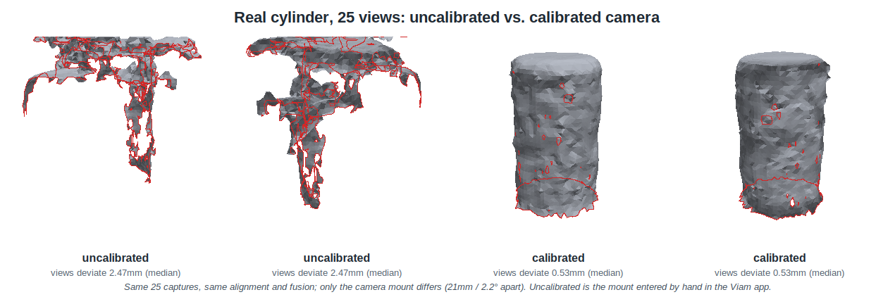
  <br><sub><b>REAL DATA.</b> The same 25 armfarm14 views of the green cylinder</sub>
</p>

"Uncalibrated" is the camera mount as it was first entered in the Viam app (measured by hand, 21mm and 2.2° from the calibrated one); these views were captured with it. **Uncalibrated, the mesh's size was off by 32% on average; calibrated, by 5%: 7× the error without calibration.** Both use the alignment step, which can't rescue a mount that far off: it rejected 14 of the 25 views' corrections.

The figure measures the **observed** surface (what the camera saw, height from the table up), not the closed mesh: Poisson can't reliably close views as badly misaligned as the uncalibrated ones, and sometimes balloons ([§5.9](#59-closing-the-mesh-with-a-flat-bottom)). Its layout takes more columns, so a scan of the same object with another camera (the Orbbec Astra 2) can go alongside. Rebuilt from the same saved views (stable to 0.1mm across reruns):

| Camera mount | Alignment | Views disagree by (median) | Diameter (calipers 29.53mm) | Height (calipers 59.93mm) | Roundness |
|---|---|---|---|---|---|
| Uncalibrated | off | 3.66mm | 50.9mm | 64.3mm | 2.5mm |
| Uncalibrated | on | 2.48mm | 45.4mm | 66.0mm | 2.35mm |
| Calibrated | off | 0.76mm | **28.9mm** | 60.3mm | 0.75mm |
| Calibrated | on | 0.53mm | 32.2mm | 60.3mm | **0.29mm** |

Roundness is the median distance of the wall's points from the best-fitting circle.

One open question: with the calibrated mount, turning alignment *off* gives a diameter within 0.65mm of the calipers (28.9 vs. 32.2mm with it on), though a less round one. On the 34-view scans of [§3.1](#31-the-latest-scans-one-view-at-a-time-and-1-to-34-views) the picture is mixed: without alignment the cylinder is 1.1mm closer (31.14 vs. 32.28mm), but the block gets one side closer and the other farther (31.82 × 35.40mm vs. 33.50 × 33.77mm), and the views disagree almost twice as much (about 1.0mm vs. 0.57mm). Alignment is not the main source of the size error, but how it moves round objects is worth a closer look.

**Aligning all views together.** The same 37 synthetic views, aligned two ways:

<p align="center">
  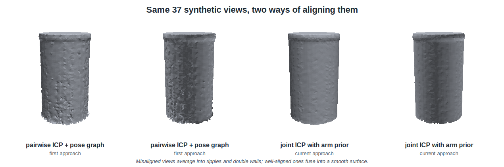
  <br><sub><b>SYNTHETIC DATA.</b> 37 simulated views with deliberate pose errors</sub>
</p>

### 3.5 The real cylinder against calipers

All four test objects were measured with calipers (`ground_truth.toml`); `scan.py compare` measures a reconstructed mesh the same way (blocks: width, length, height; the cylinder: diameter and height) and reports the errors.

| Object | Calipers |
|---|---|
| Green cylinder | Ø29.53 × 59.93mm |
| Yellow block | 29.26 × 29.48 × 60.05mm |
| Orange block | 29.73 × 29.63 × 60.05mm |
| Red block | 30.15 × 29.18 × 29.44mm |

The cylinder's 25-view reconstruction, against its calipers:

| | Calipers | Reconstruction | Error |
|---|---|---|---|
| Diameter | 29.53mm (29.51 top, 29.55 middle, 29.52 bottom) | 32.22mm (circle fit to the walls) | **+2.7mm (+9%)** |
| Height | 59.93mm | 60.45mm | +0.5mm (+0.9%) |
| Volume | 41.0cm³ (π × 14.77² × 59.93) | 49.0cm³ (closed mesh) | +19% |

The shape is right (round, straight, the right height) but the walls sit about 1.4mm too far out on every side. Breaking the error down over the 25 views:

- **Edge fattening, near the silhouette.** Wall points within 3 pixels of the object's outline in the image are 2.3mm too far out; 20+ pixels in, 1.0mm. Stereo depth blends foreground and background near edges, so objects look fatter. Dropping pixels within 2px of a depth edge (now the default) takes the diameter from 32.62 to 32.22mm; dropping more gains nothing on the real cylinder and costs accuracy on clean data.
- **A uniform part, about 1.0-1.2mm**, even where the wall faces the camera head-on, far from any edge. Because it inflates the object equally from every direction, the views still agree with each other, so neither the mount calibration nor the alignment can see it: only an absolute reference can. Adding a flat 1mm to all depth readings doesn't remove it, so it isn't a simple depth offset.
- **Not the camera mount, and not flat-surface depth.** The ChArUco board calibration ([§5.6](#56-camera-calibration)) puts the camera mount within 4.7mm / 0.5° of the scan-based one and measures depth on a flat surface to within about half a millimeter. Rebuilt with the board's mount the cylinder is 32.86mm wide; adding its depth correction, 33.13mm.

| Rebuilt with | Diameter | Height |
|---|---|---|
| Scan-based mount, no edge filter | 32.62mm | 60.57mm |
| Scan-based mount, 2px edge filter (the default) | 32.22mm | 60.45mm |
| Board mount, 2px edge filter | 32.52mm | 60.43mm |
| Board mount + depth correction, 2px edge filter | 32.90mm | 60.21mm |
| **Calipers** | **29.53mm** | **59.93mm** |

So the extra width (about 1.3mm per side after the edge filter) comes from how the RealSense measures the object's walls and edges, not from where the camera is or how it measures flat surfaces. The synthetic objects, whose simulated noise has no edge fattening, come out within 0.6-1.7% of their true volume, so it isn't the reconstruction method either. Closing this gap is the first item in [§15](#15-future-work).

---

## 4. System Architecture

### 4.1 Pipeline

<p align="center">
  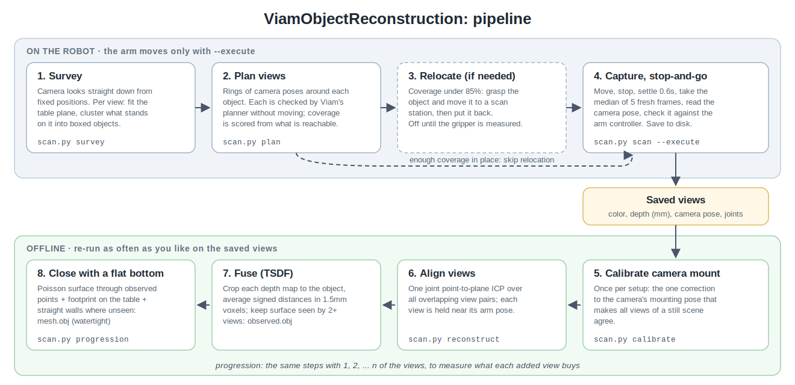
  <br><sub><b>DIAGRAM.</b> No data</sub>
</p>

The robot half moves the arm and saves raw views to disk; the offline half never touches the robot. Keeping the raw views means every reconstruction idea can be re-run and compared on the same captures, which is how most of [§8](#8-what-i-tried-that-didnt-work) was found.

### 4.2 Where each view's pixels go

<p align="center">
  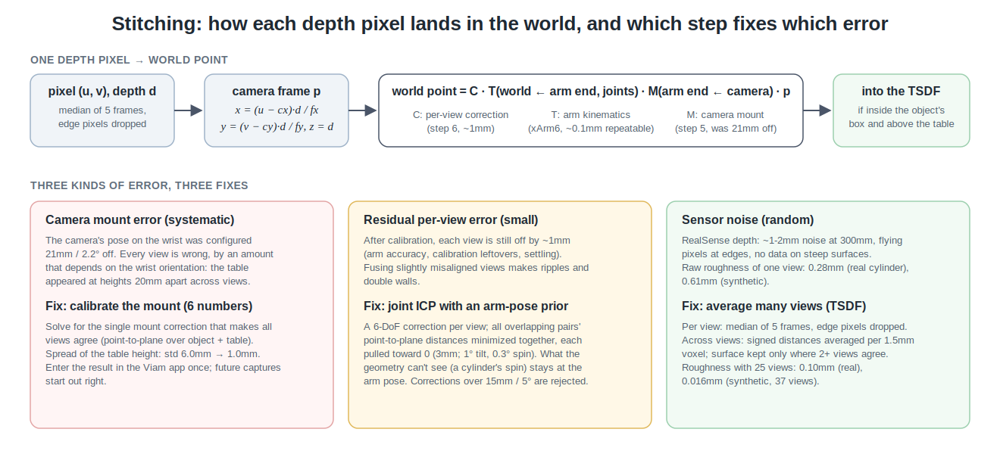
  <br><sub><b>DIAGRAM.</b> No data</sub>
</p>

---

## 5. Methodology

### 5.1 Survey: finding the table and what's on it

**Survey vs. scan.** A survey answers *what's on the table and where*: quick overhead views, a rough box per object, no meshes. A scan answers *what exactly does each object look like*: views all around one object, captured stop-and-go and fused into a mesh. A scan runs its own survey first unless given `--reuse-survey`. Calibration isn't part of either: it's done once per setup ([§5.6](#56-camera-calibration)).

#### Where the camera looks

The camera looks straight down from positions on a grid over the search region (`[workspace] x_range, y_range`), 600mm up. The grid spacing comes from what one view covers. A pinhole camera at height $h$ above the table sees a patch whose short side is

```math
w = 2h\,\tan\!\left(\tfrac{\text{FOV}}{2}\right), \qquad \tfrac{\text{FOV}}{2} = \arctan\frac{H/2}{f_y} = \arctan\frac{360}{916} \approx 21.4^\circ
```

so at $h \approx 612$mm (600mm plus the 12mm the table sits below the arm's base) the short side covers about 480mm, and the long side about 850mm. Positions 340mm apart therefore overlap by about 30% even when the camera's roll turns the short side along the grid. Only positions right over the arm's base (within 200mm) are left out. An earlier version also left out everything within 400mm of the base, where no scan target can stand ([§10.2](#102-machine-configuration)); but table near the base can still be right next to a target, and with that strip never seen, a block 400mm from the base was rejected as "not in open table".

#### Following the table

The survey doesn't visit every grid position. It starts at the reachable position nearest the camera, which must be over the table. After each view, it looks at the strip of points toward each of the four neighboring positions, beyond a quarter of the way there, and goes to a neighbor only if at least 30% of that strip is table: within 10mm of the table plane found in the first view. Floor (about 270mm lower), walls, and empty space beyond the depth range don't count. The next position visited is always the nearest one still waiting. On armfarm14 the survey visited 9 of the 10 grid positions; the 10th was over the floor.

#### Finding objects in each view

Each view is processed on its own:

1. **Points:** back-project the depth image to world points ([§5.5](#55-placing-each-view-in-the-world)), dropping "flying pixels" next to depth jumps.
2. **Table:** fit a plane with RANSAC (3 points at a time, 4mm inlier distance), keeping only a plane within 10° of horizontal.
3. **Candidates:** keep points 8-500mm above the table, inside the search region, and away from the arm's base; average them into 2mm voxels; remove statistical outliers.
4. **Clusters:** group them with DBSCAN (points within 10mm of each other belong together), then join clusters whose footprints overlap (one object split by a shadow or missing depth).
5. **Boxes:** for each cluster, the smallest rectangle around its footprint (rotating calipers on its convex hull) gives the center, length, width and heading; the height runs from the table to the 98th-percentile top. Its median color is printed with its id (green, yellow, ...), only to help a person tell objects apart; nothing selects or treats objects by color, and `--objects` takes ids. Measured hues on this table: yellow 43°, green 154°, orange 11°; table and cables are gray (saturation under 0.1).
6. **Scan targets only.** Not everything standing on a table is something to scan. There is no size limit: whether an object can be scanned all around is up to the view planner (§5.2), and an object too wide for the gripper is simply never relocated. A cluster is skipped, with its reason printed, if it is:
   - under 25mm tall (cords, cables lying flat);
   - not in open table, judged by **the ring** (below): less than 90% of the part of the ring the camera saw is bare table, or more than 25% of the ring went unseen.

**The ring.** To tell a scan target from clutter, the survey looks at the table *around* each cluster. It lays a 5mm grid over a band around the cluster's box, from 5mm to 60mm outside it on every side (a rectangular ring, like a picture frame), and checks each grid cell in that view's points:

- **bare table**: a point within 5mm of the table plane lies within 5mm of the cell;
- **something else**: the camera saw a point there, but not at table height (another object, a cable, a gap with floor in range);
- **unseen**: no point at all. The floor beyond the table's edge is out of the camera's range, so it is unseen; so is table hidden behind a tall object (its "shadow" from the survey camera).

<p align="center">
  
  <br><sub><b>DIAGRAM.</b> The cells are classified with the same rule as the code (<a href="tools/make_ring_diagram.py"><code>tools/make_ring_diagram.py</code></a>); the scenes are illustrations</sub>
</p>

A target needs at least 90% of the **seen** cells to be bare table, and at most 25% of the ring unseen. A block in open table scores 98-100% bare with 0-3% unseen. The power strip at the table's edge has cables and floor around it (72-91% bare, 17-57% unseen), and cables at the edge are 31-37% unseen; both are skipped. The 60mm also means two objects closer than about 60mm reject each other. Each view judges its own detections, and an object only needs one view (usually the one most nearly above it) to pass.

Unseen cells are judged separately because a tall object hides some table from the survey camera 600mm up: from 72mm off to the side, a 200mm pumpkin hid 11% of its ring, and counting that as "not table" rejected it (87% < 90%). Things that are rejected (and anything too short) are still kept as obstacles (below).

**Choosing what to scan.** `python scan.py` lists every target with its id, color, size and center, and asks before scanning each one (Enter, `n` to skip, `a` for all the rest, `q` to stop); the step-by-step commands take `--objects` with ids.

On the armfarm14 table, the surveys found the test objects plus the arm's base and its cables, a clamp-on power strip at the table's edge, and cords; the rules above keep the test objects. A coil of cable can occasionally pass (one 31mm-tall gray coil, seen from far to the side, had 99% bare table and 23% unseen), which is one reason the scan asks before each object.

#### Combining the views

The same object appears in several views. Each object is taken from the view that saw it closest to straight below the camera, where it is least distorted; any other detection whose center falls within that object's footprint (plus 15mm) is the same object or a fragment of it. Objects are detected per view, not after merging the views' point clouds: when the camera calibration was off, merged clouds smeared each block into a box over 100mm wide ([§8.2](#82-detection)). One limit: in steep, oblique views a real block's own sides and shadow fill part of its ring, so it may only pass the open-table test from a view more directly above it. The overhead grid provides one for anything on the table.

**Views must agree.** A patch of bad depth can look like a small object in one view: on bare, textureless table near an image's edge, the RealSense sometimes reads a blob 30mm too close. So an object is kept only if at least half of the survey views that saw its spot saw something standing there: the highest points (95th percentile) within its outline reaching half its height. The whole outline counts, not just its middle, so a bowl passes by its rim. On armfarm14's saved surveys, every such phantom (gray, about 25-30mm, over empty table) stood in only 1 of 3-5 views, and every real object, including the black printed sphere and bowl, in at least half.

#### Everything else is an obstacle

Skipped things aren't scanned, but the arm must still go around them: the survey saves them with the session as clutter, every plan treats them as obstacles, and touch-off spots keep clear of them. Some are RealSense noise (10-20mm bumps in bare table near the edge of a survey view); as obstacles they sit below the table slab, and for the touch-off they only rule out a few spots on a large table.

The table plane kept for the session is the one from the view closest to the objects.

#### The calibration board

Every survey view is also searched for the ChArUco board. If it's found, the survey checks the board looks level (it lies on the table, so through a correct camera mount it must), then moves straight over the board's center, 330mm up, for a head-on view with all 88 inner corners in the image. It records the board's pose, how well its corners fit, and a depth check against it. On armfarm14: 88 of 88 corners, 0.27px reprojection error, 0.5° from level, and depth within 0.21mm (median) of the board.

#### Speed

Each view costs a move, 0.6s to settle, one color-only frame to read the camera's clock (0.15s), and one color-plus-depth frame (2-3s over the cloud connection, almost all of it the 1.8MB depth image). Finding objects doesn't need the median of several frames that scanning uses.

### 5.2 View planning and reachability

<p align="center">
  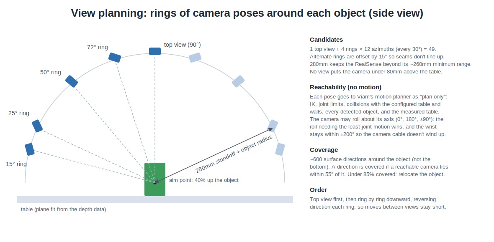
  <br><sub><b>DIAGRAM.</b> The planned view layout (the layout used on the arm)</sub>
</p>

Every candidate pose is sent to Viam's builtin motion service as a **plan-only** request (`do_command({"plan": ...})`). That runs the real planner (inverse kinematics, joint limits, and collisions with the configured table and walls, every detected object, and the measured table) without moving anything. The planner targets the **camera frame** directly, so no camera-to-gripper math is needed. The 15° ring became a default on 2026-10-29: on rounded objects (the pumpkin, the printed sphere) the surface below the widest point is only seen head-on from low views. Views that would put the camera under 80mm above the table (`min_camera_height`) are dropped before planning, a guard independent of the planner's table model; for a 30mm-tall block the 15° ring's camera is about 91mm up. Coverage is scored over about 350 surface directions (the bottom excluded); below 85%, the object would be relocated.

### 5.3 Relocation

If coverage is too low, the planner looks for a free scan station where the object would be fully coverable, finds a top-down grasp across the object's narrow side, checks the approach, grasp and place poses, and carries the object there (attached to the gripper in the planner's world state, so the carried object avoids obstacles too). After scanning, it puts the object back. **This is implemented but disabled** (`[relocate] enabled = false`) until the gripper's opening, fingertip offset and jaw direction are measured; on armfarm14 every object so far was fully coverable in place.

### 5.4 Stop-and-go capture

At each view: move, wait until the arm reports it has stopped, wait 0.6s more, then take 5 frames and keep the per-pixel median depth. Frames count only if the camera **stamped them after the settle time, by the robot's own clock**, so nothing captured while moving can slip in. The camera pose is read after settling and checked against the arm controller ([§11](#11-working-safely-on-a-shared-real-arm)). Each view is saved as `color.jpg`, `depth.png` (16-bit millimeters) and `view.json` (pose, joints, timestamps, camera mount). Storing depth as 16-bit millimeters is the usual format (the RealSense tools and RGB-D datasets do the same), but a regular image viewer shows 300-600mm as 0.5-1% of full brightness, almost black. So each view also gets a `depth_preview.jpg` for looking at: colored near-red to far-blue by each pixel's rank among that image's depths (histogram equalization, as the RealSense Viewer does), with missing readings in black. Nothing reads it; `tools/depth_previews.py` adds them to older sessions.

### 5.5 Placing each view in the world

A depth pixel (u, v) with depth d becomes a camera-frame point with the camera's intrinsics (focal lengths fx, fy and center cx, cy), then a world point through three transforms:

```math
p_\text{world} = C_i \; T_{\text{world} \leftarrow \text{arm end}}(\text{joints}) \; M_{\text{arm end} \leftarrow \text{camera}} \; p_\text{camera}
```

- **T** comes from the arm's joint angles and kinematics. The xArm6 repeats to about 0.1mm, so this part is trustworthy.
- **M** is the camera's mounting pose on the wrist, from the machine's frame configuration. If it's wrong, every view is wrong by a different amount, because the error rotates with the wrist.
- **Cᵢ** is a small correction for view *i*, found by the alignment step.

These three terms map onto the three error sources and the three fixes below.

### 5.6 Camera calibration

Every point in every mesh goes through the camera's calibration, so its errors land directly in the result ([§1.1](#11-breaking-down-the-problem)). Three things are calibrated:

| What | Symbol | Where it comes from |
|---|---|---|
| **Intrinsics:** focal lengths and image center | $f_x, f_y, c_x, c_y$ | The RealSense's factory calibration, read through Viam ($f_x \approx f_y \approx 916$px at 1280 × 720). The board fits it to 0.1-0.3px per view, so it's left as is. |
| **Camera mount:** the camera's pose on the arm's end | $M$ | Calibrated two ways: from a scan, and from the ChArUco board (below). |
| **Depth error:** how the depth readings differ from true distance | $a + b\,z$ | Measured against the board. |

The arm's end pose $E$ comes from the arm's joint angles and kinematics (the xArm6 repeats to about 0.1mm), so the camera pose for a view is $T_\text{world←camera} = E\,M$.

**The camera frame in the Viam app is only for its 3D scene.** Every move targets the arm's end, computed from where the camera should be through our calibrated mount, and every captured pose is the arm controller's end pose combined with the same mount (`calibration/armfarm14_camera_mount.json`, set in `config.toml`). So recalibrating never means editing the machine's configuration.

#### The camera model

A point $p = (X, Y, Z)$ in the camera's frame ($Z$ along the optical axis) appears at pixel

```math
u = f_x \frac{X}{Z} + c_x, \qquad v = f_y \frac{Y}{Z} + c_y
```

and a depth reading $d$ at pixel $(u, v)$ is the point $\big((u - c_x)\,d / f_x,\ (v - c_y)\,d / f_y,\ d\big)$. The RealSense aligns its depth image to the color image, so both use the color camera's intrinsics; its distortion coefficients are zero.

#### Method 1: calibrating the mount from a scan

`scan.py calibrate --objects N` uses any scan of a still scene. With a wrong mount, every view of the same scene lands in a slightly different place, by an amount that depends on the wrist's orientation. A single correction $\Delta$ to the mount (6 numbers: a rotation vector and a translation) should make them agree. For view $i$, a point $p$ in its camera frame lands at $E_i M \Delta\, p$. Between overlapping views $i$ and $j$, each point $p$ of view $i$ is matched to the nearest point $q$ of view $j$, which has the surface normal $n$ there, and the method minimizes the point-to-plane distances:

```math
\min_{\Delta} \sum_{(i,j)} \sum_{(p,q)} \rho\Big( \big(R_j n\big)^{\!\top} \big( E_i M \Delta\, p - E_j M \Delta\, q \big) \Big)
```

where $R_j$ is the rotation of $E_j M \Delta$ and $\rho$ is a robust (soft-L1) loss so that occasional bad matches don't dominate. Points come from the object and a 60mm ring of table (the table pins down height and tilt). The matches are recomputed as the estimate improves, with the match distance shrinking from 25mm to 3mm, and each round is solved with SciPy's `least_squares`.

On the real cylinder's 25 views, the uncalibrated mount (as entered in the Viam app) was off by 21mm and 2.2°:

| | Spread of table height across 25 views | Spread of the cylinder's top | Single views vs. fused surface |
|---|---|---|---|
| Uncalibrated mount | 20mm (std 6.0mm) | 21mm (std 6.1mm) | 2.48mm median |
| Calibrated mount | 4.4mm (std 1.0mm) | 5.0mm (std 1.1mm) | 0.52mm median |

On synthetic data it recovers a known 12mm / 2° mount error to within 1.5mm / 0.3°.

**What it can't see.** Anything that changes the scene's size equally from every direction (a depth bias, or a camera a little farther along its own axis than calibrated) leaves all the views in agreement, so this method can't detect it. That is why an absolute reference is needed too.

#### Method 2: the ChArUco board

`scan.py calibrate-board` uses a ChArUco board lying on the table: a checkerboard with an ArUco marker in each white square. This one is a calib.io mat (12 × 9 squares of 15mm, 11mm markers, dictionary DICT_5X5). The markers make every corner identifiable even when only part of the board is visible; the checker corners can be located to a fraction of a pixel. calib.io sells targets and calibration software; this project uses only the printed mat and free, open-source tools (OpenCV for finding the corners, and its own solver).

**One view: the board's pose.** OpenCV finds the markers, then the checker corners between them, giving pixel positions $x_k$ for corners whose positions $X_k$ on the board are known in mm. The board's pose relative to the camera ($R, t$) is the one that best reproduces them, *Perspective-n-Point*:

```math
\min_{R,\,t} \sum_k \big\lVert \pi\big(R X_k + t\big) - x_k \big\rVert^2
```

where $\pi$ is the camera model above. This uses the color image only, so it's independent of the depth sensor.

**Many views: hand-eye calibration.** The board doesn't move, so for every view $i$ its pose in the world, $B$, must be the same: $B = E_i\, M\, C_i$, where $C_i$ is the board's pose in that view's camera. Finding $M$ from such pairs is the classic *hand-eye* problem, often written $AX = XB$ (Tsai & Lenz 1989; Park & Martin 1994), with closed-form solutions. This project instead solves for $M$ and $B$ together (12 numbers) by minimizing the reprojection error of every corner in every view:

```math
\min_{M,\,B} \sum_i \sum_k \rho\Big( \big\lVert \pi\big( (E_i M)^{-1} B\, X_k \big) - x_{ik} \big\rVert^2 \Big)
```

with a Huber loss $\rho$, starting from the current mount (within a few cm and degrees). Minimizing the error in pixels, where the measurement noise actually is, is the maximum-likelihood formulation (as in Zhang's camera calibration), and it uses every corner rather than one pose per view. OpenCV's closed-form `calibrateHandEye` would also be a fine starting point, but its Python binding is missing in the OpenCV 5 build used here.

**Depth error.** At every detected corner, the depth reading $d$ is compared with the corner's true distance $z$ from the board fit, and a line is fit: $d - z \approx a + b\,z$.

**Choosing the views.** The command first finds the board (from where the camera is, then from overhead positions using color-only images, about 0.15s each), looks at it head-on, and checks it looks level: a mat on the table must be level, so if it isn't, the mount in use is wrong and the command stops. Through the camera frame entered in the Viam app (θ 129.489°, [§8.1](#81-hardware-and-platform)), the mat looked 10.5° from level; through the scan-calibrated mount, 0.5-0.8°. It then plans views from 300-460mm away and from many directions (hand-eye calibration needs the wrist to rotate about different axes between views), keeps 12 that are reachable and spread out, and captures them. On synthetic corners with 0.3px noise it recovers a known mount to within 1mm / 0.1° from a start 20mm / 3° off.

#### Results on armfarm14

| | Value |
|---|---|
| Views, corners | 12 views, 1,027 corners (76-88 of 88 per view) |
| Reprojection error, single views | 0.09-0.33px |
| Reprojection error, all views together | 4.59px with the scan-based mount → 1.61px with the board mount |
| Board mount vs. scan-based mount | 4.7mm / 0.50° apart |
| Depth vs. board, 258-505mm | median −0.47mm; fit $a = −1.66$mm, $b = +0.34\%$; rms 0.78mm |

- **The two calibrations agree to 4.7mm / 0.5°**, from entirely different data (object geometry vs. a printed pattern).
- **Depth on a flat surface is accurate to about half a millimeter** at scanning distances (at 300mm the fit gives −0.6mm).
- **The remaining 1.6px** (about 0.6mm at 350mm) is larger than single views' 0.1-0.3px. The most likely cause is the arm's absolute accuracy, which is worse than its 0.1mm repeatability.
- **Neither explains the cylinder's size error** ([§3.5](#35-the-real-cylinder-against-calipers)). With the 2px edge filter, the cylinder rebuilt with the scan-based mount is 32.22mm wide, with the board mount 32.52mm, and with the board's depth correction as well 32.90mm (calipers 29.53mm). So the mount and the flat-surface depth are good to well under a millimeter, and the extra ~1.3mm per side comes from how the RealSense measures object walls and edges.

The board mount hasn't replaced the scan-based mount yet (that is `--save-mount`).

#### The gripper: touch-off

> [!NOTE]
> The gripper was taken off on 2026-10-29 (`[machine] gripper = ""`): without it the camera reaches many more views. The touch-off is off until a gripper is back ([§15.8](#158-also)); the code and the measurements below are kept.

The planner keeps the gripper off the table using the gripper's collision model in the machine config (on armfarm14: a case and a claws box reaching 50mm past the gripper frame). If the real fingertips reach further than that, the planner can drive them into the table. `scan.py touch-off` measures the real reach the way machinists set up a tool:

1. **Three spots.** On a 20mm grid over the search region, a spot qualifies if it is 120mm clear of everything the survey saw standing on the table (scan targets and clutter; the open claws are 170mm wide), clear of the board, and the survey saw bare table over a 40mm disc around it (not past the table's edge or somewhere it never looked). The three are picked spread out, and must be reachable for step 2.
2. **Straight up, across, straight down.** The closed gripper lifts straight up until the fingertips are 600mm above the table, clear of anything on it; moves over the spot pointing straight down; and comes straight down until the fingertips are 10mm above the table (using the measured reach; with none measured yet, 40mm by the gripper model, which on this arm was 26mm short).
3. **Paper test.** It steps down 1mm per Enter (or a typed number of millimeters, up to 5) while you slide a sheet of paper under the fingertips; type `t` the moment it drags. A hard floor stops it 10mm past the expected contact. The xArm6's repeatability is ±0.1mm, so 1mm steps are well within what it can do; the measurement is as fine as the step. Then straight back up to 600mm, and on to the next spot.
4. **Two results.** The fingertips' reach is the gripper frame's height at contact minus the table's height from the survey (minus 0.1mm of paper). And three contacts define the table as the arm feels it: the reach is the same at every spot, so any slope between that plane and the camera's is a real tilt between the two (a uniform offset can't be told apart from the reach; the board check found the camera's depth within about 0.5mm).

The result goes to `calibration/armfarm14_touch_off.json`, and every plan's table slab ([§11](#11-working-safely-on-a-shared-real-arm)) adds any reach beyond the model to its margin.

**Result on armfarm14:** the fingertips reach **76.2mm** past the gripper frame (three spots within 2.1mm of each other), against the model's **50mm**. The real gripper reaches 26mm further than the planner thought, which is the most likely reason the gripper hit the table on the low views ([§8.1](#81-hardware-and-platform)). The first touch-off started 30mm above the table *by the model*; on this arm that left about 4mm.

#### Why OpenCV

ArUco isn't a library: it's a family of printed square markers, and DICT_5X5 names one set of them (5 × 5-bit patterns). Something still has to find the markers and the checker corners in the image and compute the camera's pose from them; OpenCV's `aruco` module is the standard implementation of that. This project uses OpenCV for detection and single-view pose only; the hand-eye solve and the depth model are its own.

#### References

- Z. Zhang, "A flexible new technique for camera calibration," *IEEE TPAMI*, 2000. [doi:10.1109/34.888718](https://doi.org/10.1109/34.888718)
- R. Tsai and R. Lenz, "A new technique for fully autonomous and efficient 3D robotics hand/eye calibration," *IEEE Trans. Robotics and Automation*, 1989. [doi:10.1109/70.34770](https://doi.org/10.1109/70.34770)
- F. Park and B. Martin, "Robot sensor calibration: solving AX = XB on the Euclidean group," *IEEE Trans. Robotics and Automation*, 1994. [doi:10.1109/70.326576](https://doi.org/10.1109/70.326576)
- S. Garrido-Jurado et al., "Automatic generation and detection of highly reliable fiducial markers under occlusion" (ArUco), *Pattern Recognition*, 2014. [doi:10.1016/j.patcog.2014.01.005](https://doi.org/10.1016/j.patcog.2014.01.005)
- OpenCV: [ChArUco detection tutorial](https://docs.opencv.org/4.x/df/d4a/tutorial_charuco_detection.html), [calib3d module (solvePnP, calibrateHandEye)](https://docs.opencv.org/4.x/d9/d0c/group__calib3d.html)
- calib.io: [calibration pattern generator](https://calib.io/pages/camera-calibration-pattern-generator) (ChArUco boards, DICT_4X4 to DICT_7X7)
- Intel RealSense: [tuning depth cameras for best performance](https://dev.intelrealsense.com/docs/tuning-depth-cameras-for-best-performance) (depth accuracy vs. distance, edge effects)
- Viam's `viam:camera-calibration` module (ChArUco pose tracker and hand-eye service), suggested for comparison ([§15.4](#154-calibration-that-just-works))

### 5.7 Stitching: aligning the views

After calibration, views still disagree by about a millimeter (arm accuracy, calibration leftovers). Fusing them as-is would average slightly shifted copies of each surface into ripples. The alignment step solves for all the per-view corrections **Cᵢ** at once:

1. Each view's points near the object (plus a 10mm ring of table) are downsampled to 2mm, cleaned, and given surface normals.
2. Every pair of views pointing within 60° of each other is an overlapping pair. For 1500 points per pair, the nearest point in the other view with a similar normal is a match.
3. Each match contributes a **point-to-plane** residual: the distance from a point to the plane of its match. Point-to-plane lets flat surfaces slide along themselves, which is correct: a flat patch says nothing about sliding.
4. Each correction is also pulled toward zero with a **prior**: 3mm, 1° of tilt and 0.3° of spin about the vertical axis, the arm's expected accuracy. Where the geometry pins a correction down, the thousands of matches outweigh the prior; where it can't (a cylinder spinning about its own axis looks identical), the prior keeps the arm's pose. Spin gets the tighter prior because it is exactly the motion a round object can't constrain, and noise will otherwise pretend to.
5. Gauss-Newton solves all corrections together (6 numbers per view), re-matching each iteration while the match distance shrinks from 6mm to 3mm, for up to 25 iterations. Rotations are measured about the object's center, not the robot's base 500mm away, so they mean something physically.
6. Any correction over 15mm or 5° is rejected and that view keeps its arm pose. On the real, calibrated cylinder, 1 of 25 views was rejected.

On synthetic views this cuts the relative pose error from 1.87mm to 0.48mm, and it is the difference between the two meshes in [§3.4](#34-the-two-fixes-that-mattered-most).

### 5.8 Fusing the views (TSDF)

First, the object's box is **refit from the scan itself**: every view's points above its own table, within 40mm of the survey's box, are clustered and a new box is fit around the main cluster (before alignment with the arm poses, and again after). The survey's box can be wrong by more than the crop margin, and a box in the wrong place cuts the same slice off the object in every view ([§8.2](#82-detection)).

Each view's depth map is then cropped to the object: inside its box (plus 12mm) and at least 2.5mm above **that view's own fit of the table** in a 30mm ring around the object (the survey's table can be several mm off at the object). The cropped depth maps go into a truncated signed distance function (TSDF, Open3D's `VoxelBlockGrid`, on the GPU when available):

<p align="center">
  
  <br><sub><b>DIAGRAM.</b> Illustrative numbers, not measurements</sub>
</p>

- **Space is divided into 1.5mm voxels.** Each view, along every pixel's ray, writes the signed distance from each voxel to the surface that pixel measured: positive in front of it, negative behind it.
- **Only a ±6mm band is updated.** Signed distances are truncated to ±6mm; voxels farther in front are marked as free space, and voxels more than 6mm *behind* the reading are left alone, since that region is hidden from this view and another view may see it.
- **Readings are averaged, not thrown out.** Each voxel keeps a weighted average of every view's signed distance, so random noise cancels. The surface is where the average crosses zero (marching cubes).
- **Data is thrown out before and after fusion, not inside it:** before, pixels at and within 2px of depth edges (below) and anything outside the object's box or below its table; after, surface seen by fewer than 2 views, and small fragments.

**The edge filter** works on each depth *image*, not on the table. Wherever depth jumps between neighboring pixels (an object's outline against the table behind it), the RealSense's readings are unreliable: some pixels float between the near and far surface ("flying pixels"), and a few pixels further in, stereo matching blends foreground and background, pushing the object's outline outward ("edge fattening"). On the real cylinder, wall points within 3 pixels of the outline sat 2.3mm too far out. The filter's thresholds (a 5mm or 2% jump) and its 2px growth were chosen for the RealSense; another camera has different edge behavior, so they need testing again with it ([§15.7](#157-a-second-camera-the-orbbec-astra-2)). The filter drops pixels at a jump of more than 5mm (or 2% of the distance), plus 2 pixels beyond (`[reconstruct] edge_grow`); pixels without a reading are never edges. It is unrelated to the survey's table-edge rule ([§5.1](#51-survey-finding-the-table-and-whats-on-it)), which decides where the *table* ends so the survey doesn't look at the floor.

That is `observed.obj`: everything in it was measured, and it is open wherever nothing was seen.

### 5.9 Closing the mesh with a flat bottom

The objects rest flat on the table, which gives two priors:

- the **bottom** is the object's outline seen from above, lying on the table plane;
- a **wall that was never seen** most likely drops straight down from the **lowest place the surface was seen**. On a block that is the outline itself. On a rounded object, such as a pumpkin, the surface curves back in below its widest point, so the wall drops from where the camera last saw it, tucked in underneath, not from the widest outline.

To find that place, the closing looks inward from each point of the outline (up to 60mm, within a 3mm-wide line) for the lowest observed surface whose normal faces outward along that line (so the top and the opposite wall don't count). The lowest point is the 5th percentile by height, so one stray reading can't set it, and neighboring outline points (within 6mm) are smoothed together. The wall hangs from there, and the flat bottom shrinks to match. Where nothing outward-facing was seen, the wall drops from the outline as before.

Before closing, scraps of table are dropped: points less than 15mm above the table that lie more than 3mm outside the outline of everything higher. An object's outline seen from above contains all of its surface, even what is tucked in underneath, so a low point outside it is table that fusion kept (from the object's shadow, or flared depth pixels). On the second pumpkin scan, about 2,700 such points, out to 146mm from its center, made Poisson balloon into a 2-meter bubble on one run and not on another; each block scan had 7-8.

Poisson can't close a thin sliver, such as 2 views of a pumpkin's top: it balloons into a surface far bigger than the object. A closed mesh that reaches more than 20mm past the points it was fit to (checked after flattening onto the table) is discarded, and the result says "too little seen to close" instead of reporting a meaningless volume.

The final `mesh.obj` is a screened Poisson surface fit through the observed surface points (with their normals), plus points filling the bottom (normals pointing down), plus straight-wall points only where no observed surface lies within 3mm. The lowest 5mm of observed surface is replaced by the straight-wall prior (depth pixels where wall meets table flare outward), anything below the table is flattened onto it, and the outline is shrunk by 1mm because edge noise pads it. The result is closed (no open edges), so it has a volume. [§6](#6-measured-vs-filled-in) shows which parts are measured and which are filled in.

**Example: the pumpkin (real scan, 2026-10-28, 30 views).** The 25° views saw the side facing the arm's base down to about 15mm above the table, curving in from a radius of 85mm at the widest point to about 62mm. The first version of this closing hung its walls from the widest outline anyway, so the closed mesh was a cylinder of radius 87-91mm all the way down, and the pumpkin looked projected onto the table. With the walls hung from the lowest seen surface, the closed mesh follows the measured curve on that side (radius 67-74mm in the lowest 30mm; a second scan of the same pumpkin gave 69-74mm). The far side had too few 25° views (out of reach, 590-640mm from the base), so nothing below its widest point was measured, and its wall still drops straight from the outline (radius 86-88mm).

### 5.10 Measuring quality

`scan.py progression` aligns all views once, then fuses the first *k* views for every *k* (adding each next view from the most different direction, so 3 views means 3 different sides). Each subset keeps surface seen by at least min(2, *k*) of its views: the single view keeps everything it saw, so the 1-view mesh is the best one view can give, and 2 or more views keep only what at least 2 of them agree on. `--min-views` overrides this for every subset.

| Metric | What it measures | Needs ground truth? |
|---|---|---|
| **Roughness** | Median RMS distance of 3mm surface patches from their best-fit plane. Measured only on the patch the first view saw, which every subset includes, so rows compare the same surface. | No |
| **Deviation from final** | Distance from this subset's observed surface to the all-views closed mesh (median and 90th percentile). | No |
| **Completeness** | Share of the all-views observed surface that this subset saw (within 2mm). It is relative: the all-views scan is 100% by definition, and a region no view ever saw (the bottom) can't count against it. That is why the figures label each panel with the measured share instead. | No |
| **Measured share** | Share of the closed mesh's surface that lies within 2mm of measured data ([§6](#6-measured-vs-filled-in)). | No |
| **Volume** | Enclosed volume of the closed mesh. | No |
| **Error vs. truth** | Distance from the mesh to the true shape after the best rigid fit, so it scores shape rather than placement. | Yes (synthetic) |

Results go to `recon/progression/summary.csv`, with `mesh.obj` and `observed.obj` for each *k* and the first view's raw points.

### 5.11 What can be tuned

Every setting that changes how smooth and how accurate the final mesh is, in pipeline order. All are in [`recon/config.py`](recon/config.py) (overridable in `config.toml`) unless noted. "How chosen" says what each value rests on: **real** (measured on armfarm14 scans), **synthetic** (tuned on simulated scans), or **judgment** (a reasoned default, not tuned yet). Settings tied to the RealSense are marked †; they need testing again for another camera. Future tuning should use real scans, against the calipers and the 3D-printed objects' CAD.

**Capture**

| Setting | Now | What it trades | How chosen |
|---|---|---|---|
| `capture.frames_per_view` | 5 | More frames: less per-pixel noise (median), slower views | judgment |
| `capture.settle_s` | 0.6s | Longer: less vibration blur, slower scans | judgment |
| `views.standoff` † | 280mm + object radius | Closer: more pixels on the object and less noise (it grows with distance²), but the camera can't measure closer than about 260mm | judgment |
| `capture.full_scan_frames` (`--full-scan`) | 50 | Frames per view in a full scan, every one saved; 50 frames take about 2 minutes per view over the cloud connection | judgment (a dataset to subsample) |
| `views.min_camera_height` | 80mm | No planned view puts the camera lower than this above the table: a second guard besides the planner's table slab | judgment |
| `views.elevations_deg`, `views.azimuth_step_deg`, `--max-views` | 15/25/50/72°, 30° (49 candidates; 25/50/72° until 2026-10-29) | More views: more averaging and coverage, longer scans | **real**: 16 spread views measured every side ([§3.1](#31-the-latest-scans-one-view-at-a-time-and-1-to-34-views)) |
| RealSense presets and filters † | camera defaults | "High Accuracy" preset, spatial/temporal filters: smoother depth, fewer readings | not explored yet |

**Cleaning each view**

| Setting | Now | What it trades | How chosen |
|---|---|---|---|
| Edge thresholds † (`edge_mask` in `recon/rgbd.py`) | 5mm or 2% jump | Lower: drops more edge pixels (and steep surfaces) | judgment |
| `reconstruct.edge_grow` † | 2px | Wider: removes more edge fattening, loses more wall data | **real**: 32.62 → 32.22mm diameter at 2px, nothing gained beyond |
| `reconstruct.crop_margin`, `table_clearance` | 12mm, 2.5mm | What counts as the object in each view; too tight cuts it, too loose lets the table in | judgment, plus a real crop bug ([§8.2](#82-detection)) |

**Aligning the views**

| Setting | Now | What it trades | How chosen |
|---|---|---|---|
| `prior_translation_mm`, `prior_rotation_deg`, `prior_spin_deg` | 3mm, 1°, 0.3° | Looser: alignment corrects more, but can slide where the shape gives no grip | spin: **real**; others: judgment |
| `icp_max_distance`, `icp_iterations`, `huber_mm`, `points_per_pair`, `min_pair_overlap`, `max_pair_angle_deg` | 3mm, 25, 1.5mm, 1500, 20%, 60° | Which view pairs are compared and how far apart matching points may be | **synthetic** |
| `max_correction_mm`, `max_correction_deg` | 15mm, 5° | Larger corrections are rejected as failures | judgment |

**Fusing (TSDF)**

| Setting | Now | What it trades | How chosen |
|---|---|---|---|
| `reconstruct.voxel` † | 1.5mm | Smaller: finer detail and sharper edges, but fewer readings per voxel (noisier) and more memory | judgment |
| `reconstruct.sdf_trunc` † | 6mm (4 voxels) | Wider: views that disagree still overlap and average (smoother), but thin parts and close surfaces blur together; narrower: sharper, but small misalignments leave holes or double walls | judgment |
| `reconstruct.min_views` | 2 | Higher: only surface confirmed by more views (cleaner, more holes) | judgment |
| Per-reading weights | all equal | Weighting by distance and viewing angle would trust grazing, distant readings less | not explored yet (README appendix) |

**Extracting and smoothing**

| Setting | Now | What it trades | How chosen |
|---|---|---|---|
| `reconstruct.smoothing_iterations` (Taubin) | 5 | More: smoother, but edges round off; 5-15 steps gave the same roughness | **real** |
| `reconstruct.min_component_fraction` | 5% | Floating pieces smaller than this are dropped | judgment |

**Closing the mesh** (`mesh.obj` only)

| Setting | Now | What it trades | How chosen |
|---|---|---|---|
| `reconstruct.poisson_depth` | 9 | Higher: finer closed surface, larger file; 7-9 gave the same roughness | **real** |
| `reconstruct.poisson_scale` | 3 | Working box size; too tight leaves few-view surfaces open | **synthetic** |
| `reconstruct.footprint_shrink`, `base_band` | 1mm, 5mm | How the flat bottom and the flared base are handled | **real** (the base's flared pixels) |

---

### 5.12 Watching a scan live

<p align="center">
  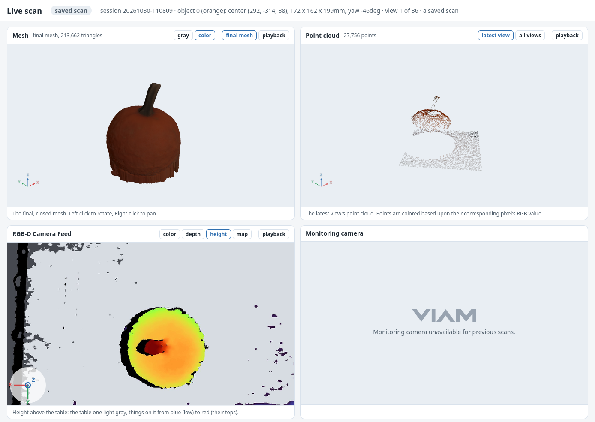
  <br><sub><b>REAL DATA.</b> The printed bowl's scan (2026-10-29) replayed with <code>tools/viewer.py</code></sub>
</p>

Every arm run (`scan.py`, `calibration.py`) starts a small web server on this computer and prints its link, `http://localhost:8765`. The page follows the scan:

- **Mesh so far**, in 3D (drag to rotate, scroll to zoom): after each view is captured, it is fused into a TSDF of its own on the GPU (about 0.2s per view), while the arm moves on, so the scan takes no longer. It shows surface seen by 2 or more views, as the final mesh keeps, placed by the arm's poses (the final alignment still runs at the end).
- **Point cloud**, in 3D: the latest view's points near the object, in their camera colors, or every view so far, thinned to one point per 2mm.
- **Scan camera**: the latest capture (survey, board or scan view), as color or as the colored depth preview.
- **Orientation**: both 3D views show the robot's world axes at the object's base (X red, Y green, Z blue, 50mm), a small gizmo in the corner that turns with the view, and an orange outline of the latest view's camera (its position and field of view). The same axes are drawn over the scan camera's image, projected through that view's pose, which also shows when a view's camera was rolled (Z pointing down means the image is upside down).
- **Monitoring camera**: an optional second camera that watches the whole cell (any Viam camera component, `[live] monitor_camera`), about one frame per second.
- **Pause** holds the arm still before its next move; **End Scan** ends the run before the next move (after a confirmation, keeping every view captured so far); **STOP** halts the arm at once, mid-move (`arm.stop()`), with no confirmation. They act inside the one function every move goes through, so they work during the survey, calibration and scanning alike. The e-stop remains the real safety.

Everything stays on this computer: the scan writes a few preview files into `data/live/` (the mesh, a few MB; the points, under 3MB; two images), and the page fetches whichever changed about once a second. The server only listens on this computer, serves only those files, and is built from Python's standard library (no new dependencies); the page uses three.js from a CDN. `python tools/viewer.py data/<session>` replays a finished scan view by view, ending on its final closed mesh, with the buttons off.

## 6. Measured vs. Filled In

Every closed mesh is part measurement and part assumption. The **measured share** is the fraction of the closed mesh's surface area that lies within 2mm of a point the camera actually measured (fused from at least 2 views). The rest, shown in orange below, comes from the two priors in [§5.9](#59-closing-the-mesh-with-a-flat-bottom): the flat bottom and straight walls where nothing was seen.

### 6.1 `observed.obj` vs. `mesh.obj`

Every scan writes two meshes of each object (in `data/<session>/object_NN/recon/`), built from the same fused data:

- **`observed.obj` is only what was measured.** It is the surface the TSDF fusion extracted where at least 2 views agreed ([§5.8](#58-fusing-the-views-tsdf)), and nothing else. Where the camera never looked it is simply open: there is no bottom (the object stands on it), and the red edges in the figure mark where measurement stops. Its bottom rim is ragged because the fusion keeps walls down to 2.5mm above the table and the views disagree a little on where that is.
- **`mesh.obj` is the finished, closed model.** It adds the two assumptions of [§5.9](#59-closing-the-mesh-with-a-flat-bottom) (a flat bottom on the table, and straight walls down to it where unseen) and rebuilds one watertight surface through everything with screened Poisson reconstruction. Orange marks what was filled in rather than measured.

<p align="center">
  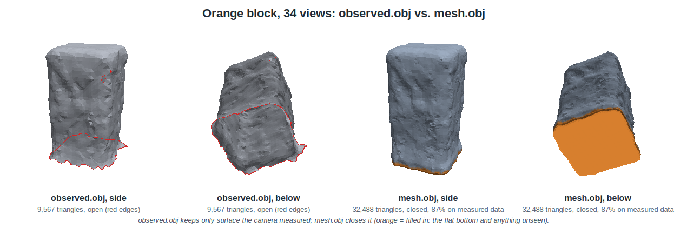
  <br><sub><b>REAL DATA.</b> Orange block, 34 views, armfarm14, 2026-10-28</sub>
</p>

<p align="center">
  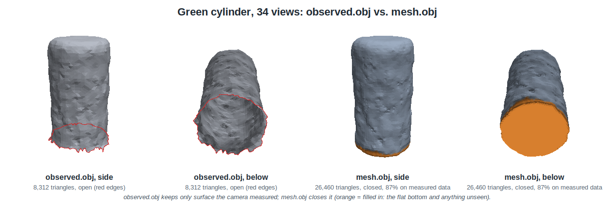
  <br><sub><b>REAL DATA.</b> Green cylinder, 34 views, armfarm14, 2026-10-28</sub>
</p>

| | `observed.obj` | `mesh.obj` |
|---|---|---|
| What it contains | Measured surface only (seen by 2+ views) | Measured surface plus a flat bottom and straight-wall fill, as one surface |
| Closed (watertight)? | No: open bottom, and holes wherever nothing was seen | Yes: has a volume, can be 3D printed or used for collision and grasp planning |
| Block, 34 views | 9,567 triangles, 77cm² of surface, 0.7MB | 32,488 triangles, 92cm², 2.2MB, 86% on measured data |
| Cylinder, 34 views | 8,312 triangles, 65cm², 0.6MB | 26,460 triangles, 76cm², 1.8MB, 87% on measured data |
| Use it to | Judge what the camera actually captured, and measure accuracy without assumptions | Use the object: volume, simulation, printing, planning around it |

Most of the difference in area (15cm² for the block, 11cm² for the cylinder) is the bottom, which the camera can never see. `mesh.obj` also has about three times as many triangles: Poisson builds its surface on a finer, uniform grid instead of reusing the fusion's triangles ([§9](#9-mesh-files-and-their-sizes)). Both are smoothed only lightly (5 Taubin steps on the observed surface, which barely change its size), so both keep the RealSense's few-tenths-of-a-millimeter ripples. Rebuilding from the same views gives the same surface (area within 0.1cm²) but not the same triangles: the closed mesh's count varies by a few percent between runs, because the GPU fusion and Poisson reconstruction aren't bit-for-bit repeatable.

### 6.2 How the measured share grows with views

<p align="center">
  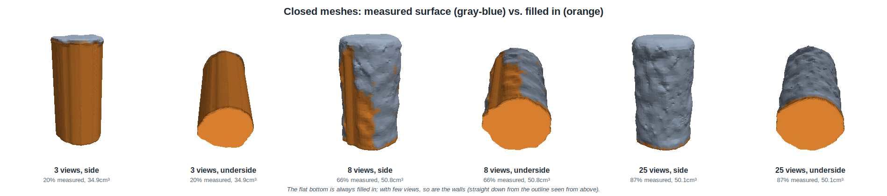
  <br><sub><b>REAL DATA.</b> The armfarm14 green cylinder from 1, 8 and 25 views</sub>
</p>

| Real cylinder | 1 view | 8 views | 25 views |
|---|---|---|---|
| Measured share | 11% | 65% | 87% |
| Closed volume | 31.4cm³ | 50.4cm³ | 49.4cm³ |

How to read it:

- **The bottom is always filled in.** The camera can never see under the object. For these cylinders the bottom is 10-11% of the surface, which is why the real 25-view scan (87%) and the synthetic 37-view scan (88%) both top out just under 90%.
- **With few views, the walls are mostly guessed.** The best single-view closed mesh looks like a plausible cylinder, but 89% of it is assumption, not data, and its volume (31.4cm³) is 36% below the 25-view result and 23% below the caliper volume. This is why the closed meshes alone would overstate what few views achieve, and why `observed.obj` is saved next to every `mesh.obj`.
- **The measured share caught a real bug.** An earlier version of this scan was only 64% measured, with one side of the cylinder orange in every closed mesh, even with 25 views. The crop box was cutting that side off ([§8.2](#82-detection)); completeness alone couldn't show it.
- **The priors are only right for objects shaped like these:** flat bottom, walls roughly vertical where unseen. An overhang or a hollow would be filled in wrong; the measured share says how much of the model depends on that.

---

## 7. Critical Design Decisions

| Decision | Alternatives considered | Why |
|---|---|---|
| **Start fresh instead of extending my earlier script** | Build on the earlier ViamOpenLab script | It was a single 636-line script that moved the arm but saved nothing and had no reconstruction. Its hand-written camera-to-gripper math and reach limits became unnecessary once the planner could target the camera frame and report reachability. I kept its good ideas: the credentials file, detected objects as obstacles, and previewing before moving. |
| **Stop, settle, then capture** | Capture while moving | Earlier experience showed cleaner clouds when stopped. Frames are accepted only if stamped after settling, by the robot's clock. |
| **Depth images + intrinsics, not the point-cloud API** | `camera.get_point_cloud()` | The full point cloud dropped the cloud connection; depth images are smaller, and owning the back-projection allows per-pixel filtering and median stacking. |
| **Reachability from Viam's planner, plan-only** | Own IK from the arm's kinematics | The planner already knows the joint limits and the cell's collision geometry; asking it guarantees that "reachable" means the same thing at plan time and at move time. |
| **Save raw views, reconstruct offline** | Reconstruct live | Every method in this README was compared on the same captures. Robot time is the scarce resource. |
| **Simulator with deliberate errors** | Develop on the real arm only | Ground truth makes it possible to tell "better" from "different", and the arm is shared. |
| **Median of 5 frames per view** | 1 frame | Cuts per-pixel noise cheaply while the arm is still anyway. |
| **Calibrate the camera mount from scan data** | ChArUco hand-eye calibration | No board needed and it uses exactly the data being fused. It found a 21mm error; a board-based calibration would be a good independent check. |
| **Joint ICP with an arm-pose prior** | Pairwise ICP + pose graph (tried first) | The pose graph trusted directions the geometry can't observe and spun symmetric objects; the joint solve with a prior handles that by construction. |
| **TSDF fusion, keeping surface seen by 2+ views** | Merge point clouds; keep everything | Averaging signed distances removes random noise; the 2-view rule removes surface no second view confirms. |
| **Refit the object's box from the scan** | Trust the survey's box | The survey sees the object from far away and before calibration; the scan sees it from 25 sides. |
| **Two meshes per object: observed and closed** | Only a closed mesh | The closed mesh is what you'd 3D-print or simulate with; the observed mesh is the honest record. The measured share connects them. |
| **Flat bottom + straight-wall prior, via Poisson** | Leave meshes open; cap only the bottom rim | Real scans have holes in the walls, so a bottom cap alone can't close them ([§8](#8-what-i-tried-that-didnt-work)). |

---

## 8. What I Tried That Didn't Work

In roughly the order I ran into them. Each was found by measuring, and the numbers are from those measurements.

### 8.1 Hardware and platform

| What I tried | What went wrong | What I did instead |
|---|---|---|
| `camera.get_point_cloud()` | The full 1280×720 cloud dropped the connection to the cloud-hosted machine. | `get_images()` returns color plus raw depth (`image/vnd.viam.dep`: header, then big-endian uint16 mm); I back-project it myself. |
| The SDK's `RotationMatrix.elements` reshaped row by row | It's column-major, so that gives the transpose. It went unnoticed at first because a camera looking straight down has a nearly symmetric rotation. | Own orientation math ([`recon/transforms.py`](recon/transforms.py)), tested against the numbers the machine's `transform_pose` reports. |
| Open3D's legacy `ScalableTSDFVolume` | On Open3D 0.20 / Python 3.14 it integrated nothing, even for a flat wall straight in front of the camera. | The tensor `VoxelBlockGrid`, which also runs on the GPU. |
| A view-count threshold of 2.0 in the `VoxelBlockGrid` | Extraction keeps weights strictly *above* the threshold, so "at least 2 views" really meant "at least 3". The real meshes had more holes than they should have. | `min_views` (an integer) passed as `min_views − 0.5`. The real 25-view surface grew from 4,237 to 7,386 triangles. |
| Widening the edge filter (drop pixels within 5px of a depth edge) | Pixels with no depth reading (dropouts, a few percent, scattered) counted as "edges", so widening the filter spread holes across whole surfaces. On the real cylinder that looked like an improvement (31.6mm) because it threw away wall pixels; on synthetic data the 1-view mesh shrank to 25 triangles. | Dropouts are never edges. Measured properly, the filter's whole benefit comes from its first 2 pixels (32.62 → 32.22mm), so that is the default. |
| A measured-table obstacle around each object, 3mm *below* the surface | The gripper hit the table moving between two views of the lowest (25°) ring; the run was stopped with the e-stop. At both views' end poses the gripper's model is 62-158mm above the table, so the contact was during the move, while the wrist swung around. The planner's table protection then was the configured table (6-11mm below the real one) plus patches only ±165mm around the object, placed a little below the surface. | A slab over the whole table, 15mm *above* the measured surface, checked along every path; and a touch-off to measure the real fingertip reach ([§5.6](#56-camera-calibration)). |
| Starting a run from wherever the arm was left (2026-10-29) | After the gripper came off, the arm had been free-moved by hand into a pose with joint 4 (the forearm roll) at 290°. The calibration's first move, a planned move to the usual camera-down view of the mat, turned joint 4 by 290° while every other joint turned 40-80°, all at once. The arm moved very fast, away from the person beside it, until the xArm controller stopped it: "Linear speed exceeds limit in ServoJ mode". The target was the same pose that had worked in four earlier runs; the start was the problem. | Every run that moves the arm now reads the joints first and steps to a fixed ready pose one joint group at a time, each step confirmed by the person at the arm. |
| The first touch-off: straight to each spot, with only the table as an obstacle | On the way to its first spot the gripper went through one of the blocks: the touch-off's moves didn't pass the objects to the planner. Things the survey skipped (not scan targets) weren't obstacles for *any* plan. And with the gripper model 26mm short, the "30mm above the table" start was about 4mm. | Every object, and everything else the survey sees standing on the table, is an obstacle for every plan (clutter is saved with the survey). The touch-off lifts until the fingertips are 600mm above the table, moves over a spot with 120mm of bare table around it, and comes straight down to 10mm above the table by the measured reach, then steps 1mm. |
| Capturing 5 frames within 10s | Each `get_images()` takes 2-4s over the cloud connection (depth alone is 1.8MB). | The timeout is per frame. A view now takes about 20s. |
| The SDK's default connection check | It allows 1s for a reply; during a 1.8MB download the reply is late, and the SDK closes the channel mid-download. | Turned off for this script. A real disconnect still raises on the next call, and viam-server's session heartbeat (which stops the arm if the client disappears) is unaffected. |
| Entering the calibrated mount in the Viam app as an orientation vector `(0.00678, -0.00574, 0.99996)`, θ 129.5° | Within 1e-4 of the pole, Viam reads θ as the *total* turn about z, ignoring the axis's longitude. The camera ended up 40.3° off, and the pose guard stopped the run before any motion. | The pose math implements Viam's pole rule (in the app's terms the value is θ 89.233°). Since then the code uses its own calibration file for the camera mount, so the app's camera frame no longer affects moves or poses. |
| The frame system, once | During one survey, Viam's frame system reported the camera exactly at its planned target while the joint readings (and the image) put it rolled 180° away. It hasn't recurred. | A pose guard ([§11](#11-working-safely-on-a-shared-real-arm)) checks the frame system against the arm controller after every move and at every capture. |
| The first roll that worked for each pose | The first survey move would have turned the wrist 140°, and a 25-view scan wound it to −280°, tangling the camera cable. | Plan every roll, keep the one needing the least joint motion, and keep the wrist within ±200°. |
| Open3D's interactive viewer | It crashes on GNOME 50 / Wayland (a GTK settings lookup), even with a hidden window. | Meshes are viewed in Blender; figures are rendered offscreen with numpy ([`recon/render.py`](recon/render.py)). |

### 8.2 Detection

| What I tried | What went wrong | What I did instead |
|---|---|---|
| Clustering every point above the table | Flying pixels between an object's top edge and the table shifted the synthetic cylinder's center by 36mm; noise on the table formed flat fake objects. | Drop pixels next to depth jumps; require objects to stand at least 20mm tall. |
| Merging the survey views' clouds, then detecting | With the camera-mount error, the two views placed the same block 7-26mm apart; merged, the blocks smeared into 121 × 92mm boxes (and once, into one 493 × 303mm blob). | Detect in each view; keep each object from the view that saw it most directly from above. |
| Cropping each view to the survey's box | The survey (taken before the mount was calibrated) placed the real cylinder 17mm off. With a 12mm crop margin, every view lost the same 60-90° slice of wall: the 25-view closed mesh was only 64-73% measured. The fitted diameter came out 29-30mm, close to the true 29.5mm only by coincidence: the missing slice hid the inflation of the rest. | Refit the box from the scan's own points ([§5.8](#58-fusing-the-views-tsdf)): every 30° sector of the wall now has data and 87% is measured. That exposed the real 1.5mm-per-side size error ([§3.5](#35-the-real-cylinder-against-calipers)). |
| Using the survey's table plane to separate object from table | Near the object the real table was about 7mm higher than the survey measured, so table points leaked into the object. | Fit the table per view from a ring around the object, in that view's own (aligned) pose. |

### 8.3 Stitching

| What I tried | What went wrong | What I did instead |
|---|---|---|
| **Pairwise ICP + Open3D pose graph** (multiway registration) | Open3D's information matrix assumes point-to-point matching, so it claimed certainty about motions the surface can't constrain, such as a cylinder's spin. Low views of the cylinder were "corrected" by up to 125°. | Point-to-plane information matrices: better, but pairwise ICP still drifted 27° along the spin before the graph ever saw it. |
| Projecting each pairwise result onto its well-constrained directions (eigenvalue cutoff) | Fragile: the table ring dominated the eigenvalues, so the box's real in-plane constraints fell below the cutoff and its 90th-percentile error jumped to 8mm. | Dropped the pose graph entirely for a joint solve with a prior ([§5.7](#57-stitching-aligning-the-views)). |
| The joint solve, first version | Every view shared a ~10° rotation. The target-side Jacobian ignored that the target's normal rotates with its view; done right, the two sides cancel exactly for a shared motion. A finite-difference check found it. | Fixed (J_target = −J_source). Relative pose error 1.87 → 1.02mm. |
| Default ICP settings | Not converged: wide match distance, a large table ring. | Match distance 6 → 3mm over 25 iterations, a 10mm table ring, 1500 points per pair: 0.48mm. |
| One rotation prior (1°) for all three axes | On the real, calibrated cylinder 21 of 25 views wanted 5-33° of spin about the vertical and were rejected, so the result was effectively arm poses only. | A separate 0.3° prior on spin: rejections 21 → 1, wall roundness 0.99 → 0.35mm, single views vs. the result 0.74 → 0.52mm. The synthetic objects are unchanged. |
| Per-view alignment on the real 25-view scan | It wanted 7-44mm, up to 33° corrections; the 15mm / 5° safety limit rejected them. The views weren't slightly off; the camera mount was wrong. | Mount calibration ([§5.6](#56-camera-calibration)), then alignment for what's left. |

**Why some early demo meshes were smoother than others.** The synthetic demos `demo-20261026-131545`, `-131913`, `-132152` and `-133443` were the first four built with the joint solve; the earlier ones used the pose graph, with up to 26 of 37 views rejected or mis-corrected. Same noise, same smoothing settings; only the alignment differed. Re-fusing the bumpy demos' own raw views with the joint solve cut their wall roughness from 0.14-0.28mm to 0.05-0.06mm and their error against the true shape from 0.19-0.46mm to 0.11mm. Misaligned views don't add noise; they add copies of the surface at slightly different places, which the averaging turns into ripples.

### 8.4 Closing the mesh

| What I tried | What went wrong | What I did instead |
|---|---|---|
| A vertical "skirt" from the observed bottom rim down to the table, capped with a flat polygon | Exact on synthetic meshes, which have a clean bottom rim. Real meshes have large holes in the walls, so the "rim" ran 60mm up the side, and pinch points between holes broke the loop tracing. | Poisson with a flat-bottom prior ([§5.9](#59-closing-the-mesh-with-a-flat-bottom)). |
| Open3D's `is_watertight()` and `get_volume()` | Both refuse meshes with tiny self-intersections, which marching cubes and smoothing always leave. | Closed means "no open edges"; volume from the divergence theorem. |
| Poisson with a tight working box | Few-view surfaces ran into the box and stayed open. | A 3× box. |
| Poisson alone with few views | With nothing to go on for the unseen sides, the 1-view synthetic cylinder ballooned to 2,521cm³ (true 177). | The straight-wall prior, only where nothing was observed: 153cm³ from 1 view, and no effect from 8 views on. |
| Wall prior points on the 1mm outline grid | Vertical ribs from the grid's staircase. | A smoothed outline with sub-cell positions. |
| The observed surface right down to the table | Pixels where wall meets table flare outward, giving the base a lip. | The lowest 5mm is replaced by the straight-wall prior. |

### 8.5 Measuring progress

| What I tried | What went wrong | What I did instead |
|---|---|---|
| Roughness over each subset's whole surface | It *rose* with more views (0.08 → 0.24mm), because few views see mostly the flat top and more views add the curved, noisier walls. | Roughness on the patch the first view saw, which every subset contains. |
| Completeness alone as the coverage measure | It is relative to the all-views surface, so a slice that every view lost (the crop bug above) still scored 100%. | The measured share, which compares against the closed mesh, showed the missing side as a persistent orange band. |
| Judging the real result by self-consistency | Round to 0.35mm, the same volume from 18 views on, views agreeing to 0.5mm: all true, and the cylinder was still 3mm too wide. | Calipers ([§3.5](#35-the-real-cylinder-against-calipers)). Consistency measures precision, not accuracy. |
| Correcting the size error with a flat depth offset | Adding 1mm to all depth made the diameter slightly *larger* (the alignment and table fits move with it). | Measure the depth error against the ChArUco board instead of guessing ([§5.6](#56-camera-calibration)). |
| Applying "seen by 2+ views" to every subset, including 1 view | The 1-view mesh was empty, so there was no single-view result to compare the others against. | Each subset keeps surface seen by min(2, k) views: the 1-view mesh is the best one view can give. |

---

## 9. Mesh Files and Their Sizes

Each reconstruction writes, in `data/<session>/object_NN/recon/`:

| File | What it is |
|---|---|
| `mesh.obj`, `mesh.ply` | Closed mesh with a flat bottom (the final model). PLY keeps vertex colors; OBJ doesn't. |
| `observed.obj`, `observed.ply` | Only the surface seen by 2+ views; open where nothing was seen. |
| `cloud.ply` | The fused surface points with normals (what Poisson closes). |
| `report.json` | Alignment corrections per view, per-view table offsets, how far each raw view lies from the result, mesh statistics. |
| `refined_poses.json` | Each view's camera pose after alignment. |
| `progression/views_NN/` | `mesh.*` and `observed.*` from the first N views; `views_01/raw_points.ply` is the first view's raw points. |
| `progression/summary.csv` | The metrics in [§5.10](#510-measuring-quality) for every N. |

Sizes from the scans in [§3](#3-results):

| | Views | Observed triangles | `observed.obj` | Closed triangles | `mesh.obj` |
|---|---|---|---|---|---|
| Real cylinder (~33 × 60mm) | 1 | 604 | 45KB | 26,142 | 1.7MB |
| | 2 | 683 | 51KB | 25,742 | 1.7MB |
| | 12 | 5,129 | 408KB | 29,240 | 1.9MB |
| | 25 | 8,436 | 638KB | 25,394 | 1.7MB |
| Synthetic cylinder (Ø50 × 90mm) | 1 | 2,781 | 207KB | 129,072 | 9.0MB |
| | 2 | 1,316 | 98KB | 124,320 | 8.6MB |
| | 8 | 19,297 | 1.5MB | 46,186 | 3.1MB |
| | 37 | 18,493 | 1.4MB | 43,360 | 2.9MB |

How to read the sizes:

- **The observed mesh grows with coverage.** Its triangle count tracks how much surface was seen, at a fixed 1.5mm voxel. (One view keeps everything it saw, so the 1-view observed mesh can be bigger than the 2-view one, which keeps only the overlap.) It stops growing once everything is seen (the synthetic cylinder at 8 views) and then shrinks slightly as averaging smooths out small bumps.
- **The closed mesh's size says nothing about quality.** Poisson's resolution is set by its working box (2⁹ cells across), so the triangle count follows surface area and wrinkliness. With few views the guessed surface is larger and lumpier: the 1- and 2-view synthetic cylinders' closed meshes have about 3× the triangles of the 37-view one.
- **The real cylinder's meshes are smaller** than the synthetic one's because the object is smaller (33mm vs. 50mm across, 60mm vs. 90mm tall).
- **Raw data:** the 25 captured views take 4.2MB (each about 170KB: a JPEG and a 16-bit PNG depth map); one raw view's object points are 43KB.

---

## 10. Setup and Usage

### 10.1 Prerequisites

- Python 3.14 with the packages in [`requirements.txt`](requirements.txt) (Viam SDK, Open3D 0.20, NumPy, SciPy). `cairosvg` is optional, for PNG copies of figures.
- A Viam machine with an arm, a depth camera whose frame is attached to the arm, the builtin motion service, and the work area's static obstacles (table, walls) as geometry in the frame system.

### 10.2 Machine Configuration

`config.toml` holds the cell's settings; every setting and its default is documented in [`recon/config.py`](recon/config.py). For armfarm14:

| Setting | Value | Notes |
|---|---|---|
| `[machine] address` | `armfarm14-main.310sld03v2.viam.cloud` | resources `arm`, `cam`, `gripper`, `builtin` |
| `[workspace] x_range, y_range` | −350..700, −650..350mm | clear of the walls (front x=800, side y=425) |
| `[workspace] survey_height, survey_spacing` | 600mm, 340mm | overhead grid over the search region |
| `[workspace] min_base_distance` | 350mm | the arm's base and the cables around it are ignored (default 200mm) |
| `[machine] camera_mount_file` | `calibration/armfarm14_camera_mount.json` | our calibrated camera mount; the app's camera frame is display-only |
| `[views] standoff` | 280mm | beyond the RealSense's ~260mm minimum range |
| `[views] min_camera_height` | 80mm | views that would bring the camera lower above the table are skipped |
| `[capture]` | settle 0.6s, 5 frames | |
| `[relocate] enabled` | false | until the gripper is measured |

The camera mount is a 4 × 4 transform (camera pose relative to the arm's end, in mm) in `calibration/armfarm14_camera_mount.json`, written by `scan.py calibrate --save-mount` or `calibrate-board --save-mount`. Both commands also print the equivalent Viam frame values, in case you want the app's 3D scene to match; the code doesn't read them.

### 10.3 Running step by step

The [Quick Start](#quick-start) runs everything with defaults. These are the same steps with more control, for troubleshooting and for watching the arm closely.

**Previewing moves.** Nothing moves without `--execute`; without it, every command only looks and plans. With it:
- `--confirm-moves` shows every move (target and joint changes) and waits for Enter;
- `--confirm-above 45` only waits when a joint would turn 45° or more;
- `--step` asks before each object.

**Calibrating one step at a time.** `calibration.py` runs these three steps in order; separately, each can be planned first and watched move by move:

```bash
python scan.py calibrate-board                        # find the mat from where the camera is and plan its views (no motion)
python scan.py calibrate-board --execute --confirm-above 45 --save-mount   # about 2 minutes
python scan.py survey --execute                       # finds the table (touch-off needs it)
python scan.py touch-off                              # plan only: check the 3 touch spots are open table
python scan.py touch-off --execute                    # with you at the arm and a sheet of paper
```

**Scanning in stages.** `python scan.py` runs the whole scan. A **survey** finds what's on the table and where; a **scan** builds each object's mesh. `scan --execute` alone runs its own survey first. To check the survey (and the plan) before scanning, run them separately and scan with `--reuse-survey`:

```bash
python scan.py survey --execute                       # overhead views across the table; prints each object's id, center and color
python scan.py plan                                   # reachable views per object (no motion)
python scan.py scan --execute --reuse-survey          # every object found (or --objects 0,2); about 15 minutes per object
python scan.py scan --execute --reuse-survey --max-views 16   # about half the time: 16 views spread over all directions
```

**After scanning (no arm needed):**

```bash
python scan.py compare                                # measure each mesh and compare with ground_truth.toml (calipers), if it resembles a measured object
python scan.py reconstruct --objects 1                # rebuild meshes from the saved views: mesh.obj (closed) and observed.obj
python scan.py progression --objects 1                # meshes, metrics and progression.png from 1, 2, ... n views
```

**Without a robot:**

```bash
python -m pytest                                      # 61 tests, about 80s
python scan.py demo --progression                     # synthetic table scene: survey, plan, render noisy views, reconstruct, score
```

### 10.4 Commands

| Command | Moves the arm? | What it does |
|---|---|---|
| `calibration.py [--plan-only] [--touch-off ask\|yes\|no]` | yes (asks first) | The whole calibration: camera (board), table (survey), gripper (touch-off, asks first) |
| `scan.py [--plan-only] [--max-views K] [--full-scan]` | yes (asks first) | The whole scan: survey, list the objects, ask before each, scan, park over the mat, build meshes and figures, compare with the calipers where possible. `--full-scan`: 50 frames per view and every raw frame saved in `views/view_NNN/frames/` (about 10MB per view) |
| `scan.py [--full-scan] --resume data/<session>` | yes (asks first) | Finish an interrupted scan in the same session: reuses its survey, steps to the ready pose, looks again from each started object's first view and refuses if the object moved more than 3mm, refuses if the frame settings differ from the first part, then captures only the views still missing (numbered after the existing ones) and builds the meshes from all of them |
| `scan.py survey [--execute]` | with `--execute` | Overhead grid over the table: objects, table plane, calibration board (then a head-on board view); without `--execute`, from the current pose |
| `scan.py plan [--new-survey]` | no | Reachable views, coverage and relocation decision per object |
| `scan.py scan --execute [--objects N] [--max-views K] [--reuse-survey]` | yes | Plan, (relocate), capture every object, return home over the mat, then build each mesh and its progression figure. `--max-views K` captures K views spread over all directions (16 is enough to measure every side of the test blocks) |
| `scan.py calibrate --objects N [--save-mount]` | no | Camera mount from a scan; `--save-mount` makes it the mount for all moves and captures |
| `scan.py calibrate-board [--execute] [--save-mount]` | with `--execute` | ChArUco mat: level check, board views, hand-eye mount and depth error |
| `scan.py reconstruct [--objects N] [--no-refine]` | no | Re-run reconstruction on saved views |
| `scan.py progression --objects N [--counts 1,2,5,25] [--order spread\|capture] [--min-views M]` | no | Meshes and metrics for 1..n views |
| `scan.py compare [--objects N] [--truth NAME]` | no | Measure each mesh like calipers and compare with the `ground_truth.toml` entry it resembles (by shape and size; skipped if none), or with `--truth NAME` |
| `scan.py touch-off [--execute]` | with `--execute` | Touch bare table with the closed gripper (paper test) to measure the real fingertip reach (off while no gripper is mounted) |
| `scan.py demo [--progression]` | no | Everything on synthetic data, scored against the truth |
| `tools/camera_height_check.py [--height 100] [--execute]` | with `--execute` | A ruler check of the camera mount: the lens straight above the calibration board at a known height, with the predicted heights of the camera's face and of its collision box |
| `tools/viewer.py data/<session> [--object N]` | no | Replay a finished scan in the live viewer, view by view, ending on its final closed mesh |
| `tools/depth_previews.py data/<session>` | no | Add colored `depth_preview.jpg` files to a session saved before they existed |
| `tools/make_figures.py`, `tools/make_tsdf_diagram.py`, `tools/make_ring_diagram.py` | no | Regenerate this README's figures, the fusion diagram and the ring diagram |

Motion options: `--confirm-moves` previews every move (target, joint changes) and waits for Enter; `--confirm-above 45` previews every move but only waits when a joint would turn 45° or more; `--step` asks before each object and each relocation.

### 10.5 Testing

`python -m pytest` runs 61 tests, about 80s. Besides unit tests (pose math against the machine's own numbers, depth decoding, edge filtering, detection, view geometry, grasp poses, the pose guard, ChArUco detection and hand-eye recovery of a known mount), several run the pipeline on synthetic scenes and check it against the truth: fused meshes beat single views, mount calibration recovers a known error, closed meshes have the right volume, and the progression improves with views.

---

## 11. Working Safely on a Shared Real Arm

The armfarm cells are shared and remote, so the code assumes that nobody may be watching the arm closely:

- **Nothing moves without `--execute`.** Every command without it only looks and plans.
- **Every move can be previewed**, with its target and the joint changes from a plan-only check, and waits for Enter. Typing `n` stops cleanly before the move.
- **Pose guard.** At startup, after every move and at every capture, the arm's end pose according to Viam's frame system is compared with the arm controller's own. If they disagree by more than 2mm or 1°, the run stops before any further motion. (An earlier version compared camera poses, and caught a 40° camera-configuration error before the first move; camera poses now come from our own mount file.)
- **The table is a slab 15mm above where it was measured.** The machine's configured table sat 6-11mm below the real one. Every plan (including the paths between views, not just their end points) treats the table as a slab over the whole search region, its top 15mm above the measured surface at its highest point (plus any extra fingertip reach found by the touch-off), with a 200mm square cut out around the arm's base. An earlier version added the measured table only around each object and slightly *below* its surface, and the gripper hit the table while moving between two of the lowest (25°) views; see [§8.1](#81-hardware-and-platform).
- **The camera has its own collision boxes.** With the gripper off, nothing in the machine's model covered the wrist, and the camera frame configured in the Viam app (with its collision box) sat 44-75mm from the real camera. Every plan now attaches two boxes to the arm's end through our calibrated mount: the camera body (130 x 45 x 45mm, a RealSense plus 20mm all round) and its bracket from the flange (40mm wide). A plan-only test of the camera 30mm above the table was refused by the planner for exactly that: `camera-body-guard` against the table slab. A ruler check (`tools/camera_height_check.py`, 2026-10-29) put the lens 100.4mm above the calibration board by our mount; the camera's front glass measured 95mm (the lens sits a few mm behind it), and the board's thickness from depth, 5.6mm, matched its real 6mm. Plans that used to pass no obstacles (board views, going home) now get the table, the clutter and these boxes too.
- **Everything on the table is an obstacle**, with a 15mm margin: the scan targets, and anything the survey skipped as a target (too big, too flat, crowded), which is saved with the survey as clutter.
- **Wrist limit.** Camera rolls that would take the last joint past ±200° are never chosen.
- **Every run that moves the arm starts at a ready pose.** It reads the arm's joints, and if they aren't already at the ready pose (camera about 320mm over the mat, looking down; `[machine] ready_joints_deg`), steps there one joint group at a time: forearm roll, wrist, shoulder and elbow, then base, each shown and confirmed at the terminal. See the free-move incident in [§8.1](#81-hardware-and-platform).
- **Ctrl+C sends `arm.stop()`** before disconnecting. The e-stop remains the real safety.
- **Pause, End Scan and STOP from the live viewer** ([§5.12](#512-watching-a-scan-live)): Pause holds the arm before its next move, End Scan ends the run before the next move, and STOP sends `arm.stop()` immediately, mid-move, without asking. A second camera watching the whole cell can be shown beside the scan.
- **No view puts the camera under 80mm above the table** (`min_camera_height`), checked before planning and independent of the planner's table slab.
- **Relocation is off** until the gripper is measured; it hasn't been tested on hardware.
- **Board level check.** `calibrate-board` refuses to plan views if the mat doesn't look level through the camera mount in use, which is what a wrong mount looks like.

---

## 12. Repository Structure

```
calibration.py           the whole calibration in one command: camera, table, gripper
scan.py                  command line: survey, plan, scan, calibrate, calibrate-board, reconstruct, progression, demo
config.toml              this cell's settings (address, workspace, survey grid, stations, calibration files)
ground_truth.toml        caliper measurements of the test objects
calibration/             calibrated camera mounts (used for every move and capture)
  printed_objects/       3D-printed reference objects: CAD (STEP), printed mesh (STL), print details
recon/
  config.py              every setting, with defaults and explanations
  robot.py               everything that talks to Viam: plan-only checks, moves, previews, pose guard, capture
  pipeline.py            survey → plan → (relocate) → capture → reconstruct, and calibration I/O
  scene.py               table plane, object detection, merging detections across views
  views.py, planner.py   candidate viewpoints, coverage, reachability and roll choice
  relocate.py            grasps, scan stations, pick and place
  calibrate.py           camera-mount calibration from a scan
  board.py               ChArUco board: detection, hand-eye calibration, depth error model
  touchoff.py            touch-off: the real fingertip reach, by touching the table
  measure.py             measure meshes like calipers; compare with ground_truth.toml
  reconstruct.py         per-view table, joint alignment, TSDF fusion, observed mesh, reports
  bottom.py              closed mesh: flat bottom, straight-wall prior, Poisson
  progression.py         1..n view comparison and its metrics
  render.py, figures.py  offscreen renders and the figures saved with each scan (and used here)
  rgbd.py, transforms.py depth decoding and filtering, view files, depth previews, pose math (Viam conventions)
  live.py                the live viewer: preview fusion, pause/stop, its local web server
  session.py             data/<session>/ layout
  synthetic.py           noisy synthetic RGB-D renderer with a camera-mount error
web/
  live.html              the live viewer's page (three.js)
tools/
  viewer.py              replay a finished scan in the live viewer
  depth_previews.py      colored depth previews for older sessions
  render_mesh.py         render meshes to a PNG from the command line
  make_figures.py        this README's result figures
  make_noise_figure.py   one view at a time: color image and raw points per view
  make_tsdf_diagram.py   the fusion diagram
  make_ring_diagram.py   the open-table ring diagram
tests/                   71 tests, mostly against synthetic ground truth
media/                   diagrams (SVG + PNG) and figures
```

---

## 13. Shortcomings and Proposed Solutions

| Shortcoming | Impact | Proposed solution |
|---|---|---|
| **Real objects come out 1.4-2mm too large on every side** (the cylinder 32.3mm vs. 29.5mm; the block 33.5 × 33.8mm vs. 29.6 × 29.7mm). | Volumes are 15-19% high for objects this size; heights are right to about 1%. The board calibration ruled out the camera mount and flat-surface depth. | Drop pixels near depth edges (2px: 32.62 → 32.22mm on the earlier cylinder scan); weight each reading by how squarely it sees the surface; try the RealSense's own filters or a close-range camera. |
| **Real meshes are lumpy** at a scale of a few mm to a centimeter, where synthetic ones are smooth. | Smoothing settings barely change it (Poisson depth 7-9, 5-15 smoothing steps: roughness 0.112-0.116mm), so it's in the data. The likely cause is edge fattening varying from view to view: each view pushes the wall near its own silhouette outward by up to 2mm, and the views' silhouettes fall at different places around the object. The synthetic noise is independent from pixel to pixel and has no edge fattening, so it averages away. | Weight each reading by how squarely its view sees the surface, or drop grazing readings ([§15.5](#155-telling-noise-from-surface)); compare with the calipers each time. |
| **Real noise levels off at about 0.10mm roughness.** | Beyond a few views, more views tighten the shape but don't make the surface smoother; the RealSense's noise is partly correlated across pixels and views. | Vary the views more (distances, rolls), use the RealSense's own spatial/temporal filters, or a camera better suited to close range (such as the D405). |
| **Calibration from one object, and blind to uniform scale.** | A good fit to one scene could hide a degenerate direction, and no scan-based calibration can see an error that inflates everything equally. | Run `calibrate-board` and compare; calibrate from two or three objects. |
| **Sharp edges are rounded** by about one voxel. | The box's error is 0.25mm vs. the cylinder's 0.07mm, and it loses 1.7% of its volume. | Smaller voxels near edges, less smoothing, or fitting planes and edges for box-like objects. |
| **Priors assume flat bottoms and vertical unseen walls.** | Overhangs, hollows or tilted objects would be filled in wrong. | Use the measured share to flag models that lean on the priors; capture more views where it's low; a visual hull from many silhouettes for unseen regions. |
| **Capture is slow over the cloud connection** (about 20s per view). | A full 37-view scan takes about 15 minutes. | Run the scanner next to the arm (a Viam module), stream depth only, or use 3 frames per view. |
| **Relocation untested on hardware.** | Objects the arm can't reach around wouldn't be scanned well. | Measure the gripper (opening, fingertip offset, jaw axis) and test pick and place on its own first. |
| **A symmetric object's spin is unobservable.** | Fine for shape; texture would be smeared on a textured cylinder. | Colored ICP when the object has texture. |
| **The intermittent frame-system flip** has no known cause. | Caught by the pose guard, but a run would stop. | Log joints and frame-system poses at high rate around moves to reproduce it, then report it. |
| **Stop-and-go vs. continuous capture** hasn't been measured. | Stop-and-go is the slower, assumed-better choice. | Capture the same object both ways and compare with the progression metrics; capture already records timestamps and joints per frame. |

---

## 14. Lessons for Other Developers

- **Build a simulator with your real errors in it.** Noise alone isn't enough; add a camera-mount error, and every alignment idea can be scored against the truth before touching the robot.
- **Calibrate the camera mount before anything else.** A 21mm / 2° mount error looked like noisy, unalignable views; no amount of per-view alignment fixes a systematic error.
- **Keep the raw views.** Nearly every improvement here came from re-running reconstruction on captures that already existed.
- **Point-to-plane, and know what your geometry can't see.** A cylinder's spin, a plane's sliding: an optimizer that doesn't know these are unobservable will invent motion along them. A weak prior toward the measured pose is the cleanest fix.
- **Check derivatives numerically.** A missing term in one Jacobian made every view rotate together by 10°; a finite-difference check found it in a minute.
- **Check every threshold's exact meaning.** "Weight > 2" vs. "≥ 2" and Viam's pole rule for orientation vectors each produced results that looked plausible and were wrong.
- **Self-consistency isn't accuracy.** Views agreeing to half a millimeter, a round cylinder, a stable volume: all true of a reconstruction that was 3mm too wide. One caliper measurement found it.
- **Report what's measured and what's assumed.** A closed mesh always looks complete; the measured share tells the truth about it.
- **On a shared arm, verify the world model, not just the commands.** The pose guard compares two independent sources of where the camera is; it stopped a run with a 40°-wrong camera configuration before the first move.
- **Make sure every crop contains the whole object.** A crop box from a coarser, earlier step quietly removed the same slice of the object from every view; only a metric that compared against an independent closed surface exposed it.

---

## 15. Future Work

### 15.1 Closing the size gap

The real cylinder is about 3mm too wide and the block about 4mm ([§3.1](#31-the-latest-scans-one-view-at-a-time-and-1-to-34-views), [§3.5](#35-the-real-cylinder-against-calipers)), even with the 25° ring, and the board calibration showed it isn't the camera mount or flat-surface depth. The block's flat faces, seen head-on, come out too far out as well, so it isn't only curved surfaces or edges. Next:

- **Drop or down-weight readings near depth edges and at grazing angles** (the 2px edge filter takes the diameter from 32.62 to 32.22mm; wider doesn't help).
- **Try the RealSense's own depth settings** ("High Accuracy" preset, its spatial and temporal filters), and a camera made for close range (the D405).

### 15.2 Choosing the next best view

The scan now visits fixed rings of viewpoints. A next-best-view planner would choose each next pose for what it is expected to add:

- **Information gain:** cast rays from each candidate pose into the current TSDF and count voxels it would see for the first time (unknown) or improve (low weight, high variance). This is the classic next-best-view formulation, and the voxel grid already holds what it needs.
- **Objectives to compare:** fastest to a watertight, mostly measured mesh (measured share per second of robot time, including travel); smoothest surface (largest expected drop in roughness or per-voxel variance); most accurate where it matters (edges, or a region a task cares about); or least arm motion for a given coverage.
- **Constraints already in place:** every candidate can be checked with plan-only motion requests, and travel cost can come from the planned joint change.
- **How to judge it:** the progression metrics already measure what each added view buys. A next-best-view planner should reach, say, 85% measured or a given roughness in fewer views (and seconds) than the fixed rings, on the same objects.

### 15.3 Learning which objects to scan, and how

- **Recognize and separate objects** with a vision model (open-vocabulary detection and segmentation, served through Viam's ML model and vision services) instead of clustering points above the table. That also separates objects that touch, which clustering merges.
- **Prioritize** with a vision-language model (or a VLA policy): which objects matter for the task, which are likely to be hard (shiny, transparent, thin, hollow), and which sides are probably still unseen. A model's uncertainty, or the mesh's measured share, can say which object needs more views next.
- **Use semantic priors** where the camera can't see: a mug has a handle and a hollow inside; a box has flat, square faces. These could replace the generic straight-wall prior ([§6](#6-measured-vs-filled-in)) for known object types.

### 15.4 Calibration that just works

- **Board-based:** run `calibrate-board` routinely (and on a schedule), and keep its mount, depth model and intrinsics check with each session.
- **Known objects:** a caliper-measured object, such as this cylinder, is itself a calibration target: fit the depth model so the scanned object matches its known size.
- **Compare with Viam's camera-calibration module.** A technical interviewer suggested looking at `viam:camera-calibration`, which Viam's team is using to calibrate cameras for its surface-finishing project. It provides a ChArUco pose tracker (`viam:camera-calibration:charuco`) and a hand-eye calibration service (`viam:camera-calibration:handeye`). My earlier lab setup had both configured but disabled. Its methods should be compared with this project's scan-based and board-based calibrations, on the same arm and board.
- **Self-calibration at startup:** turn the camera on, look at whatever is on the table from a few poses, and solve for the mount and depth error together. The table plane (flat and level) and the board's level check already show that a few frames carry this information.
- **A 3D-printed calibration artifact:** a shape designed for this job and printed with precisely known dimensions (flat faces at several angles, a sphere or cylinder, steps of known height, a few sharp edges). Scanning around it gives ground truth for every part of the pipeline at once: the mount and the depth error (fit so the scan matches the design), the edge fattening (from its edges), and the meshing choices (smoothing, voxel size and edge handling, scored against the true shape).
- **Watch for drift:** RealSense depth changes with temperature and time, so re-check (the level test takes one frame) and warn when it changes.

### 15.5 Telling noise from surface

Fusion averages every reading that lands near the surface. That cancels random noise, but a bad reading still pulls its voxels' average a little, and a consistently bad one (a flying pixel that keeps reappearing, a reflective spot) can survive into the mesh. Ways to recognize and drop such readings instead of averaging them in:

- **Use surface smoothness:** real surfaces of objects like these are locally smooth, so a reading that disagrees sharply with its neighbors' local plane or curvature (a large depth gradient or normal change across a few pixels) is likely noise. Weight it down or drop it, as the edge filter already does for jumps at silhouettes.
- **Use agreement between views:** each voxel can track the spread of the readings it receives, not just their average. Readings far from the others are outliers, and voxels whose readings disagree widely can be flagged or re-measured.
- **Use viewing angle:** readings of a surface seen at a grazing angle are noisier (and the edge fattening is worst there), so weight each reading by how squarely its view sees the surface.
- **Use robust fusion:** combine readings with a median-like (robust) average rather than a plain mean, so a minority of bad readings can't move the surface.

### 15.6 Two arms

Use a second arm to hold and turn the object while the camera arm scans it, or hold the camera still and let one arm present every side of the object. That would see the bottom (removing the flat-bottom assumption), reach sides a single arm can't, and avoid moving the object to a scan station. It needs:

- both arms in one frame system, with their relative pose calibrated (the ChArUco mat again);
- collision checking between the arms and the carried object;
- the gripper masked out of the depth images (its geometry is known from the frame system);
- the object's pose tracked as it moves, either from the gripper's pose or by registering each view to the growing model.

### 15.7 A second camera: the Orbbec Astra 2

The next step is to scan the same objects with an Orbbec Astra 2, which is expected to give cleaner depth, and compare it with the RealSense side by side. Several settings here were chosen for the RealSense and need choosing again, on real scans, for the Orbbec: the edge filter (thresholds and growth), the depth range, the scan distance (each camera has a minimum range), the voxel size and truncation band, and the depth correction from the board. Each is marked in [`recon/config.py`](recon/config.py). To compare the two cameras fairly, each is calibrated with the board and scans the same planned views of the same objects; then compare:

- **per view:** depth error against the ChArUco board, noise on flat table, the share of pixels with no reading, flying pixels at edges, and noise across the 5 frames taken at one pose;
- **fused:** error against the calipers (how much too wide), wall roughness, volume, and how many views each needs to measure the whole object.

### 15.8 Also

- Scans of objects that aren't blocks: a pumpkin, a can, a water bottle, a roll of tape.
- **A gripper again, for pick and place.** The gripper was taken off (2026-10-29) so the camera reaches more views. With one back: set `[machine] gripper`, run the touch-off again (it measures the real fingertips; the code is kept in `recon/touchoff.py`), measure the grasp width and jaw direction, and test relocation (`recon/relocate.py`, `[relocate] enabled`) on hardware.
- The stop-and-go vs. continuous capture comparison.
- Colored meshes (vertex colors are already fused; texture maps would need colored ICP and better color calibration).
- Package the scanner as a Viam module running next to the arm.

---

## 16. Feedback on Viam

### What Worked Well

- **Plan-only motion requests** (`do_command({"plan": ...})`) made reachability checks exact and fast (0.03-0.6s per pose) without writing any IK.
- **Targeting any frame** (here, the camera) in `motion.move` removed a whole class of transform bugs.
- **The frame system's collision geometry** for the table and walls was enforced automatically, and `WorldState` transforms let a carried object be attached to the gripper.
- **`transform_pose`** gave an authoritative check for my own pose math.

### Issues and Suggestions

- **Orientation vectors near the pole** read θ as the total turn about z. That's sensible but surprising, and nothing warns when a configured value falls inside that zone. A warning in the app, or accepting quaternions everywhere, would prevent a silent 40° error.
- **`RotationMatrix.elements` is column-major**; a note in the docstring would help.
- **The Python SDK's connection check** uses a fixed 1s timeout, which closes healthy connections during large transfers. It should be configurable or skip while a call is streaming.
- **`get_point_cloud()` over a cloud connection** dropped the connection at 1280×720; documenting a size limit, or a decimation option, would help.
- **Once, the frame system reported a pose 180° off the arm's joints.** I couldn't reproduce it, but a built-in consistency check (frame system vs. controller) would be valuable on shared arms.

---

## Appendix (temporary): Research Notes on Reconstruction Methods

*Working notes, gathered in October 2026, to guide what to try next; this section may be removed. The goal throughout: the most accurate 3D model possible from a noisy RGB-D camera. Every candidate should be judged on our real scans, against the calipers and, soon, against the CAD models of 3D-printed objects, not on synthetic data.*

### What this project uses now, with the original papers

| Step | Method | Paper / documentation |
|---|---|---|
| Fusing views | TSDF: a weighted average of each view's truncated signed distance in a voxel grid | Curless & Levoy, [A Volumetric Method for Building Complex Models from Range Images](https://graphics.stanford.edu/papers/volrange/) (SIGGRAPH 1996); the same idea run live in [KinectFusion](https://www.microsoft.com/en-us/research/publication/kinectfusion-real-time-dense-surface-mapping-tracking/) (ISMAR 2011) |
| Observed mesh | Marching cubes at the TSDF's zero crossing | Lorensen & Cline, [Marching Cubes](https://doi.org/10.1145/37402.37422) (SIGGRAPH 1987) |
| Closed mesh | Screened Poisson surface reconstruction | Kazhdan & Hoppe, [Screened Poisson Surface Reconstruction](https://hhoppe.com/proj/screenedpoisson/) (ACM TOG 2013), building on Kazhdan, Bolitho & Hoppe, [Poisson Surface Reconstruction](https://hhoppe.com/proj/poissonrecon/) (SGP 2006) |
| Smoothing | Taubin λ\|μ smoothing: two Laplacian passes with opposite signs, so the surface doesn't shrink | Taubin, [A Signal Processing Approach to Fair Surface Design](https://doi.org/10.1145/218380.218473) (SIGGRAPH 1995; [PDF](https://faculty.cc.gatech.edu/~jarek/graphics/papers/09FairingTaubin.pdf)). Plain Laplacian smoothing, which shrinks, and its implicit form: Desbrun et al., [Implicit Fairing of Irregular Meshes](https://doi.org/10.1145/311535.311576) (SIGGRAPH 1999). Both are in [Open3D's mesh filtering](https://www.open3d.org/docs/release/tutorial/geometry/mesh.html) |

### 1. Better depth before fusion (most promising for our size error)

Our meshes are 3-4mm too wide while the views agree with each other, so the error is in the depth readings themselves, near edges and at grazing angles. Fixing the input is likely worth more than any meshing change.

- **Weight each reading by how much to trust it.** Depth-camera noise grows with distance squared and sharply at grazing angles ([Nguyen, Izadi & Lovell, 3DIMPVT 2012](https://computer.org/csdl/proceedings-article/3dimpvt/2012/4873a524/12OmNAlvHUP), measured on the Kinect). TSDF systems use that as a per-reading weight: [Voxblox](https://arxiv.org/abs/1611.03631) weights by distance; a [directional TSDF](https://arxiv.org/abs/2301.12796) adds the viewing angle without per-sensor calibration. Our fusion weights every reading equally. **Cheap to try on our saved scans.**
- **The camera's own processing.** Intel's [tuning guide](https://dev.intelrealsense.com/docs/tuning-depth-cameras-for-best-performance) covers presets ("High Accuracy"), spatial/temporal filters and the RMS error model (noise ∝ distance² / (focal length × baseline)). Needs new captures.
- **Learned stereo on the RealSense's own infrared pair.** The RealSense computes depth by matching its two infrared images. [FoundationStereo](https://nvlabs.github.io/FoundationStereo) (NVIDIA, CVPR 2025, [arXiv](https://arxiv.org/abs/2501.09898)) is a zero-shot stereo model; its authors report it works on RealSense D4xx infrared pairs, with sharper edges than the onboard matcher. This attacks edge fattening at its source. Needs the infrared images captured (if the Viam camera module exposes them) and a GPU.
- **Depth refinement with foundation-model priors.** [Prompt Depth Anything](https://arxiv.org/abs/2412.14015) (CVPR 2025) uses low-resolution metric depth as a "prompt" for a monocular depth model and outputs sharp, high-resolution metric depth; [Perfecting Depth](https://arxiv.org/abs/2506.04612) (2025) targets noisy sensor depth with uncertainty estimates to drop unreliable pixels. Both were trained on other sensors; whether they help a close-range RealSense needs testing.

### 2. Fusion and surfaces beyond averaging

- **Learned depth fusion.** [RoutedFusion](https://arxiv.org/abs/2001.04388) (CVPR 2020) and [NeuralFusion](https://arxiv.org/abs/2011.14791) (CVPR 2021) replace TSDF averaging with networks that learn a sensor's noise and outliers. They need training data from the sensor (our scans plus CAD ground truth could become that).
- **Neural implicit surfaces from RGB-D.** [Neural RGB-D Surface Reconstruction](https://arxiv.org/abs/2104.04532) (CVPR 2022) stores the TSDF in a network and uses color to fill where depth is missing; [BundleSDF](https://arxiv.org/abs/2303.14158) (CVPR 2023) reconstructs a single unknown object from RGB-D video while tracking it, which matches our object-centered setting. Minutes of GPU training per object.
- **Gaussian splatting surfaces.** The most active area: [2D Gaussian Splatting](https://arxiv.org/abs/2403.17888), [PGSR](https://github.com/zju3dv/PGSR) and Gaussian Opacity Fields report 0.5-0.8mm Chamfer error on the DTU benchmark (from images alone; numbers vary between papers). With depth: [DN-Splatter](https://arxiv.org/abs/2403.17822) (WACV 2025) found sensor depth a much stronger signal than monocular depth; [AGS-Mesh](https://arxiv.org/abs/2411.19271) filters noisy sensor depth by checking it against predicted normals. Most still extract meshes by TSDF fusion or Poisson at the end, so they would slot in ahead of our existing steps.
- **Learned meshing from points.** [Neural Kernel Surface Reconstruction](https://research.nvidia.com/labs/toronto-ai/NKSR) (NVIDIA, CVPR 2023) is a drop-in alternative to Poisson for large, noisy point clouds.

### 3. Smoothing and denoising

- **Feature-preserving mesh denoising** smooths flat regions but keeps sharp edges, which Taubin and Laplacian smoothing round off (our blocks lose about one voxel at each edge). Bilateral normal filtering ([Zheng et al., 2011](https://i.cs.hku.hk/GraphicsGroup/publications/pdf/Feature-Preserving%20Mesh%20Denoising%20via%20Bilateral%20Normal%20Filtering.pdf)) and guided normal filtering are the standard choices; [this survey](https://arxiv.org/abs/2209.00841) (ACM TOMM 2023) compares geometric and learned methods.
- **Point cloud denoising before meshing:** [Score-Based Point Cloud Denoising](https://arxiv.org/abs/2107.10981) (ICCV 2021) moves noisy points toward the most likely surface.
- **Caution:** smoothing reduces roughness but can't fix a systematic offset (our walls being too far out); judge it against the calipers and CAD, not only roughness.

### 4. Concave and convex shapes

- **TSDF fusion already handles concavities**: it records free space in front of every reading, so a mug's cavity is carved out wherever a view sees into it. The limits are visibility and closing:
  - **Visibility:** a cavity is only seen from views looking into its opening, at steep angles where depth is noisiest. That argues for next-best-view planning (aim views where the model is still unknown) over fixed rings.
  - **Closing:** our flat-bottom, straight-wall closing assumes a solid; for a mug it would cap the opening. A visual hull (from silhouettes) can't help either: it is always the convex envelope ([space carving](https://doi.org/10.1023/A:1008191222954), Kutulakos & Seitz, IJCV 2000). Options: leave unseen regions open, or close only where views confirm the inside is empty.
- **Shape completion** fills unseen parts (like the bottom) with learned priors: [RealDiff](https://arxiv.org/abs/2409.10180) (trained on real scans), [SC-Diff](https://arxiv.org/abs/2403.12470) (completes TSDFs), [ComPC](https://arxiv.org/abs/2404.06814) (ICLR 2025, no category training). Their output is a plausible guess, not a measurement, so it belongs in the "filled in" share, never the measured one.

### 5. Using the color image to sharpen depth

The color camera has no edge fattening: an object's outline in the color image is sharp to about a pixel, while the depth image pushes it outward by a few pixels. That suggests fusing the two:

- **Object masks from a segmentation model.** [SAM 2](https://ai.meta.com/research/sam2/) (Meta, 2024, [paper](https://arxiv.org/abs/2408.00714)) outlines an object in an image from a single click or box (or follows it through a sequence of frames). We already know where each object is, so the scan could prompt it automatically.
- **Silhouette carving.** With a mask per view, any voxel that projects *outside* the object's mask in some view must be empty space. That trims exactly the outward-bulging edge readings that make our meshes too wide, using views we already capture. It is the visual-hull idea ([§4 above](#4-concave-and-convex-shapes)) used as a check on the depth, not as the shape.
- **Color-guided edge repair in each depth image.** Pixels that look alike in color are likely on the same surface: [Color-Guided Flying Pixel Correction](https://arxiv.org/abs/2410.08084) (2024) uses this to re-estimate flying pixels; classic joint bilateral and guided filters do the same more simply.
- **Learned depth refinement from RGB:** [Prompt Depth Anything](https://arxiv.org/abs/2412.14015) and [Perfecting Depth](https://arxiv.org/abs/2506.04612) (§1 above) take color plus sensor depth and return sharper metric depth.
- **What it depends on:** the depth and color images must line up to within a pixel or so. The RealSense aligns them itself; how well can be checked on our saved views at the board's corners.

### 6. Suggested order, judged on real scans

1. **Angle- and distance-weighted fusion** on the saved 34-view block and cylinder: offline, no new captures. Measure the width error against the calipers.
2. **Feature-preserving denoising vs. Taubin** on the same scans.
3. **Silhouette carving with object masks** (SAM 2 or a simpler color mask) on the same scans: no new captures, aimed straight at the size error.
4. **Scan closer** (within the camera's minimum range) and try the RealSense presets/filters: new captures.
5. **FoundationStereo on the infrared pair**: new captures and a GPU model.
6. **Test on harder objects** (mug, bottle, pumpkin, tape roll, 3D-printed shapes) to see where the flat-bottom closing and the fixed rings break down.
7. **A neural or Gaussian method** (BundleSDF, a depth-supervised 2DGS) as a heavier comparison, once the 3D-printed objects give exact ground truth.

---

## Review

*Earlier text replaced by code changes, kept here for review. Newest first; each entry says what replaced it.*

### 2026-10-29: uncalibrated vs. calibrated table (§3.4)

Replaced after the closing changes of 2026-10-28 (walls from the lowest seen surface, table scraps, the balloon check): the numbers below were measured on closed meshes, which the uncalibrated views can't reliably produce any more. The new table measures the observed surface, from the table up. Old text:

> | Camera mount | Alignment | Views disagree by (median) | Diameter (calipers 29.53mm) | Roundness |
> |---|---|---|---|---|
> | Uncalibrated | off | 3.66mm | 57.05mm | 2.13mm |
> | Uncalibrated | on | 2.47mm | 52.87mm | 3.55mm |
> | Calibrated | off | 0.76mm | 30.87mm | 1.22mm |
> | Calibrated | on | 0.53mm | 32.22mm | 0.29mm |
>
> One open question: with the calibrated mount, turning alignment *off* gives a diameter 1.35mm closer to the calipers, though a far less round one.

### 2026-10-28: the straight-wall prior (§5.9)

Replaced by walls that hang from the lowest place the surface was seen, after the pumpkin's closed mesh came out as a cylinder below its widest point even where the 25° views had measured the surface curving in. Old text:

> - a **wall that was never seen** most likely drops straight down from that outline.
>
> The final `mesh.obj` is a screened Poisson surface fit through the observed surface points (with their normals), plus points filling the bottom outline (normals pointing down), plus straight-wall points only where no observed surface lies within 3mm.

### 2026-10-28: the open-table rule (§5.1)

Replaced by the seen-only rule with a cap on unseen table, after the survey rejected a 200mm-tall pumpkin: its own shadow hid 11% of its ring and counted as "not table" (87% < 90%). Old text:

> - not in open table: less than 90% of a ring 5-60mm around its footprint is bare table (within 5mm of the plane). That rules out cords at the table's edge, things in a gap between tables, and things beside a power strip. It also means two objects closer than about 60mm reject each other.

> On the armfarm14 table, the survey found 10 things above the table: the three blocks, the arm's base and its cables, a clamp-on power strip at the table's edge, and cords. The rules above keep exactly the three blocks.
